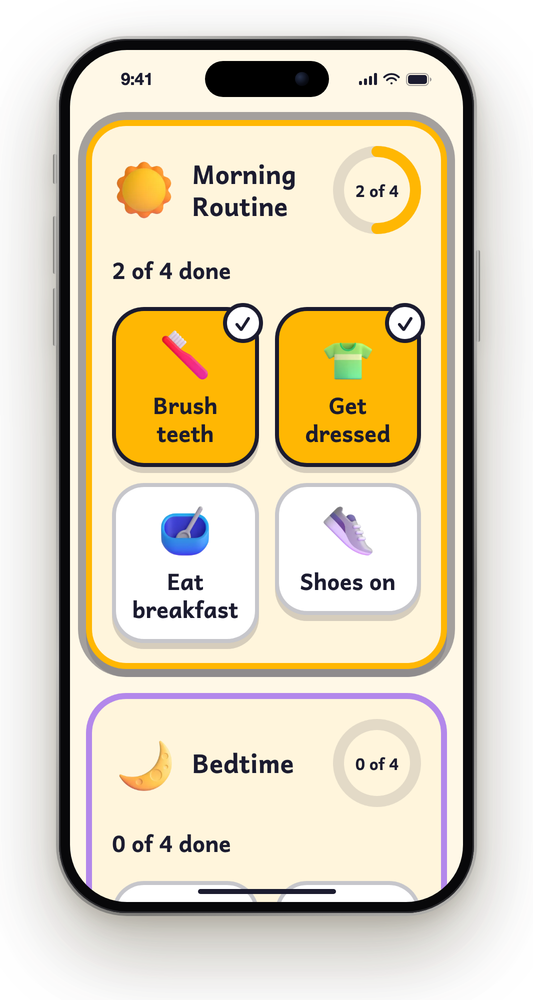

# Sticker Bank

Sticker Bank is a toddler sticker and reward-chart app, installable as a PWA. A child completes daily tasks by tapping them, earns stickers, and picks rewards; a parent uses a PIN-protected Parent Mode to manage tasks, the sticker library, rewards, and requests.

<p align="center">
  
</p>

## Architecture

- One container image: a Kotlin Spring Boot 4 service serves both the JSON API (`/api`) and the built React PWA from the same origin.
- MySQL 8.4 stores all data; Flyway runs the migrations at startup.
- Deployed to a home Kubernetes cluster and reachable only over the LAN or a VPN, always through HTTPS.
- Health probes run on a separate management port (8081), which is never exposed through the Service or ingress.

## Repository layout

| Path | Contents |
| --- | --- |
| `backend/` | Spring Boot service (Kotlin, Gradle wrapper) |
| `frontend/` | React PWA (Vite, TypeScript, Vitest, Playwright) |
| `artwork/` | Sticker catalog and artwork build scripts |
| `Dockerfile`, `compose.yaml` | Image build and an app + MySQL stack for end-to-end tests |
| `deploy/k8s/` | Deployment, Service, Traefik IngressRoute, DB Secret example |
| `deploy/runbooks/` | Operational runbooks |
| `env.example` | Configuration template |

## Prerequisites

- JDK: provisioned automatically by the Gradle toolchain (Java 25); no manual install.
- Node 24 or newer.
- A container runtime for the database-backed modes (integration tests, `bootTestRun`, compose). OrbStack and Docker Desktop work out of the box. Colima needs `DOCKER_HOST` set to its socket and `TESTCONTAINERS_DOCKER_SOCKET_OVERRIDE=/var/run/docker.sock`.

## Local development

UI only, with mocked API (no backend, no database):

```sh
cd frontend && npm install && npm run dev:mock
```

Add `?scenario=<name>` to the URL. Scenarios: `fresh-install`, `one-task-left`, `pick-waiting`, `empty-library`, `pending-request`, `chore-waiting`, `chore-ready`, `offline`. The demo PIN is `1234` in mock and dev modes only.

Full stack (backend with a throwaway MySQL via Testcontainers, plus the Vite dev server):

```sh
cd backend && ./gradlew bootTestRun
# in another terminal
cd frontend && npm run dev
```

Vite proxies `/api` to `API_PROXY_TARGET` (default `http://localhost:8080`).

## Tests

```sh
cd backend && ./gradlew build          # compile, ktlint, unit + integration tests
cd frontend
npm run typecheck && npm run lint && npm run test && npm run build
npm run e2e                            # Playwright; needs a running stack
```

Integration tests need a container runtime and are skipped without one.

### Finishing a routine (I'm Done!)

Checking the last task of a routine does not earn the sticker. The routine becomes **Ready to finish** and shows a big **I'm Done!** button, so a child can tap a task again to undo a mistaken tap. Tapping **I'm Done!** earns the sticker, locks the routine and opens the Sticker Pick. If the day ends before the button is tapped, the routine is finished automatically: the sticker waits in the child's "Stickers to pick" tray, and Parent Mode marks it "Finished automatically" so you can check the tasks and take it back if they weren't done. This happens lazily, the first time the app is used after midnight, so no scheduled job is needed. A parent who checks off a past day finishes it with the same **I'm Done!** button in History.

### Taking a sticker back (Parent Mode)

Open History, pick a day (today or past), and tap **Uncheck** on a done task in a finished routine. The "Remove this sticker?" sheet takes an optional note; confirm with **Remove sticker**. The sticker is marked removed (kept in history, struck through in prize history) and taken out of a waiting prize request; a request left with no stickers is cancelled as "Cancelled: stickers removed". The routine reopens, and finishing it again earns a new sticker with the same three choices as before, whether or not the child had already picked one. Spent (Used) stickers can't be removed. Every removal, with its note, is listed in History. Child Mode can never uncheck a finished routine. Designs that were ever earned or offered in a pick, even if the sticker was later removed, can't be deleted from the library, only retired.

### Chores

A chore is a one-off job that sits outside a routine, such as "Clean your room" or "Feed the fish". Like a routine it has tasks, and finishing it earns a sticker, but it belongs to one child on one list instead of to a weekly schedule. A child can have up to five chores to do at a time.

In Parent Mode, tap **Assign a chore** on Home (or on the Chores page). Give it a name and a picture, then add up to six tasks. With no tasks, the chore is one tile with its own name and picture. A due date is optional: choose No due date, Today, Tomorrow or a later day. Recent chores appear as chips that fill in the form. Tick several children to give each of them the same chore. The **Done already** switch is for a job that is finished before you assign it: the sticker is earned at once, and you can let the child pick now or leave it in their "Stickers to pick" tray.

The child sees the chore in a Chores group below the routines, with a Chore tag and, when there is a due date, "Today only" or "By Saturday". A "New chore!" notice with a chime appears the first time the chart shows it, and tapping the notice scrolls to the card. Tasks and **I'm Done!** work as in a routine, and the sticker is picked the same way.

A chore that isn't finished stays on the chart day after day, until it is finished or removed. When its due date has passed, a chore with every task checked is finished automatically, like a routine at the end of the day, and its sticker waits in the tray. A chore with tasks still undone becomes **Missed**: it leaves the chart and waits under Done and missed on the Chores page, where **Reopen** puts it back with no due date. The Chores page lists what is to do (a parent can check tasks and tap I'm Done! there too) and what is done or missed, newest first, and a chore can be edited or removed until it is finished.

To take a chore's sticker back, open the Chores page, find the chore under Done and missed and tap **Uncheck** on a done task. The sheet says what will happen: the chore goes back on the child's chart, with its other tasks still checked and the same three stickers on offer, or, if you tick **Remove this chore too**, the chore is removed as well. A chore whose due date has passed shows as Missed instead. Spent (Used) stickers can't be removed. Chores also appear in History, where the same Uncheck works.

## Configuration

Copy `env.example` to `.env` (gitignored; never commit it) and replace every placeholder.

| Variable | Purpose |
| --- | --- |
| `SPRING_DATASOURCE_URL` | JDBC URL of the MySQL 8.4 database |
| `SPRING_DATASOURCE_USERNAME` / `SPRING_DATASOURCE_PASSWORD` | Database credentials |
| `SERVER_PORT` / `MANAGEMENT_SERVER_PORT` | App port (8080) and health port (8081) |
| `STICKER_BANK_COOKIE_SECURE` | `true` always, except plain-http localhost e2e |
| `JAVA_TOOL_OPTIONS` | JVM flags (default `-XX:MaxRAMPercentage=60`) |
| `APP_VERSION` | Optional. Stamped automatically with the build time (UTC `YYYY.MMDD.HHMMSS`); set it only to pin a version. `compose.yaml` uses `dev` |
| `STICKER_BANK_MIN_FRONTEND_VERSION` | Optional `x.y.z`. Oldest app version allowed to keep running; older ones refresh themselves. Blank means this build's own version |
| `MYSQL_ROOT_PASSWORD`, `MYSQL_DATABASE`, `MYSQL_USER`, `MYSQL_PASSWORD` | `compose.yaml` database setup |
| `APP_HOST_PORT` | Host port for compose (bound to 127.0.0.1) |
| `API_PROXY_TARGET` / `E2E_BASE_URL` | Frontend dev proxy and Playwright base URL |
| `STICKER_BANK_HOSTNAME` / `IMAGE_REGISTRY` | Deployment placeholders |

End-to-end stack with compose: `docker compose up --build` (reads `.env`).

## Building the image

```sh
docker buildx build --platform linux/amd64,linux/arm64 \
  -t registry.example.com/sticker-bank:<new-tag> --push .
```

The app version is stamped from the build time, so there is nothing to bump. Use a new tag every time (see `deploy/runbooks/upgrade.md`).

## Deploying

1. Edit `deploy/k8s/deployment.yaml`: set the image (pinned tag, never `latest`) and `SPRING_DATASOURCE_URL`.
2. Edit the hostname in `deploy/k8s/ingressroute.yaml`.
3. `kubectl create ns sticker-bank`, then create the DB Secret (see `deploy/k8s/secret.example.yaml`).
4. `kubectl -n sticker-bank apply -f deploy/k8s/deployment.yaml -f deploy/k8s/service.yaml -f deploy/k8s/ingressroute.yaml`

Keep the hostname forever: it is the PWA origin, and changing it loses the installed app and its local data on every device.

## Security notes

- Reachable only on the LAN or VPN; do not expose it to the internet.
- Child Mode is open by design (no PIN). Lock the tablet to the app: see `deploy/runbooks/lock-child-tablet.md`.
- Parent Mode is protected by a PIN with attempt lockout and increasing cooldowns.
- A Content Security Policy is applied; the pod runs non-root with a read-only root filesystem, no capabilities, and a default-deny NetworkPolicy.
- No secrets live in the repo: all credentials come from environment variables or Kubernetes Secrets.

## Admin PIN reset

If the parent PIN is forgotten, follow [`deploy/runbooks/reset-parent-pin.md`](deploy/runbooks/reset-parent-pin.md). Other runbooks: backup/restore, upgrade, lock child tablet, change time zone (all in `deploy/runbooks/`).

## Licenses

- Fluent Emoji artwork: MIT.
- Andika font: SIL Open Font License 1.1.

License texts ship with the app under `/licenses/`.
