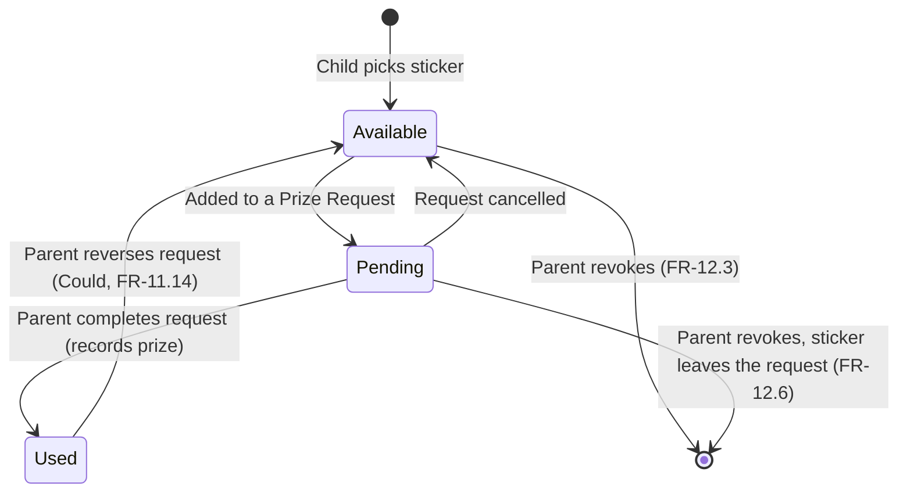

# Sticker Bank: Functional Design Document (FDD)

| | |
|---|---|
| **Product** | Sticker Bank: a sticker / reward chart for young children |
| **Document** | Functional Design Document |
| **Version** | 1.1 |
| **Status** | Draft |
| **Date** | 2026-10-15 |

> **Scope note:** This document covers **functional** behavior only. Technology choices, architecture, data storage, and APIs are covered in a separate technical design document.

### Revision History

| Version | Date | Summary |
|---|---|---|
| 0.1 | 2026-10-15 | First draft: children, routines, tasks, scheduling, daily chart, stickers. |
| 0.2 | 2026-10-15 | Child picks a sticker from 3 random choices. Parent Sticker Library page added. |
| 0.3 | 2026-10-15 | Built-in sticker artwork only. Uploading your own images out of scope. |
| 0.4 | 2026-10-15 | Spending stickers through Prize Requests that the parent completes. |
| 0.5 | 2026-10-15 | No partial credit. Stickers never un-earned. Per-child routines. PIN gate. Stickers treated as currency. |
| 0.6 | 2026-10-15 | One shared Sticker Library. One pending Prize Request per child. Admin-only PIN reset. |
| 0.7 | 2026-10-15 | One deployment serves one family. |
| 1.0 | 2026-10-15 | Approved. |
| 1.1 | 2026-10-15 | Parent can revoke an earned sticker by unchecking a task in Parent Mode. The sticker is un-earned until the routine is finished again. Replaces "stickers never un-earned" (D-2). |

---

## 1. Purpose

Sticker Bank is a reward chart app for young children. Parents set up **routines**, which are groups of **tasks** (e.g. *Morning School Routine*). Each day the child sees the routines scheduled for that day. When the child finishes **every task in a routine**, they earn **one sticker** and **pick it from 3 random choices**. Stickers collect in the child's Sticker Book and can be **spent on real-world prizes**. The child picks which stickers to spend, and the parent writes down what prize was given.

## 2. Users & Roles

| Role | Description | Typical actions |
|---|---|---|
| **Parent** | Sets up and runs the app day to day. | Manage children, routines, tasks, schedules, and the Sticker Library. Complete Prize Requests. Review history and earned stickers. Revoke a sticker if a task wasn't really done. Fix mistakes. |
| **Child** | Toddler or young child, usually guided by a parent. | Taps tasks to mark them done. Picks a sticker when a routine is finished. Looks at their Sticker Book. Picks stickers to spend on a prize. |
| **Admin** | Runs the deployment (usually a parent with technical access). Not a day-to-day user. | Resets the family's PIN when it's forgotten. |

## 3. Assumptions

| # | Assumption |
|---|---|
| A-1 | **One deployment = one family.** Each deployment holds exactly one family: one parent PIN, its children, routines, Sticker Library, stickers, and Prize Requests. |
| A-2 | There are no family accounts, sign-ups, or logins. Every device that opens the deployment sees the same family data. The parent PIN protects Parent Mode. |
| A-3 | The parent usually runs the app and the child does the tapping. Because a child might tap their way into setup screens, the app has a **Child Mode** and a PIN-protected **Parent Mode**. |
| A-4 | The app is used on phones and tablets, so touch targets must suit toddlers. |
| A-5 | Many children can't read yet. Tasks are always shown as **text plus an icon**, and a parent reads the text aloud if needed. |

## 4. Glossary

| Term | Definition |
|---|---|
| **Child** | A profile for one child (sibling). It has its own routines, progress, stickers, and Prize Requests. |
| **Routine** | A named, ordered group of tasks for one child, scheduled on certain days of the week. |
| **Task** | One step in a routine, shown as text plus an icon (e.g. 🪥 "Brush teeth"). Every task belongs to exactly one routine. |
| **Daily Chart** | A child's routines and tasks scheduled for one calendar day. |
| **Sticker** | A design (image plus name) in the Sticker Library. A child earns one when every task in a routine is done for that day. All stickers are worth the same. |
| **Sticker Library** | The set of sticker designs, managed by the parent and shared by all children. Only **active** stickers can be offered as choices. |
| **Sticker Pick** | The moment a child chooses 1 of 3 randomly offered stickers after finishing a routine. |
| **Sticker Book** | The child's collection of every sticker earned, including spent ones. |
| **Sticker status** | Each earned sticker is **Available** (can be spent), **Pending** (part of an open Prize Request), or **Used** (spent on a prize). |
| **Revoke** | A parent action (Parent Mode only) that unchecks a completed task in a routine that already earned its sticker. The sticker is removed (un-earned) until every task in the routine is done again. |
| **Prize Request** | A record started by the child (or by the parent for the child), listing the stickers to spend. The parent completes it by writing down the prize given, or cancels it. |

## 5. Key User Flows

### 5.1 Earning a Sticker

1. The child opens the app (Child Mode) and sees today's Daily Chart.
2. The child taps tasks in a routine to mark them done (any order).
3. When the last task is done, the routine earns a sticker and locks for the day.
4. A celebration plays, then a **Sticker Pick** shows 3 random stickers.
5. The child taps one. It is added to the Sticker Book as **Available**.

### 5.2 Spending Stickers

1. The child taps **Get a Prize** and selects the Available stickers to spend.
2. The child taps **"Get my prize!"**. This creates a Prize Request, and the stickers become **Pending**.
3. The parent enters Parent Mode (PIN) and opens **Prize Requests**.
4. The parent gives the prize, types what it was, and completes the request. The stickers become **Used**.
   - *Or* the parent cancels the request, and the stickers go back to **Available**.

### 5.3 Sticker Status Lifecycle

A revoked sticker is removed from the Sticker Book. Used stickers can't be revoked (FR-12.7).

### 5.4 Revoking a Sticker

1. The parent enters Parent Mode (PIN) and opens the child's Daily Chart for today, or a past day from History.
2. The parent taps a completed task in a routine that earned a sticker (e.g. "Brush teeth" wasn't actually done).
3. The app asks the parent to confirm, showing the sticker that will be removed.
4. On confirm, the task is unchecked, the sticker is removed from the Sticker Book, and the routine is no longer finished.
5. The child does the task and taps it again (today), or the parent re-checks it (past day). When every task is done, the routine earns a sticker again and a new **Sticker Pick** opens.

### 5.5 Forgotten PIN

1. The parent can't enter Parent Mode and contacts the Admin.
2. The Admin resets the PIN, which clears it.
3. The next attempt to enter Parent Mode asks for a new PIN. All family data is unchanged.

## 6. Functional Requirements

Priority: **M** = Must (v1 / MVP), **S** = Should (v1 if time allows), **C** = Could (later)

### 6.1 Child Profiles

| ID | Requirement | Pri |
|---|---|---|
| FR-1.1 | Parent can create a child profile with a name. | M |
| FR-1.2 | Parent can give each child an avatar (icon/emoji) and a theme color so siblings are easy to tell apart. | M |
| FR-1.3 | Parent can edit and delete a child profile. Deleting requires confirmation and removes that child's history, stickers, and Prize Requests. | M |
| FR-1.4 | Parent can archive a child profile (hide it but keep history). | C |
| FR-1.5 | The app supports multiple children. Each child's routines, completions, stickers, and Prize Requests are kept separately. | M |
| FR-1.6 | Parent can switch between children quickly from the main screen. | M |

### 6.2 Routine Management

| ID | Requirement | Pri |
|---|---|---|
| FR-2.1 | Parent can create a routine for a child with a name (e.g. "Morning School Routine"), an icon, and an optional color. | M |
| FR-2.2 | Parent can edit a routine's name, icon, color, and schedule. | M |
| FR-2.3 | Parent can delete a routine (with confirmation). Stickers already earned from it are kept. | M |
| FR-2.4 | Parent can set the display order of routines on the Daily Chart (e.g. Morning → After School → Bedtime). | M |
| FR-2.5 | Parent can copy a routine to another child. Each child then has an independent copy. Routines are never shared between children. | S |
| FR-2.6 | Parent can pause a routine (e.g. during summer break) without deleting it. | S |
| FR-2.7 | The app offers starter routine templates (Morning, Bedtime, Tidy Up) that the parent can customize. | C |

### 6.3 Task Management

| ID | Requirement | Pri |
|---|---|---|
| FR-3.1 | Parent can add tasks to a routine. Each task has a text label and an icon. Every task belongs to exactly one routine. There are no standalone tasks. | M |
| FR-3.2 | Parent can pick the task icon from a built-in icon/emoji library. | M |
| FR-3.3 | Parent can edit and delete tasks. | M |
| FR-3.4 | Parent can reorder tasks within a routine (e.g. drag and drop). | M |
| FR-3.5 | A routine must have at least one task before it can appear on a Daily Chart. | M |
| FR-3.6 | Parent can mark a task as needed only on certain days within a routine (e.g. "Pack library book" on Wednesdays only). | C |

### 6.4 Scheduling

| ID | Requirement | Pri |
|---|---|---|
| FR-4.1 | Parent can pick which days of the week a routine is active (e.g. Mon–Fri). | M |
| FR-4.2 | New routines default to every day. | M |
| FR-4.3 | Schedule changes apply from today onward. Past days keep the routines and tasks they had at the time. | M |
| FR-4.4 | A new day starts at local midnight. | M |
| FR-4.5 | Parent can skip a routine for one specific day (e.g. sick day, holiday). A skipped routine counts as neither missed nor earned. | S |

### 6.5 Daily Chart (Child-Facing Main Screen)

| ID | Requirement | Pri |
|---|---|---|
| FR-5.1 | The main screen shows today's Daily Chart for the selected child: every routine scheduled today, in order, with its tasks. | M |
| FR-5.2 | Each task shows its icon and text label in a large, easy-to-tap format suited to toddlers. | M |
| FR-5.3 | Each routine shows its progress (e.g. "2 of 4 done", or a progress bar or ring). | M |
| FR-5.4 | A routine with all tasks done looks clearly finished and shows the sticker it earned. | M |
| FR-5.5 | If nothing is scheduled today, the screen shows a friendly empty state. | M |
| FR-5.6 | The chart can highlight the routine that matters right now (e.g. Morning in the morning) or collapse finished routines. | S |
| FR-5.7 | Siblings view: a side-by-side summary of each child's progress today. | C |

### 6.6 Completing Tasks

| ID | Requirement | Pri |
|---|---|---|
| FR-6.1 | Tapping a task marks it done for today. Completed tasks look clearly different (e.g. checkmark, color fill). | M |
| FR-6.2 | Tapping a completed task undoes it, **until the routine earns its sticker**. After that, the routine is locked as finished in Child Mode for the rest of the day (see FR-7.4). Only a parent can unlock it, by revoking the sticker (§6.12). | M |
| FR-6.3 | Tasks can be completed in any order. | M |
| FR-6.4 | Completing a task gives a small celebration (animation and/or sound). | S |
| FR-6.5 | In Parent Mode, the parent can mark tasks done for **past days** (e.g. forgot to tap yesterday). Finishing a past routine this way earns its sticker. Unchecking a task in a routine that already earned a sticker is a revoke (§6.12). | S |

### 6.7 Earning Stickers

| ID | Requirement | Pri |
|---|---|---|
| FR-7.1 | When **every** task in a routine is done for the day, the child earns **one sticker** for that routine and day. There is no partial credit: skipping or missing any task means no sticker. | M |
| FR-7.2 | Earning a sticker triggers a bigger celebration (e.g. full-screen reveal, confetti, sound). | M |
| FR-7.3 | A routine can earn **at most one** sticker per day. | M |
| FR-7.4 | Once a routine earns its sticker, its tasks are locked as done for that day **in Child Mode**. The child can't uncheck them. Only a parent can take the sticker back, by revoking it in Parent Mode (§6.12). | M |
| FR-7.5 | Each child has a **Sticker Book** showing every sticker earned, grouped by date. Each entry shows the sticker and the routine and date it was earned for. | M |
| FR-7.6 | The Sticker Book shows counts for **Available**, **Pending**, and **Used** stickers, plus total earned. | M |
| FR-7.7 | **Sticker Pick:** after the celebration, the child is shown **3 different stickers, picked at random** from the active stickers in the Sticker Library. Duplicates of stickers the child already has are allowed. | M |
| FR-7.8 | The child taps one of the 3 stickers to keep it. It is added to their Sticker Book as **Available**, with a short "sticking" animation. The other 2 are thrown away. | M |
| FR-7.9 | Each choice shows the sticker image large enough for a toddler to tap easily, with the sticker name underneath. | M |
| FR-7.10 | If the Sticker Pick is closed without choosing (or the app is closed), the sticker stays **unclaimed**. The routine card shows a "Pick your sticker!" button that reopens the **same 3 choices**. Reloading the app does not change the choices. | M |
| FR-7.11 | If fewer than 3 active stickers are available, show as many as there are. If there are none, a default sticker is awarded automatically. | M |
| FR-7.12 | Parent can award a bonus sticker by hand (e.g. "great sharing today!"). This also opens a Sticker Pick. | C |

### 6.8 Parent Mode, Child Mode & PIN

| ID | Requirement | Pri |
|---|---|---|
| FR-8.1 | By default the app opens in **Child Mode**: Daily Chart, marking tasks, the Sticker Book, and the **Get a Prize** screen only. | M |
| FR-8.2 | Setup and management screens (children, routines, tasks, schedules, Sticker Library, Prize Requests, sticker review and revocation, settings) require **Parent Mode**. | M |
| FR-8.3 | Entering Parent Mode requires the **parent PIN** (4 digits). | M |
| FR-8.4 | Parent Mode turns itself off after a period of inactivity or when the parent exits it. | S |
| FR-8.5 | On first launch, the parent must create a PIN (entered twice to confirm) before setting anything else up. | M |
| FR-8.6 | In Parent Mode, the parent can change the PIN. This requires entering the current PIN. | M |
| FR-8.7 | After 5 wrong PIN attempts in a row, PIN entry is locked for a short cooldown (e.g. 1 minute). | S |
| FR-8.8 | Parents can't reset a forgotten PIN themselves in the app. Only an **Admin** can reset it. | M |
| FR-8.9 | When an Admin resets the PIN, the current PIN is cleared. The next time someone tries to enter Parent Mode, they are asked to create a new PIN (same as FR-8.5). Children, routines, stickers, and history are not affected. | M |
| FR-8.10 | Each PIN reset is recorded with the date/time and the Admin who did it. | S |

### 6.9 History & Progress

| ID | Requirement | Pri |
|---|---|---|
| FR-9.1 | Parent can see a calendar or weekly view of each child's earned, incomplete, and skipped routines. Routines whose sticker was revoked and not yet re-earned show as incomplete. | M |
| FR-9.2 | Parent can open any past day to see which tasks were done. | S |
| FR-9.3 | The app shows simple trends (e.g. "Morning Routine finished 4 of 5 school days this week"). | C |

### 6.10 Sticker Library (Parent Page)

| ID | Requirement | Pri |
|---|---|---|
| FR-10.1 | Parent Mode includes a **Sticker Library** page showing every sticker in a grid, with its image, name, and status (active or retired). | M |
| FR-10.2 | On first use, the library comes with a starter set of built-in stickers (e.g. at least 20, across themes like animals, space, food, and vehicles). | M |
| FR-10.3 | Parent can **add** a sticker by picking an image from the **built-in artwork/emoji set** and giving it a name. Uploading your own images is not supported. | M |
| FR-10.4 | Parent can **edit** a sticker's name and swap its image for another built-in one. Changes also show up on copies already in Sticker Books. | M |
| FR-10.5 | Parent can **retire** a sticker. Retired stickers are never offered in a Sticker Pick, but stay in any Sticker Book that already has them. Parent can make a retired sticker active again. | M |
| FR-10.6 | Parent can **delete** a sticker only if no child has ever earned it. Otherwise the app suggests retiring it instead. | M |
| FR-10.7 | If fewer than 3 stickers are active, the page warns the parent that Sticker Picks will offer fewer choices. | M |
| FR-10.8 | Parent can search or filter the library by name, status, or category. | S |
| FR-10.9 | Parent can group stickers into **categories/packs** (e.g. "Dinosaurs", "Unicorns") and turn whole packs on or off. | S |
| FR-10.10 | There is **one Sticker Library, shared by all children**. Every active sticker can be offered to any child. | M |

### 6.11 Spending Stickers (Prize Requests)

Prizes are **not** set up in the app. The app only records which stickers were spent and what prize the parent gave.

#### Child side: Get a Prize screen

| ID | Requirement | Pri |
|---|---|---|
| FR-11.1 | In Child Mode, a **Get a Prize** button opens a screen showing the child's **Available** stickers. | M |
| FR-11.2 | The child taps stickers to select or deselect them. Selected stickers are clearly highlighted (e.g. lifted, checkmark), and a large counter shows how many are selected. | M |
| FR-11.3 | A **"Get my prize!"** button submits the selection as a new **Prize Request**. At least 1 sticker must be selected. There is no maximum. | M |
| FR-11.4 | After submitting, the child sees a friendly message (e.g. "Show Mom or Dad to get your prize!"). The selected stickers become **Pending**. | M |
| FR-11.5 | If the child has no Available stickers, the screen shows a friendly empty state (e.g. "Finish a routine to earn stickers!"). | M |
| FR-11.6 | While a request is Pending, the Get a Prize screen shows it as "Waiting for grown-up" and lets the child cancel it, returning the stickers to Available. | S |

#### Parent side: Prize Requests page

| ID | Requirement | Pri |
|---|---|---|
| FR-11.7 | Parent Mode includes a **Prize Requests** page listing **Pending** requests for all children. Each shows the child, request date/time, the selected stickers, and the sticker count. | M |
| FR-11.8 | Parent **completes** a request by typing what prize was given (free text, required, e.g. "Ice cream after dinner") and an optional note. Completing it marks every sticker in the request **Used** and records the completion date/time. | M |
| FR-11.9 | Parent can **cancel** a pending request. Its stickers go back to **Available**. | M |
| FR-11.10 | The page has a **history** of completed and cancelled requests, filterable by child. It shows the date, stickers spent, prize, and note. | M |
| FR-11.11 | The button that opens Parent Mode shows a small badge with the number of pending requests. | S |
| FR-11.12 | Parent can start a Prize Request for a child from Parent Mode, choosing the stickers for them. | S |
| FR-11.13 | Parent can edit the prize text or note on a completed request. | S |
| FR-11.14 | Parent can **reverse** a completed request to fix a mistake. Its stickers go back to **Available**, and the reversal is kept in history. | C |

#### Sticker Book display

| ID | Requirement | Pri |
|---|---|---|
| FR-11.15 | **Used** stickers stay in the Sticker Book but look **faded** with a "used" mark. | M |
| FR-11.16 | **Pending** stickers have a distinct "waiting" look (e.g. small hourglass badge). | M |
| FR-11.17 | Tapping a Used sticker shows the prize it went toward and the date. | S |
| FR-11.18 | The Sticker Book can filter to show only Available stickers. | S |

### 6.12 Sticker Review & Revocation (Parent)

A parent can take back a sticker if the child didn't really finish a task. Revoking is done by unchecking the task, not by deleting the sticker directly.

| ID | Requirement | Pri |
|---|---|---|
| FR-12.1 | In Parent Mode, the parent can **review** each earned sticker: which routine and date it was earned for, which tasks were checked, and its current status (Unclaimed, Available, Pending, or Used). | M |
| FR-12.2 | In Parent Mode, the parent can **uncheck** a completed task in a routine that already earned its sticker, for today or a past day. This is the only way to revoke a sticker. | M |
| FR-12.3 | Before revoking, the app asks for confirmation and shows the sticker that will be removed and the task being unchecked. On confirm, the task is unchecked and the sticker is **un-earned**: it is removed from the Sticker Book and no longer counts toward any total. | M |
| FR-12.4 | After a revoke, the routine is **no longer finished** for that day. It unlocks and shows its normal progress (e.g. "3 of 4 done"). Other tasks stay checked. | M |
| FR-12.5 | The sticker can be **earned again** for that routine and day once every task is done again: by the child in Child Mode (today only) or by the parent in Parent Mode (today or a past day, FR-6.5). Re-earning opens a new Sticker Pick with **new random choices**. | M |
| FR-12.6 | If the sticker is **Pending** in a Prize Request, the confirmation says so. Revoking removes it from that request. If the request is left with no stickers, it is cancelled automatically. | M |
| FR-12.7 | A **Used** sticker can't be revoked, because the prize was already given. The app explains this. (If request reversal, FR-11.14, is available, the parent can reverse the request first and then revoke.) | M |
| FR-12.8 | If the sticker is still **unclaimed** (Sticker Pick not yet made), revoking discards its saved choices and removes the "Pick your sticker!" button. | M |
| FR-12.9 | Each revoke is recorded in the child's history with the date/time, routine, day, task unchecked, and the sticker removed. | S |
| FR-12.10 | Revoking happens quietly. There is no celebration or sound in reverse, and Child Mode shows no message beyond the routine no longer being finished. | S |
| FR-12.11 | Parent can add an optional short note when revoking (e.g. "Teeth not actually brushed"). The note appears in history. | C |

## 7. Business Rules

| ID | Rule |
|---|---|
| BR-1 | Task completion is tracked per **child × routine × task × date**. |
| BR-2 | Editing a routine (adding, removing, or changing tasks) **never** removes a sticker already earned. If the routine already earned its sticker today, the changes take effect the next day. Otherwise they apply right away to today's chart. |
| BR-3 | Deleting a task or routine never deletes stickers already earned. |
| BR-4 | Past days are read-only in Child Mode. |
| BR-5 | Tasks can't be completed for future days. |
| BR-6 | The 3 Sticker Pick choices are generated once, when the routine is finished, and saved. Closing and reopening never produces new choices. A revoke (§6.12) discards them, and re-finishing the routine generates new ones. |
| BR-7 | **No double earning:** each child × routine × date can hold at most one earned sticker at a time, however it's completed (by the child, or by the parent fixing a past day). After a revoke, it can be earned again, but never more than one at once. |
| BR-8 | If a sticker is retired or edited while it's waiting as an unclaimed choice, it is still shown with its latest image and name, and can still be picked. |
| BR-9 | Retiring or editing stickers never removes anything from a child's Sticker Book. |
| BR-10 | A sticker can be in only **one** open Prize Request at a time. Pending and Used stickers can't be selected again. |
| BR-11 | A child can have only **one Pending** Prize Request at a time. While one is Pending, the Get a Prize screen shows it instead of letting the child start a new one. This also applies to requests the parent starts (FR-11.12). |
| BR-12 | **Stickers are currency.** Every sticker is worth exactly 1, whatever its image. The design is only for fun and doesn't affect earning or spending. A child can hold any number of the same design. |
| BR-13 | Prize Requests are tracked per child. Siblings can't spend each other's stickers. |
| BR-14 | Deleting a child deletes their Prize Requests. Retiring a sticker design doesn't affect Prize Requests that include it. |
| BR-15 | A sticker design can't be deleted from the library if any child has earned it, whatever its status. |
| BR-16 | Only a parent can revoke a sticker, and only by unchecking a task in Parent Mode. Child Mode can never uncheck a task in a routine that earned its sticker. |
| BR-17 | A revoked sticker is fully un-earned: it leaves the Sticker Book, the Available/Pending/Used/total counts, and any Pending Prize Request. Used stickers can't be revoked. |

## 8. Out of Scope (v1)

- Multiple families per deployment, family accounts, or sign-up/login
- Separate logins or PINs for each caregiver (all parents share one PIN)
- Prize catalog, sticker prices, or savings goals in the app (prizes are recorded as free text only)
- Push notifications and reminders
- Photo-based task icons
- Uploading your own sticker images (built-in artwork only)
- Per-child sticker libraries (one shared library)
- Spoken (text-to-speech) task names
- Self-service PIN recovery (Admin reset only)
- Admin tools other than PIN reset

## 9. Decision Log

| # | Topic | Decision | Reference |
|---|---|---|---|
| D-1 | Partial credit | None. Every task in a routine must be done to earn the sticker. | FR-7.1 |
| D-2 | Un-earning stickers | *(Revised v1.1)* A routine locks in Child Mode once it earns its sticker. A parent can revoke the sticker by unchecking a task in Parent Mode. It is un-earned until the routine is finished again. Used stickers can't be revoked. At most one sticker per routine per day at a time. | FR-7.4, §6.12, BR-7, BR-16, BR-17 |
| D-3 | Routine ownership | Routines are per child. They can be copied but not shared. | FR-2.5 |
| D-4 | Standalone tasks | Not supported. Every task belongs to a routine. | FR-3.1 |
| D-5 | Sticker selection | Child picks 1 of 3 random stickers. Unclaimed picks keep the same choices. | FR-7.7 to FR-7.10, BR-6 |
| D-6 | Sticker artwork | Built-in artwork/emoji only. No uploads. | FR-10.3 |
| D-7 | Spending stickers | Child picks stickers to spend, which creates a Prize Request. Parent completes it by recording the prize as free text. No prize catalog. | §6.11 |
| D-8 | Spent stickers | Stay in the Sticker Book, shown faded as Used. | FR-11.15 |
| D-9 | Duplicates / value | Duplicates allowed. Stickers are currency, and their images carry no value. | BR-12 |
| D-10 | Sticker Library scope | One library shared by all children. | FR-10.10 |
| D-11 | Pending requests | One Pending Prize Request per child. | BR-11 |
| D-12 | Parent gate | 4-digit PIN. | FR-8.3 to FR-8.7 |
| D-13 | PIN recovery | Admin reset only. | FR-8.8 to FR-8.10 |
| D-14 | Tenancy | One deployment serves one family. | A-1, A-2 |

## 10. Future Considerations

**Motivation & fun**
- **Goal jar:** stickers fill a jar, and a full jar unlocks a parent-defined prize.
- **Reward shop:** parent-defined prizes with sticker prices, so older kids can save up and choose.
- **Prize wishlist:** the child picks a prize picture to save toward, with a progress bar.
- **Streaks:** e.g. "5 school mornings in a row!" badge.
- **Virtual pet or garden** that grows with each sticker.
- **Sticker scenes:** the child drags earned stickers onto a background scene.
- **Custom celebration sounds** recorded by the parent.

**Toddler-friendliness**
- Read task names aloud on tap.
- Photos of the child's real items as task icons.
- Visual timers (e.g. "Brush teeth for 2 minutes").
- "Now / Next" focus mode: one task at a time, full screen.

**Parent tools**
- Routine templates by age.
- Printable weekly chart.
- Separate caregiver profiles with their own PIN and a record of who approved what.
- Gentle reminders (e.g. "Bedtime routine starts in 10 min").
- Weekly progress summary.
