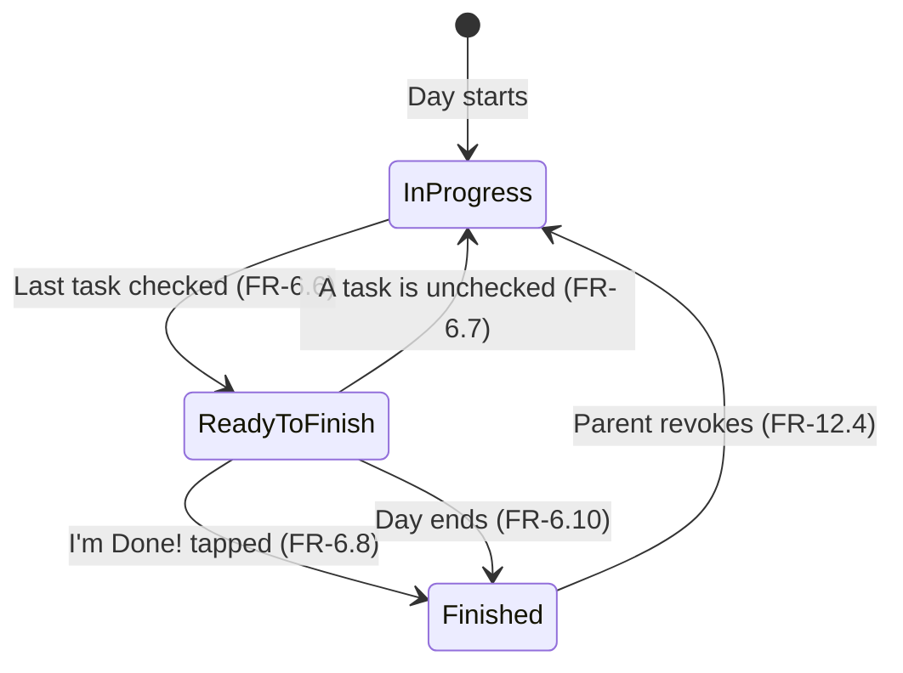
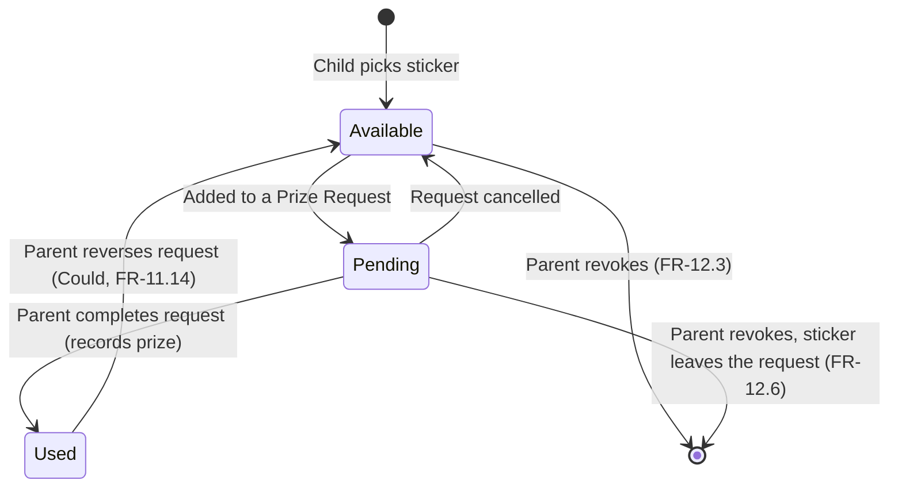
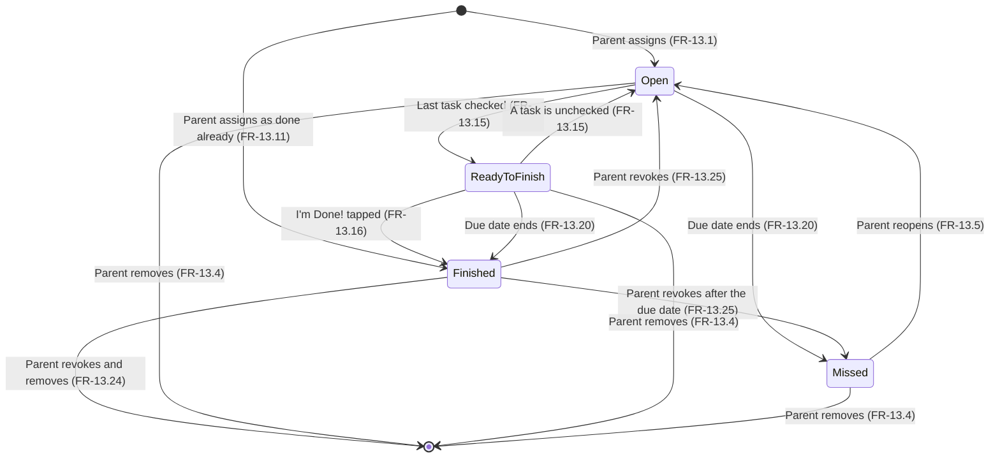

# Sticker Bank: Functional Design Document (FDD)

| | |
|---|---|
| **Product** | Sticker Bank: a sticker / reward chart for young children |
| **Document** | Functional Design Document |
| **Version** | 1.5 |
| **Status** | Draft |
| **Date** | 2026-11-26 |

> **Scope note:** This document covers **functional** behavior only. Technology choices, architecture, data storage, and APIs are covered in a separate technical design document.

### Revision History

| Version | Date | Summary |
|---|---|---|
| 0.1 | 2026-10-15 | First draft: children, routines, tasks, scheduling, daily chart, stickers. |
| 0.2 | 2026-10-15 | Child picks a sticker from 3 random choices. Parent Sticker Library page added. |
| 0.3 | 2026-10-15 | Built-in sticker artwork only. Uploading your own images out of scope. |
| 0.4 | 2026-10-15 | Spending stickers through Prize Requests that the parent completes. |
| 0.5 | 2026-10-15 | No partial credit. Stickers never un-earned. Per-child routines. PIN gate. Stickers treated as currency. |
| 0.6 | 2026-10-15 | One shared Sticker Library. One pending Prize Request per child. Admin-only PIN reset. |
| 0.7 | 2026-10-15 | One deployment serves one family. |
| 1.0 | 2026-10-15 | Approved. |
| 1.1 | 2026-10-15 | Parent can revoke an earned sticker by unchecking a task in Parent Mode. The sticker is un-earned until the routine is finished again. Replaces "stickers never un-earned" (D-2). |
| 1.2 | 2026-10-15 | Added an **I'm Done!** confirmation. Checking the last task no longer earns the sticker. The routine becomes Ready to finish, and the child taps I'm Done! to earn it and open the Sticker Pick. Until then, tasks can be unchecked to undo a mistaken tap. A routine still Ready to finish when the day ends is finished automatically (D-15). |
| 1.3 | 2026-10-15 | Re-earning a revoked sticker offers the **same 3 choices** as before, instead of a new random draw (FR-12.5, FR-12.8, BR-6, D-5). A design that was ever offered in a Sticker Pick can't be deleted, only retired (FR-10.6, BR-15). |
| 1.4 | 2026-10-17 | The child switcher shows names: the current child's name is always visible, and opening the switcher lists every child by name (FR-1.6). |
| 1.5 | 2026-11-26 | Added **chores**: one-off jobs a parent assigns to a child outside any routine (§6.13). A chore has a name, an icon, and one or more tasks. It stays on the Daily Chart until it is finished, removed, or its optional due date passes. Finishing it earns one sticker through the same I'm Done! step and Sticker Pick as a routine, and a parent revokes that sticker by unchecking a task in the finished chore. A chore can also be assigned as done already, which is now how a sticker is awarded by hand (FR-7.12). New flow §5.6, FR-13.1 to FR-13.26, BR-20 to BR-26, D-16 to D-19. Replaces "no standalone tasks" (D-4). |

---

## 1. Purpose

Sticker Bank is a reward chart app for young children. Parents set up **routines**, which are groups of **tasks** (e.g. *Morning School Routine*). Each day the child sees the routines scheduled for that day. When the child has checked off **every task in a routine** and taps **I'm Done!** to confirm, they earn **one sticker** and **pick it from 3 random choices**. A parent can also assign a one-off **chore** outside any routine, and finishing it earns a sticker the same way. Stickers collect in the child's Sticker Book and can be **spent on real-world prizes**. The child picks which stickers to spend, and the parent writes down what prize was given.

## 2. Users & Roles

| Role | Description | Typical actions |
|---|---|---|
| **Parent** | Sets up and runs the app day to day. | Manage children, routines, tasks, schedules, and the Sticker Library. Assign one-off chores. Complete Prize Requests. Review history and earned stickers. Revoke a sticker if a task wasn't really done. Fix mistakes. |
| **Child** | Toddler or young child, usually guided by a parent. | Taps tasks to mark them done, then taps I'm Done! when a routine or chore is complete. Picks a sticker. Looks at their Sticker Book. Picks stickers to spend on a prize. |
| **Admin** | Runs the deployment (usually a parent with technical access). Not a day-to-day user. | Resets the family's PIN when it's forgotten. |

## 3. Assumptions

| # | Assumption |
|---|---|
| A-1 | **One deployment = one family.** Each deployment holds exactly one family: one parent PIN, its children, routines, Sticker Library, stickers, and Prize Requests. |
| A-2 | There are no family accounts, sign-ups, or logins. Every device that opens the deployment sees the same family data. The parent PIN protects Parent Mode. |
| A-3 | The parent usually runs the app and the child does the tapping. Because a child might tap their way into setup screens, the app has a **Child Mode** and a PIN-protected **Parent Mode**. |
| A-4 | The app is used on phones and tablets, so touch targets must suit toddlers. |
| A-5 | Many children can't read yet. Tasks are always shown as **text plus an icon**, and a parent reads the text aloud if needed. |

## 4. Glossary

| Term | Definition |
|---|---|
| **Child** | A profile for one child (sibling). It has its own routines, progress, stickers, and Prize Requests. |
| **Routine** | A named, ordered group of tasks for one child, scheduled on certain days of the week. |
| **Task** | One step in a routine or a chore, shown as text plus an icon (e.g. 🪥 "Brush teeth"). Every task belongs to exactly one routine or one chore. |
| **Chore** | A one-off job a parent assigns to one child, outside any routine (e.g. 🧹 "Tidy the playroom"). It has a name, an icon, and one or more tasks. It stays on the Daily Chart until it is finished, removed by a parent, or its due date passes. Finishing it earns one sticker. |
| **Due date** | An optional last day for a chore. A chore with a task still unchecked when its due date ends is **Missed** and leaves the Daily Chart. A chore that was Ready to finish at that moment is finished automatically instead (FR-13.20). |
| **Daily Chart** | A child's routines and tasks scheduled for one calendar day, plus the child's open chores. |
| **Ready to finish** | A routine whose tasks are all checked but whose **I'm Done!** button hasn't been tapped yet. No sticker is earned at this point, and tasks can still be unchecked. A chore whose tasks are all checked is Ready to finish in the same way. |
| **I'm Done!** | The confirmation button a routine shows once it is Ready to finish. Tapping it **finishes** the routine: the sticker is earned, the routine locks, and the Sticker Pick opens. If the day ends first, the routine is finished automatically. A chore shows the same button once all its tasks are checked. |
| **Sticker** | A design (image plus name) in the Sticker Library. A child earns one when every task in a routine is done for that day and the routine is finished (**I'm Done!** tapped, or the day ends), or when a chore is finished. All stickers are worth the same. |
| **Sticker Library** | The set of sticker designs, managed by the parent and shared by all children. Only **active** stickers can be offered as choices. |
| **Sticker Pick** | The moment a child chooses 1 of 3 randomly offered stickers after a routine or chore is finished. |
| **Sticker Book** | The child's collection of every sticker earned, including spent ones. |
| **Sticker status** | Each earned sticker is **Available** (can be spent), **Pending** (part of an open Prize Request), or **Used** (spent on a prize). |
| **Revoke** | A parent action (Parent Mode only) that unchecks a completed task in a routine that already earned its sticker. The sticker is removed (un-earned) until every task in the routine is done again. Unchecking a task in a finished chore revokes its sticker in the same way. |
| **Prize Request** | A record started by the child (or by the parent for the child), listing the stickers to spend. The parent completes it by writing down the prize given, or cancels it. |

## 5. Key User Flows

### 5.1 Earning a Sticker

1. The child opens the app (Child Mode) and sees today's Daily Chart.
2. The child taps tasks in a routine to mark them done (any order). Tapping a done task again undoes it.
3. When the last task is checked, the routine becomes **Ready to finish**. A large **I'm Done!** button appears. No sticker is earned yet.
4. If a task was tapped by mistake, the child taps it again to undo it. The I'm Done! button goes away until every task is checked again.
5. The child taps **I'm Done!**. The routine earns its sticker and locks for the day.
6. A celebration plays, then a **Sticker Pick** shows 3 random stickers.
7. The child taps one. It is added to the Sticker Book as **Available**.

A routine moves through these states each day:

Only a **Finished** routine has earned a sticker. If the day ends while a routine is Ready to finish, it is finished automatically (FR-6.10).

### 5.2 Spending Stickers

1. The child taps **Get a Prize** and selects the Available stickers to spend.
2. The child taps **"Get my prize!"**. This creates a Prize Request, and the stickers become **Pending**.
3. The parent enters Parent Mode (PIN) and opens **Prize Requests**.
4. The parent gives the prize, types what it was, and completes the request. The stickers become **Used**.
   - *Or* the parent cancels the request, and the stickers go back to **Available**.

### 5.3 Sticker Status Lifecycle

A revoked sticker is removed from the Sticker Book. Used stickers can't be revoked (FR-12.7).

### 5.4 Revoking a Sticker

1. The parent enters Parent Mode (PIN) and opens the child's Daily Chart for today, or a past day from History.
2. The parent taps a completed task in a routine that earned a sticker (e.g. "Brush teeth" wasn't actually done).
3. The app asks the parent to confirm, showing the sticker that will be removed.
4. On confirm, the task is unchecked, the sticker is removed from the Sticker Book, and the routine is no longer finished.
5. The child does the task and taps it again (today), or the parent re-checks it (past day). When every task is done, the routine is Ready to finish again.
6. The child taps **I'm Done!** (today), or the parent does (past day). The routine earns a sticker again and the **Sticker Pick** opens with the **same 3 choices** as the first time (FR-12.5). (If the child never taps it, the routine finishes automatically when the day ends.)

A chore's sticker is revoked the same way: the parent unchecks a task in the finished chore, and the chore goes back on the Daily Chart to be finished again, or is Missed if its due date has passed (§5.6, FR-13.23, FR-13.25).

### 5.5 Forgotten PIN

1. The parent can't enter Parent Mode and contacts the Admin.
2. The Admin resets the PIN, which clears it.
3. The next attempt to enter Parent Mode asks for a new PIN. All family data is unchanged.

### 5.6 Doing a Chore

1. The parent enters Parent Mode (PIN) and assigns a chore to a child: a name, an icon, one or more tasks, and an optional due date.
2. Within about half a minute the chore appears on the child's Daily Chart, after the routines, and the app announces it with a sound and a short message.
3. The child does the chore's tasks and taps each one to mark it done (any order). Tapping a done task again undoes it.
4. When the last task is checked, the chore becomes **Ready to finish** and shows the **I'm Done!** button. No sticker is earned yet.
5. The child taps **I'm Done!**. The chore earns its sticker and locks. The celebration plays and the **Sticker Pick** opens, as for a routine (§5.1).
6. The finished chore shows its sticker for the rest of the day, then leaves the chart.

A chore that isn't finished is still on the chart the next day, and the day after, with the tasks that were already checked still checked, until it is finished or the parent removes it. If it has a due date and that day ends first, the chore is **Missed** and leaves the chart. The one exception is a chore that was Ready to finish when its due date ended: it is finished automatically (FR-13.20).

If the child has already done the job, the parent assigns the chore as **done already** instead. It is finished on the spot, and the child can go straight to the Sticker Pick (FR-13.11).

Only a **Finished** chore has earned a sticker. An Open chore may have some of its tasks checked. A chore with no due date is never Missed.

## 6. Functional Requirements

Priority: **M** = Must (v1 / MVP), **S** = Should (v1 if time allows), **C** = Could (later)

### 6.1 Child Profiles

| ID | Requirement | Pri |
|---|---|---|
| FR-1.1 | Parent can create a child profile with a name. | M |
| FR-1.2 | Parent can give each child an avatar (icon/emoji) and a theme color so siblings are easy to tell apart. | M |
| FR-1.3 | Parent can edit and delete a child profile. Deleting requires confirmation and removes that child's history, chores, stickers, and Prize Requests. | M |
| FR-1.4 | Parent can archive a child profile (hide it but keep history). | C |
| FR-1.5 | The app supports multiple children. Each child's routines, completions, stickers, and Prize Requests are kept separately. | M |
| FR-1.6 | Parent can switch between children quickly from the main screen. The current child's name is always shown, and the switcher lists every child by name (with avatar) so siblings are told apart by name, not only by picture. | M |

### 6.2 Routine Management

| ID | Requirement | Pri |
|---|---|---|
| FR-2.1 | Parent can create a routine for a child with a name (e.g. "Morning School Routine"), an icon, and an optional color. | M |
| FR-2.2 | Parent can edit a routine's name, icon, color, and schedule. | M |
| FR-2.3 | Parent can delete a routine (with confirmation). Stickers already earned from it are kept. | M |
| FR-2.4 | Parent can set the display order of routines on the Daily Chart (e.g. Morning → After School → Bedtime). | M |
| FR-2.5 | Parent can copy a routine to another child. Each child then has an independent copy. Routines are never shared between children. | S |
| FR-2.6 | Parent can pause a routine (e.g. during summer break) without deleting it. | S |
| FR-2.7 | The app offers starter routine templates (Morning, Bedtime, Tidy Up) that the parent can customize. | C |

### 6.3 Task Management

| ID | Requirement | Pri |
|---|---|---|
| FR-3.1 | Parent can add tasks to a routine. Each task has a text label and an icon. Every task in a routine belongs to that routine only. A one-off job outside a routine is a chore, which has tasks of its own (§6.13). | M |
| FR-3.2 | Parent can pick the task icon from a built-in icon/emoji library. | M |
| FR-3.3 | Parent can edit and delete tasks. | M |
| FR-3.4 | Parent can reorder tasks within a routine (e.g. drag and drop). | M |
| FR-3.5 | A routine must have at least one task before it can appear on a Daily Chart. | M |
| FR-3.6 | Parent can mark a task as needed only on certain days within a routine (e.g. "Pack library book" on Wednesdays only). | C |

### 6.4 Scheduling

| ID | Requirement | Pri |
|---|---|---|
| FR-4.1 | Parent can pick which days of the week a routine is active (e.g. Mon–Fri). | M |
| FR-4.2 | New routines default to every day. | M |
| FR-4.3 | Schedule changes apply from today onward. Past days keep the routines and tasks they had at the time. | M |
| FR-4.4 | A new day starts at local midnight. | M |
| FR-4.5 | Parent can skip a routine for one specific day (e.g. sick day, holiday). A skipped routine counts as neither missed nor earned. | S |

### 6.5 Daily Chart (Child-Facing Main Screen)

| ID | Requirement | Pri |
|---|---|---|
| FR-5.1 | The main screen shows today's Daily Chart for the selected child: every routine scheduled today, in order, with its tasks, and the child's chores (FR-13.13). | M |
| FR-5.2 | Each task shows its icon and text label in a large, easy-to-tap format suited to toddlers. | M |
| FR-5.3 | Each routine shows its progress (e.g. "2 of 4 done", or a progress bar or ring). | M |
| FR-5.4 | A routine that is **finished** (I'm Done! tapped) looks clearly finished and shows the sticker it earned. A routine that is only Ready to finish shows the I'm Done! button instead (FR-6.6). | M |
| FR-5.5 | If nothing is scheduled today and the child has no chores, the screen shows a friendly empty state. | M |
| FR-5.6 | The chart can highlight the routine that matters right now (e.g. Morning in the morning) or collapse finished routines. | S |
| FR-5.7 | Siblings view: a side-by-side summary of each child's progress today. | C |

### 6.6 Completing Tasks

| ID | Requirement | Pri |
|---|---|---|
| FR-6.1 | Tapping a task marks it done for today. Completed tasks look clearly different (e.g. checkmark, color fill). | M |
| FR-6.2 | Tapping a completed task undoes it, **until the routine is finished** (the child taps I'm Done!, FR-6.8, or the day ends, FR-6.10) and it earns its sticker. After that, the routine is locked as finished in Child Mode for the rest of the day (see FR-7.4). Only a parent can unlock it, by revoking the sticker (§6.12). | M |
| FR-6.3 | Tasks can be completed in any order. | M |
| FR-6.4 | Completing a task gives a small celebration (animation and/or sound). | S |
| FR-6.5 | In Parent Mode, the parent can mark tasks done for **past days** (e.g. forgot to tap yesterday) and finish the routine with the same **I'm Done!** button, which earns its sticker. Unchecking a task in a routine that already earned a sticker is a revoke (§6.12). | S |
| FR-6.6 | When the last task in a routine is checked, the routine becomes **Ready to finish**. It shows a large **I'm Done!** button (text plus an icon, sized for a toddler) and does not earn a sticker yet. The button is clearly separate from the task list, so the tap that checked the last task can't also hit it. | M |
| FR-6.7 | While a routine is Ready to finish, its tasks can still be tapped. Unchecking any task puts the routine back in progress (e.g. "3 of 4 done") and hides the I'm Done! button. Checking every task again brings it back. This is how a task tapped by mistake gets undone. | M |
| FR-6.8 | Tapping **I'm Done!** finishes the routine. It earns its sticker (FR-7.1), its tasks lock (FR-7.4), the celebration plays (FR-7.2), and the Sticker Pick opens (FR-7.7). The child can't take this back. Only a parent can, by revoking the sticker (§6.12). | M |
| FR-6.9 | A routine stays Ready to finish, with its tasks checked and the I'm Done! button showing, if the child leaves the screen or the app is closed or reloaded. It stays that way until I'm Done! is tapped or the day ends. | M |
| FR-6.10 | If the day ends (local midnight, FR-4.4) while a routine is Ready to finish, the routine is **finished automatically**. It earns its sticker and locks, as if I'm Done! had been tapped, but with no celebration. The sticker is **unclaimed** (FR-7.10), and the child picks it the next time they open the app. This applies only when a day ends, so a parent finishes a past day they edit afterward with I'm Done! (FR-6.5). | M |
| FR-6.11 | A sticker earned by automatic finish is marked as such in the parent's sticker review (FR-12.1) and in History, so the parent can check that the tasks were really done and revoke the sticker if not (§6.12). | S |

### 6.7 Earning Stickers

| ID | Requirement | Pri |
|---|---|---|
| FR-7.1 | When **every** task in a routine is done for the day **and the routine is finished** (I'm Done! tapped, FR-6.8, or the day ends, FR-6.10), the child earns **one sticker** for that routine and day. Checking the last task alone doesn't earn it. There is no partial credit: skipping or missing any task means no sticker. | M |
| FR-7.2 | Tapping I'm Done! triggers a bigger celebration (e.g. full-screen reveal, confetti, sound). Checking the last task gets only the small celebration in FR-6.4, and an automatic finish (FR-6.10) has none. | M |
| FR-7.3 | A routine can earn **at most one** sticker per day. | M |
| FR-7.4 | Once a routine is finished and has earned its sticker, its tasks are locked as done for that day **in Child Mode**. The child can't uncheck them. Only a parent can take the sticker back, by revoking it in Parent Mode (§6.12). | M |
| FR-7.5 | Each child has a **Sticker Book** showing every sticker earned, grouped by date. Each entry shows the sticker and the routine or chore and date it was earned for. | M |
| FR-7.6 | The Sticker Book shows counts for **Available**, **Pending**, and **Used** stickers, plus total earned. | M |
| FR-7.7 | **Sticker Pick:** after the celebration, the child is shown **3 different stickers, picked at random** from the active stickers in the Sticker Library. Duplicates of stickers the child already has are allowed. | M |
| FR-7.8 | The child taps one of the 3 stickers to keep it. It is added to their Sticker Book as **Available**, with a short "sticking" animation. The other 2 are not added to the Sticker Book. | M |
| FR-7.9 | Each choice shows the sticker image large enough for a toddler to tap easily, with the sticker name underneath. | M |
| FR-7.10 | If the Sticker Pick is closed without choosing (or the app is closed), the sticker stays **unclaimed**. The routine card shows a "Pick your sticker!" button that reopens the **same 3 choices**. Reloading the app does not change the choices. | M |
| FR-7.11 | If fewer than 3 active stickers are available, show as many as there are. If there are none, a default sticker is awarded automatically. | M |
| FR-7.12 | Parent can award a sticker by hand for something the child has already done (e.g. "great sharing today!"). The parent does this by assigning a chore as done already (FR-13.11), which also opens a Sticker Pick. | M |

### 6.8 Parent Mode, Child Mode & PIN

| ID | Requirement | Pri |
|---|---|---|
| FR-8.1 | By default the app opens in **Child Mode**: Daily Chart, marking tasks, the Sticker Book, and the **Get a Prize** screen only. | M |
| FR-8.2 | Setup and management screens (children, routines, tasks, schedules, chores, Sticker Library, Prize Requests, sticker review and revocation, settings) require **Parent Mode**. | M |
| FR-8.3 | Entering Parent Mode requires the **parent PIN** (4 digits). | M |
| FR-8.4 | Parent Mode turns itself off after a period of inactivity or when the parent exits it. | S |
| FR-8.5 | On first launch, the parent must create a PIN (entered twice to confirm) before setting anything else up. | M |
| FR-8.6 | In Parent Mode, the parent can change the PIN. This requires entering the current PIN. | M |
| FR-8.7 | After 5 wrong PIN attempts in a row, PIN entry is locked for a short cooldown (e.g. 1 minute). | S |
| FR-8.8 | Parents can't reset a forgotten PIN themselves in the app. Only an **Admin** can reset it. | M |
| FR-8.9 | When an Admin resets the PIN, the current PIN is cleared. The next time someone tries to enter Parent Mode, they are asked to create a new PIN (same as FR-8.5). Children, routines, stickers, and history are not affected. | M |
| FR-8.10 | Each PIN reset is recorded with the date/time and the Admin who did it. | S |

### 6.9 History & Progress

| ID | Requirement | Pri |
|---|---|---|
| FR-9.1 | Parent can see a calendar or weekly view of each child's earned, incomplete, and skipped routines. Routines whose sticker was revoked and not yet re-earned show as incomplete. | M |
| FR-9.2 | Parent can open any past day to see which tasks were done. | S |
| FR-9.3 | The app shows simple trends (e.g. "Morning Routine finished 4 of 5 school days this week"). | C |

### 6.10 Sticker Library (Parent Page)

| ID | Requirement | Pri |
|---|---|---|
| FR-10.1 | Parent Mode includes a **Sticker Library** page showing every sticker in a grid, with its image, name, and status (active or retired). | M |
| FR-10.2 | On first use, the library comes with a starter set of built-in stickers (e.g. at least 20, across themes like animals, space, food, and vehicles). | M |
| FR-10.3 | Parent can **add** a sticker by picking an image from the **built-in artwork/emoji set** and giving it a name. Uploading your own images is not supported. | M |
| FR-10.4 | Parent can **edit** a sticker's name and swap its image for another built-in one. Changes also show up on copies already in Sticker Books. | M |
| FR-10.5 | Parent can **retire** a sticker. Retired stickers are never offered in a Sticker Pick, but stay in any Sticker Book that already has them. Parent can make a retired sticker active again. | M |
| FR-10.6 | Parent can **delete** a sticker only if no child has ever earned it or been offered it in a Sticker Pick. Otherwise the app suggests retiring it instead. | M |
| FR-10.7 | If fewer than 3 stickers are active, the page warns the parent that Sticker Picks will offer fewer choices. | M |
| FR-10.8 | Parent can search or filter the library by name, status, or category. | S |
| FR-10.9 | Parent can group stickers into **categories/packs** (e.g. "Dinosaurs", "Unicorns") and turn whole packs on or off. | S |
| FR-10.10 | There is **one Sticker Library, shared by all children**. Every active sticker can be offered to any child. | M |

### 6.11 Spending Stickers (Prize Requests)

Prizes are **not** set up in the app. The app only records which stickers were spent and what prize the parent gave.

#### Child side: Get a Prize screen

| ID | Requirement | Pri |
|---|---|---|
| FR-11.1 | In Child Mode, a **Get a Prize** button opens a screen showing the child's **Available** stickers. | M |
| FR-11.2 | The child taps stickers to select or deselect them. Selected stickers are clearly highlighted (e.g. lifted, checkmark), and a large counter shows how many are selected. | M |
| FR-11.3 | A **"Get my prize!"** button submits the selection as a new **Prize Request**. At least 1 sticker must be selected. There is no maximum. | M |
| FR-11.4 | After submitting, the child sees a friendly message (e.g. "Show Mom or Dad to get your prize!"). The selected stickers become **Pending**. | M |
| FR-11.5 | If the child has no Available stickers, the screen shows a friendly empty state (e.g. "Finish a routine or a chore to earn stickers!"). | M |
| FR-11.6 | While a request is Pending, the Get a Prize screen shows it as "Waiting for grown-up" and lets the child cancel it, returning the stickers to Available. | S |

#### Parent side: Prize Requests page

| ID | Requirement | Pri |
|---|---|---|
| FR-11.7 | Parent Mode includes a **Prize Requests** page listing **Pending** requests for all children. Each shows the child, request date/time, the selected stickers, and the sticker count. | M |
| FR-11.8 | Parent **completes** a request by typing what prize was given (free text, required, e.g. "Ice cream after dinner") and an optional note. Completing it marks every sticker in the request **Used** and records the completion date/time. | M |
| FR-11.9 | Parent can **cancel** a pending request. Its stickers go back to **Available**. | M |
| FR-11.10 | The page has a **history** of completed and cancelled requests, filterable by child. It shows the date, stickers spent, prize, and note. | M |
| FR-11.11 | The button that opens Parent Mode shows a small badge with the number of pending requests. | S |
| FR-11.12 | Parent can start a Prize Request for a child from Parent Mode, choosing the stickers for them. | S |
| FR-11.13 | Parent can edit the prize text or note on a completed request. | S |
| FR-11.14 | Parent can **reverse** a completed request to fix a mistake. Its stickers go back to **Available**, and the reversal is kept in history. | C |

#### Sticker Book display

| ID | Requirement | Pri |
|---|---|---|
| FR-11.15 | **Used** stickers stay in the Sticker Book but look **faded** with a "used" mark. | M |
| FR-11.16 | **Pending** stickers have a distinct "waiting" look (e.g. small hourglass badge). | M |
| FR-11.17 | Tapping a Used sticker shows the prize it went toward and the date. | S |
| FR-11.18 | The Sticker Book can filter to show only Available stickers. | S |

### 6.12 Sticker Review & Revocation (Parent)

A parent can take back a sticker if the child didn't really finish a task. Revoking is done by unchecking the task, not by deleting the sticker directly. A chore's sticker is revoked the same way, by unchecking a task in the finished chore (FR-13.23).

| ID | Requirement | Pri |
|---|---|---|
| FR-12.1 | In Parent Mode, the parent can **review** each earned sticker: which routine or chore and date it was earned for, which tasks were checked, and its current status (Unclaimed, Available, Pending, or Used). | M |
| FR-12.2 | In Parent Mode, the parent can **uncheck** a completed task in a routine that already earned its sticker, for today or a past day. This is the only way to revoke a routine's sticker. A chore's sticker is revoked the same way, by unchecking a task in the finished chore (FR-13.23). | M |
| FR-12.3 | Before revoking, the app asks for confirmation and shows the sticker that will be removed and the task being unchecked. On confirm, the task is unchecked and the sticker is **un-earned**: it is removed from the Sticker Book and no longer counts toward any total. | M |
| FR-12.4 | After a revoke, the routine is **no longer finished** for that day. It unlocks and shows its normal progress (e.g. "3 of 4 done"). Other tasks stay checked. | M |
| FR-12.5 | The sticker can be **earned again** for that routine and day once every task is done again and the routine is finished again (FR-6.8, FR-6.10): by the child in Child Mode (today only) or by the parent in Parent Mode (today or a past day, FR-6.5). Re-earning opens a Sticker Pick with the **same 3 choices** the sticker was first offered, whether or not the child had already picked one. The child can pick any of them, including a different one than last time. (A sticker that was awarded automatically because the library was empty, FR-7.11, had no choices, so a normal random draw is made.) | M |
| FR-12.6 | If the sticker is **Pending** in a Prize Request, the confirmation says so. Revoking removes it from that request. If the request is left with no stickers, it is cancelled automatically. | M |
| FR-12.7 | A **Used** sticker can't be revoked, because the prize was already given. The app explains this. (If request reversal, FR-11.14, is available, the parent can reverse the request first and then revoke.) | M |
| FR-12.8 | If the sticker is still **unclaimed** (Sticker Pick not yet made), revoking removes the "Pick your sticker!" button. Its saved choices are kept, so the same ones are offered when the sticker is earned again (FR-12.5). | M |
| FR-12.9 | Each revoke is recorded in the child's history with the date/time, routine, day, task unchecked, and the sticker removed. | S |
| FR-12.10 | Revoking happens quietly. There is no celebration or sound in reverse, and Child Mode shows no message beyond the routine no longer being finished. | S |
| FR-12.11 | Parent can add an optional short note when revoking (e.g. "Teeth not actually brushed"). The note appears in history. | C |

### 6.13 Chores

A chore is a one-off job that a parent assigns to one child, outside any routine. Like a routine it has a name, an icon, and one or more tasks. Unlike a routine it has no schedule and doesn't repeat: it stays until it is done. Finishing a chore earns one sticker, through the same I'm Done! step and Sticker Pick as a routine.

#### Parent side: assigning chores

| ID | Requirement | Pri |
|---|---|---|
| FR-13.1 | In Parent Mode, the parent can **assign a chore** to a child: a name, an icon, and **one or more tasks**, each with a text label and an icon from the built-in library (FR-3.2). A chore that needs only one task can be assigned with just a name and an icon. A chore belongs to one child and to no routine. It appears on that child's Daily Chart within about half a minute. | M |
| FR-13.2 | A chore can have an optional **due date** (today or later), which is the last day it can be done. A chore with no due date stays until it is finished or removed. | M |
| FR-13.3 | Parent can **edit** an unfinished chore's name, icon, tasks (add, change, remove, reorder), and due date. Changes show on the Daily Chart within about half a minute, and tasks that stay keep their checks. | M |
| FR-13.4 | Parent can **remove** an unfinished chore, with confirmation. It leaves the Daily Chart and can't be brought back. | M |
| FR-13.5 | Parent can **reopen** a Missed chore by giving it a new due date, or none. It goes back on the Daily Chart with the tasks that were already checked still checked. | M |
| FR-13.6 | A **finished** chore can't be edited or removed (BR-22). To change it, the parent first revokes its sticker (FR-13.23). | M |
| FR-13.7 | Parent Mode has one **Chores** page for the whole family, which can be filtered by child (like the Prize Requests page, FR-11.7, FR-11.10). It lists the chores still to do with their progress, and a history of finished and Missed chores with the date, the sticker earned, and that sticker's status. A Missed chore stays in the list for 30 days. | M |
| FR-13.8 | When assigning a chore, the parent can pick from **recently used chores** to reuse a name, icon, and tasks. | M |
| FR-13.9 | From a finished chore, the parent can **assign it again** in one step: a new chore with the same name, icon, and tasks. | S |
| FR-13.10 | Parent can assign the same chore to several children in one step. Each child gets their own independent chore (BR-24). | S |
| FR-13.11 | When assigning a chore, the parent can mark it as **done already**, for something the child has just done (e.g. "Helped carry the groceries"). The chore is assigned and finished in one step: every task is checked and it earns its sticker, dated today. The parent can hand the device to the child to pick the sticker now, or leave it unclaimed (FR-7.10). This is also how a parent awards a sticker by hand (FR-7.12). | M |
| FR-13.12 | The built-in icon library (FR-3.2) includes icons for common household chores (e.g. dishes, trash, pets, garden, shopping). They can be used for chores, for tasks, and for routines. | S |

#### Child side: doing chores

| ID | Requirement | Pri |
|---|---|---|
| FR-13.13 | The Daily Chart shows the child's open chores in their own group, **after the routines**. Each chore shows its name, icon, tasks, and progress the way a routine does (FR-5.2, FR-5.3). A newly assigned chore appears within about half a minute, without the app being reopened. It is added at the end, so its arrival never moves a task the child is about to tap. | M |
| FR-13.14 | A new chore is **announced** on the child's device with a sound and a short message. Tapping the message takes the child to the chore. Each chore is announced once on each device. | M |
| FR-13.15 | The child taps a chore's tasks to mark them done, in any order, and taps a done task again to undo it, as in a routine (FR-6.1 to FR-6.4). When the last task is checked, the chore becomes **Ready to finish** and shows the **I'm Done!** button (FR-6.6). No sticker is earned yet, and unchecking any task hides the button again (FR-6.7). | M |
| FR-13.16 | Tapping **I'm Done!** finishes the chore. It earns **one sticker** (BR-20), the chore locks, the celebration plays (FR-7.2), and the Sticker Pick opens (FR-7.7 to FR-7.11). The child can't take this back. Only a parent can, by revoking the sticker (FR-13.23). | M |
| FR-13.17 | An unfinished chore **carries over**. It is still on the Daily Chart the next day, and every day after, with the tasks that were already checked still checked, until it is finished, removed, or its due date passes. It is not finished automatically when an ordinary day ends (BR-21). | M |
| FR-13.18 | A chore finished today looks clearly finished and shows the sticker it earned for the rest of the day (FR-5.4). From the next day it is no longer on the chart. If its sticker hasn't been picked yet, the chore shows the "Pick your sticker!" button, and from the next day the sticker waits with the child's other unclaimed stickers (FR-7.10). | M |
| FR-13.19 | A chore with a due date shows it with an icon and a few words (e.g. ⏰ "Today only", "By Saturday"), so the deadline can be seen without reading (A-5). | M |
| FR-13.20 | When a chore's **due date ends** (local midnight, FR-4.4) and the chore is Ready to finish, it is **finished automatically**, like a routine (FR-6.10): it earns its sticker with no celebration, the sticker is unclaimed, and the parent sees it marked as finished automatically (FR-6.11). If any task is still unchecked, the chore is **Missed**: it leaves the Daily Chart and earns nothing. There is no partial credit (FR-7.1). | M |
| FR-13.21 | A chore's sticker is dated the day the chore was finished (the due date, for an automatic finish). The Sticker Book shows the chore's name and icon where a routine's sticker shows its routine (FR-7.5). The sticker is spent like any other (BR-12). | M |
| FR-13.22 | In Parent Mode, the parent can check a chore's tasks and finish it for the child, with the same **I'm Done!** button (as in FR-6.5). | S |

#### Revoking a chore's sticker

| ID | Requirement | Pri |
|---|---|---|
| FR-13.23 | In Parent Mode, the parent can **uncheck a task in a finished chore** to revoke its sticker. The confirmation, the Pending and Used rules, the unclaimed rule, the history record, the quiet removal, and the optional note are the same as for a routine (FR-12.3, FR-12.6 to FR-12.11). | M |
| FR-13.24 | The confirmation also says what will happen to the chore: it goes back on the Daily Chart, or it will be Missed because its due date has passed. The parent can choose to **remove the chore** in the same step, so that it doesn't come back. | M |
| FR-13.25 | After a revoke the chore is **unfinished again**, unless the parent chose to remove it (FR-13.24). That task is unchecked and its other tasks stay checked (as in FR-12.4). The chore is back on the Daily Chart, or Missed if its due date has passed. Finishing it again earns a sticker and opens a Sticker Pick with the **same 3 choices** (FR-12.5). | M |

#### History

| ID | Requirement | Pri |
|---|---|---|
| FR-13.26 | The parent's History (FR-9.1) shows, for each day, the chores finished that day and the chores Missed that day, with the tasks that were checked. Today also shows the chores still to do. Chores that were finished automatically are marked (FR-6.11). | S |

## 7. Business Rules

| ID | Rule |
|---|---|
| BR-1 | Task completion is tracked per **child × routine × task × date**. A chore's tasks are checked on the chore itself, not per date (BR-23). |
| BR-2 | Editing a routine (adding, removing, or changing tasks) **never** removes a sticker already earned. If the routine already earned its sticker today, the changes take effect the next day. Otherwise they apply right away to today's chart. |
| BR-3 | Deleting a task or routine never deletes stickers already earned. |
| BR-4 | Past days are read-only in Child Mode. |
| BR-5 | Tasks can't be completed for future days. |
| BR-6 | The 3 Sticker Pick choices are generated once, when the routine is finished (I'm Done! tapped, or automatically when the day ends), and saved. Closing and reopening never produces new choices. A revoke (§6.12) keeps them, whether or not the child had picked, and re-finishing the routine offers the same choices again (FR-12.5). New choices are generated only when the routine has no saved ones. A chore's choices follow the same rule: they are saved when the chore is finished and offered again after a revoke (FR-13.25). |
| BR-7 | **No double earning:** each child × routine × date can hold at most one earned sticker at a time, however it's completed (by the child, or by the parent fixing a past day). After a revoke, it can be earned again, but never more than one at once. |
| BR-8 | If a sticker is retired or edited while it's waiting as an unclaimed choice, or while it's a saved choice held for a re-earn (FR-12.5), it is still shown with its latest image and name, and can still be picked. |
| BR-9 | Retiring or editing stickers never removes anything from a child's Sticker Book. |
| BR-10 | A sticker can be in only **one** open Prize Request at a time. Pending and Used stickers can't be selected again. |
| BR-11 | A child can have only **one Pending** Prize Request at a time. While one is Pending, the Get a Prize screen shows it instead of letting the child start a new one. This also applies to requests the parent starts (FR-11.12). |
| BR-12 | **Stickers are currency.** Every sticker is worth exactly 1, whatever its image. The design is only for fun and doesn't affect earning or spending. A child can hold any number of the same design. |
| BR-13 | Prize Requests are tracked per child. Siblings can't spend each other's stickers. |
| BR-14 | Deleting a child deletes their Prize Requests. Retiring a sticker design doesn't affect Prize Requests that include it. |
| BR-15 | A sticker design can't be deleted from the library if any child has earned it, whatever its status, or has been offered it in a Sticker Pick (the choices are kept, BR-6). Retire it instead. |
| BR-16 | Only a parent can revoke a sticker, and only by unchecking a task in Parent Mode. Child Mode can never uncheck a task in a routine, or in a chore, that earned its sticker. |
| BR-17 | A revoked sticker is fully un-earned: it leaves the Sticker Book, the Available/Pending/Used/total counts, and any Pending Prize Request. Used stickers can't be revoked. |
| BR-18 | **Explicit finish.** A routine earns its sticker only when I'm Done! is tapped (by the child in Child Mode or by a parent in Parent Mode) or when the day ends with the routine Ready to finish (FR-6.10). Checking the last task never earns it on its own. This also holds when a routine edit (BR-2) leaves every remaining task done: the routine becomes Ready to finish, not finished. |
| BR-19 | A routine that is Ready to finish has no sticker and no saved Sticker Pick choices (BR-6). Its tasks can be unchecked freely (in Child Mode today, or in Parent Mode), with no confirmation and no revoke. If the day ends first, it is finished automatically (FR-6.10). |
| BR-20 | **One sticker per chore.** A chore can hold at most one earned sticker at a time, however it is finished (by the child, by a parent, or at the end of its due date). After a revoke it can be earned again, but never more than one at once. |
| BR-21 | **Explicit finish for chores.** A chore earns its sticker only when I'm Done! is tapped, or when its due date ends while it is Ready to finish (FR-13.20). Checking the last task never earns it on its own, and neither does an edit that leaves every remaining task checked. A chore that is Ready to finish has no sticker and no saved Sticker Pick choices, and its tasks can be unchecked freely with no confirmation and no revoke (as in BR-19). The end of any other day changes nothing: the chore stays Ready to finish. |
| BR-22 | A finished chore is locked. Its tasks can't be unchecked in Child Mode, and it can't be edited or removed. Only a parent's revoke reopens it (BR-16). Removing an unfinished chore never removes a sticker, and stickers revoked from it earlier stay in history. |
| BR-23 | **Chores live in the present.** A chore isn't tied to a calendar day. Its tasks can only be checked, and the chore finished, now, and its sticker is dated the day it was finished (the due date, for an automatic finish). A chore can't be completed for a past or a future day (BR-4, BR-5). |
| BR-24 | A chore belongs to exactly one child and to no routine. A chore assigned to several children is a separate, independent chore for each of them (FR-13.10). Deleting a child deletes their chores. |
| BR-25 | A Missed chore earns nothing, however many of its tasks were done. Its tasks can't be checked and it can't be finished. A parent can put it back on the chart by giving it a new due date, or none (FR-13.5). |
| BR-26 | **Chore limits.** A child can have at most **5 unfinished chores** at a time, and a chore has at most **6 tasks**. The limit of 5 applies when a parent assigns a chore or reopens a Missed one. A chore assigned as done already doesn't count (FR-13.11), and a revoke may put a finished chore back on the chart above the limit. |

## 8. Out of Scope (v1)

- Multiple families per deployment, family accounts, or sign-up/login
- Separate logins or PINs for each caregiver (all parents share one PIN)
- Prize catalog, sticker prices, or savings goals in the app (prizes are recorded as free text only)
- Push notifications and reminders
- Photo-based task icons
- Uploading your own sticker images (built-in artwork only)
- Per-child sticker libraries (one shared library)
- Spoken (text-to-speech) task names
- Self-service PIN recovery (Admin reset only)
- Admin tools other than PIN reset
- Chores that repeat on a schedule (that is a routine)
- Chores shared between children, or given to whichever child does them first
- A parent's approval before a chore earns its sticker
- Chores worth more than one sticker

## 9. Decision Log

| # | Topic | Decision | Reference |
|---|---|---|---|
| D-1 | Partial credit | None. Every task in a routine must be done to earn the sticker. | FR-7.1 |
| D-2 | Un-earning stickers | *(Revised v1.1)* A routine locks in Child Mode once it earns its sticker. A parent can revoke the sticker by unchecking a task in Parent Mode. It is un-earned until the routine is finished again. Used stickers can't be revoked. At most one sticker per routine per day at a time. | FR-7.4, §6.12, BR-7, BR-16, BR-17 |
| D-3 | Routine ownership | Routines are per child. They can be copied but not shared. | FR-2.5 |
| D-4 | Standalone tasks | *(Revised v1.5)* A task still never stands alone: it belongs to a routine or to a chore. A one-off job is a **chore**: assigned by a parent to one child, outside any routine, with one or more tasks of its own, and worth one sticker. | FR-3.1, §6.13 |
| D-5 | Sticker selection | Child picks 1 of 3 random stickers. Unclaimed picks keep the same choices, and so does a re-earn after a revoke. | FR-7.7 to FR-7.10, FR-12.5, BR-6 |
| D-6 | Sticker artwork | Built-in artwork/emoji only. No uploads. | FR-10.3 |
| D-7 | Spending stickers | Child picks stickers to spend, which creates a Prize Request. Parent completes it by recording the prize as free text. No prize catalog. | §6.11 |
| D-8 | Spent stickers | Stay in the Sticker Book, shown faded as Used. | FR-11.15 |
| D-9 | Duplicates / value | Duplicates allowed. Stickers are currency, and their images carry no value. | BR-12 |
| D-10 | Sticker Library scope | One library shared by all children. | FR-10.10 |
| D-11 | Pending requests | One Pending Prize Request per child. | BR-11 |
| D-12 | Parent gate | 4-digit PIN. | FR-8.3 to FR-8.7 |
| D-13 | PIN recovery | Admin reset only. | FR-8.8 to FR-8.10 |
| D-14 | Tenancy | One deployment serves one family. | A-1, A-2 |
| D-15 | Finish confirmation | Checking the last task doesn't earn the sticker. The routine becomes Ready to finish, and the child taps **I'm Done!** first, so a task tapped by mistake can be undone before the routine locks. There is no timer. If the child never taps it, the routine is finished automatically when the day ends, so a forgotten tap never costs the child a sticker. The parent can see which stickers were auto-finished and revoke them. | FR-6.6 to FR-6.11, BR-18, BR-19 |
| D-16 | Chore lifetime | A chore carries over from day to day until it is finished or removed, so forgetting it for a day never loses it. A parent can set an optional due date. When that day ends with a task still unchecked, the chore is Missed and leaves the chart (a chore that was Ready to finish is finished automatically, D-17). Chores have no past-day fixes: a parent puts a Missed chore back with a new due date instead. | FR-13.2, FR-13.5, FR-13.17, FR-13.20, BR-23, BR-25 |
| D-17 | Finishing a chore | The same **I'm Done!** confirmation as a routine, with no parent approval, so the child is rewarded right away. The parent's revoke is the safety net. A chore carries over, so the end of an ordinary day settles nothing: its checked tasks are still checked tomorrow, and the child can tap I'm Done! then. It is finished automatically only at the end of its due date, the one moment a forgotten tap would otherwise cost the sticker. This also keeps one stray tap on a single-task chore from earning a sticker at midnight. | FR-13.15, FR-13.16, FR-13.20, FR-13.23, BR-21 |
| D-18 | Chores on the Daily Chart | After the routines, with a newly assigned chore added at the end and announced by a sound and a message. The routines keep their place, and a chore that arrives never moves a task under the child's finger. | FR-13.13, FR-13.14 |
| D-19 | Rewarding something already done | The parent assigns a chore as done already: one step that names the deed and earns the sticker. This replaces a separate hand-awarded bonus sticker, so every sticker still has a routine or a chore behind it and is revoked the same way. | FR-13.11, FR-7.12 |

## 10. Future Considerations

**Motivation & fun**
- **Goal jar:** stickers fill a jar, and a full jar unlocks a parent-defined prize.
- **Reward shop:** parent-defined prizes with sticker prices, so older kids can save up and choose.
- **Prize wishlist:** the child picks a prize picture to save toward, with a progress bar.
- **Streaks:** e.g. "5 school mornings in a row!" badge.
- **Virtual pet or garden** that grows with each sticker.
- **Sticker scenes:** the child drags earned stickers onto a background scene.
- **Custom celebration sounds** recorded by the parent.

**Toddler-friendliness**
- Read task names aloud on tap.
- Photos of the child's real items as task icons.
- Visual timers (e.g. "Brush teeth for 2 minutes").
- "Now / Next" focus mode: one task at a time, full screen.

**Parent tools**
- Routine templates by age.
- Printable weekly chart.
- Separate caregiver profiles with their own PIN and a record of who approved what.
- Gentle reminders (e.g. "Bedtime routine starts in 10 min").
- Weekly progress summary.

**Chores**
- A parent's approval before a chore earns its sticker, for older children.
- Bigger chores worth more than one sticker.
- A start day, so a chore appears on the chart later.
- A saved list of favorite chores.
