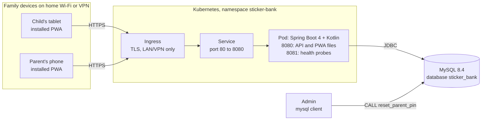
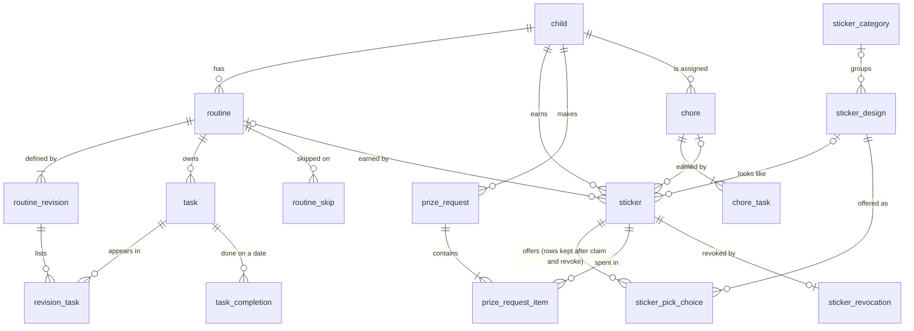
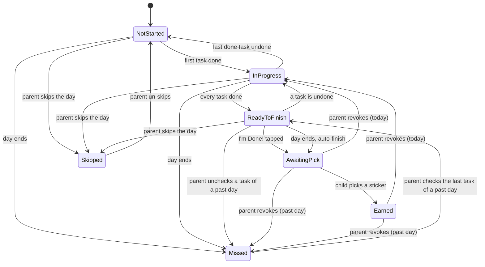
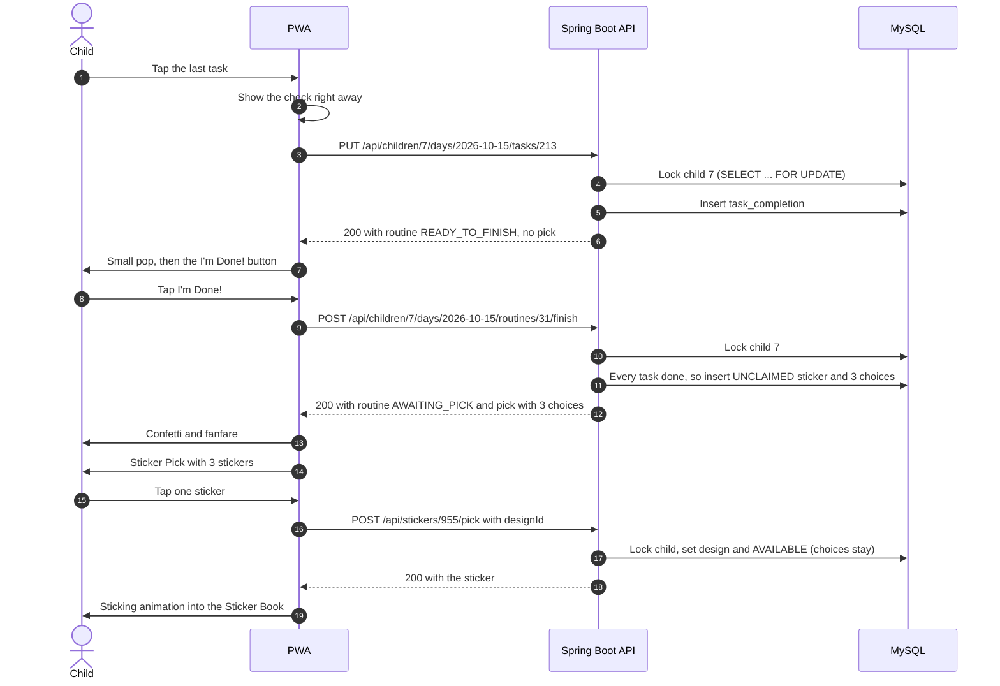
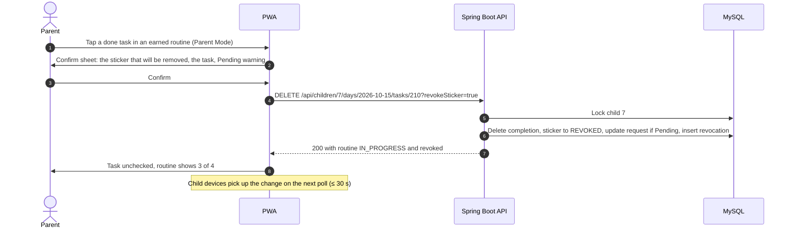
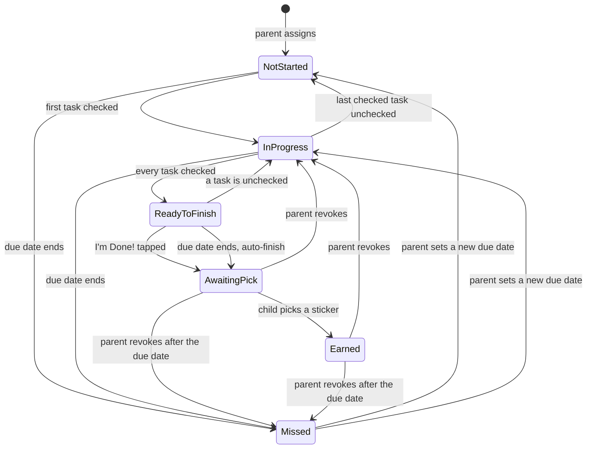

# Sticker Bank: Technical Design Document (TDD)

| | |
|---|---|
| **Product** | Sticker Bank: a sticker / reward chart for young children |
| **Document** | Technical Design Document |
| **Version** | 0.9 |
| **Status** | Draft |
| **Date** | 2026-11-26 |
| **Implements** | [Functional Design Document v1.5](FDD.md) |

> **Scope note:** This document covers **how** Sticker Bank is built: architecture, data storage, APIs, frontend, security, and deployment. **What** the app does is defined in the FDD. Requirement IDs (FR-x.y, BR-x, A-x, D-x) refer to it. Where the FDD is silent and a technical choice fills the gap, the choice is listed in §16.

### Revision History

| Version | Date | Summary |
|---|---|---|
| 0.1 | 2026-10-15 | First draft from FDD v1.0. Spring Boot 4 (Kotlin), MySQL 8.4, React PWA, one container on Kubernetes, LAN/VPN-only access, online-only writes, Admin PIN reset by SQL. |
| 0.2 | 2026-10-15 | Local development with no database server to run: Testcontainers dev mode for full-stack work, an MSW mock-API mode for UI work (TD-16, §12.5). SQLite and H2 considered and rejected. |
| 0.3 | 2026-10-15 | Sticker revocation from FDD v1.1 (§6.12): `REVOKED` sticker status with a live-only unique key, `sticker_revocation` log, `V4` migration, revoke via a confirmed parent undo (§7.11), new error codes, Parent Mode confirm sheet (TD-17, I-16 to I-20). |
| 0.4 | 2026-10-15 | I'm Done! finish step from FDD v1.2 (FR-6.6 to FR-6.11). `READY_TO_FINISH` is a derived state. Completing the last task no longer earns a sticker: a new `finish` endpoint does (§7.4). A routine still Ready to finish at the end of the day is finished by lazy settlement with a `child.settled_through` watermark (§7.12). `V5` migration (`sticker.finish_mode`, `child.settled_through`, `live_sticker` refresh), `ROUTINE_NOT_READY`, I'm Done! button and parent "Finished automatically" chip, TD-18, TD-19, I-21 to I-25. A routine edit that leaves every task done no longer earns (I-3). |
| 0.5 | 2026-10-15 | Re-earning after a revoke offers the same Sticker Pick choices (FDD v1.3: FR-12.5, FR-12.8, BR-6). `sticker_pick_choice` rows are kept after a claim and after a revoke, and the earn step copies the latest revoked sticker's rows for the same routine and day (§7.5, §7.11). No schema change. A design that was ever offered can't be deleted (I-16). |
| 0.6 | 2026-10-16 | A stale frontend is told to refresh. Every `/api` response carries `X-Min-Frontend-Version` (the configured `STICKER_BANK_MIN_FRONTEND_VERSION`, or the server's own version), and a PWA built older than that applies the new service worker at the first safe moment instead of waiting for a foreground event, with a guarded hard-reload fallback (§8.1, §9.5, TD-20, I-26). `APP_VERSION` is now stamped automatically with the build time, once per build, so every build differs (§12.1). The child and parent pages end with a small `App … · Server …` line (§9.5). No schema or endpoint change. |
| 0.7 | 2026-10-17 | Responsive layout rules from a multi-viewport audit (iPhone 11 Pro, Pixel 10 Pro, iPad Air, desktop). §9.3 now spells out the breakpoints: the two-row child header on phones, the centered auto-fit chart grid, the short-viewport layouts (landscape phones) for the PIN screens and the child picker, the Parent Mode navigation and History grid breakpoints, the pinned Sheet footer, and where safe-area insets are applied. §9.9 adds that theme colors are never used as text color. No schema, endpoint or FDD change. |
| 0.8 | 2026-10-17 | Child switcher shows names (FDD v1.4, FR-1.6). The header's avatar cluster becomes one name chip with a popover list of all children, so the one-row breakpoints no longer depend on the number of children (§9.3). No schema or endpoint change. |
| 0.9 | 2026-11-26 | Chores from FDD v1.5 (§6.13). New `chore` and `chore_task` tables and a `chore/` package, not a one-off routine (TD-21). A chore has 1 to 6 tasks. Its state is derived, not stored (TD-22): each task's check is `chore_task.checked_at`, and a finished chore is one with a live sticker. A chore's sticker is a `sticker` row with `source = CHORE` and a `chore_id`, protected by a new live-only unique key, and the earn step now takes its source as a parameter (§6.9, §7.5). Check, finish and revoke endpoints mirror the task ones but carry no date (§7.13). Day settlement also finishes a chore whose tasks are all checked when its due date ends (TD-23, §7.12). `V6` migration, `CHORE_NOT_READY`, `CHORE_MISSED`, `CHORE_LOCKED`, `CHORE_LIMIT_REACHED`, chore cards after the routines on the Daily Chart with a new-chore toast, a family-wide Chores page in Parent Mode, assigning a chore as done already (which delivers FR-7.12), a chore icon pack (§9.7), I-27 to I-39, and milestone M7. |

---

## 1. Summary

Sticker Bank ships as **one container image**. A Kotlin Spring Boot service serves both the JSON API (`/api/...`) and the React PWA's static files from the same origin, and keeps all data in a MySQL database. It runs as a Deployment on the family's Kubernetes cluster and is reachable over HTTPS only on the home network or over a VPN.

The decisions that shape the rest of the design:

1. **The server owns "today".** The family's time zone is stored in the database, and the server decides which calendar day it is (FR-4.4). Every device sees the same day, and a device with a wrong clock can't complete tomorrow's tasks (BR-5).
2. **Routines are versioned by date.** Editing a routine writes a dated *revision* instead of changing it in place. Any past day can be rebuilt exactly as it was (FR-4.3). The "once today's sticker is earned, changes start tomorrow" rule (BR-2) becomes a single choice of date.
3. **The database protects the currency.** Stickers are currency (BR-12), so earning and spending run in transactions that lock the child's row, backed by unique keys. Two devices tapping at the same moment can't earn twice (BR-7) or spend the same sticker twice (BR-10). A parent's revoke (FDD §6.12) runs under the same lock, so it can't race a claim or a spend.
4. **The PWA is built for toddlers.** Big touch targets, instant (optimistic) taps, celebrations, an installable app shell, and a friendly "waiting for Wi-Fi" state when the server can't be reached.
5. **Earning is an explicit step.** A routine whose tasks are all done is only *Ready to finish*: a state derived from the saved completions, with no stored row. A sticker row is created by the finish call (the child's **I'm Done!**) or, if nobody taps it, by a lazy end-of-day settlement. A mistaken tap is therefore undone with a plain delete (FR-6.7), and both ways of finishing run under the same child lock as every other currency write.
6. **A chore is a thing, not a day.** A chore (FDD §6.13) has no schedule and no revisions. It is one row with its tasks, and it stays open until it is finished, removed, or its due date passes. Its state is derived from those rows and its live sticker, and finishing it goes through the same earn step, the same Sticker Pick, and the same child lock as a routine.

## 2. Technical Decisions

| # | Topic | Decision | Why |
|---|---|---|---|
| TD-1 | Backend | Kotlin 2.2+ on Spring Boot 4, Java 25 LTS | Mature ecosystem. Health probes, migrations, validation, and testing come built in. |
| TD-2 | Data access | Spring Data JDBC for simple aggregates. `JdbcClient` for chart/history queries and row locks. No JPA. | The core logic is set-based SQL with explicit locks. JPA's proxies and lazy loading fight Kotlin and hide the SQL. |
| TD-3 | Schema | Flyway migrations, forward-only, expand/contract | Repeatable, and safe during rolling updates. |
| TD-4 | Frontend | React 19 + TypeScript, Vite, vite-plugin-pwa (Workbox), TanStack Query, React Router | Standard, well-supported PWA tooling. |
| TD-5 | Packaging | One image. Spring Boot serves the built PWA. | Same origin: no CORS, one thing to deploy, and the UI and API versions always match. |
| TD-6 | Network | LAN / VPN only, HTTPS required | Child Mode has no login (A-2). Service workers only run over HTTPS. |
| TD-7 | Offline | Writes need the server. The app shell, artwork, and last-loaded data are shown read-only while offline. | No sync conflicts around currency. The server generates Sticker Picks (BR-6). |
| TD-8 | PIN reset | Direct SQL. The Admin runs `CALL reset_parent_pin('<name>')`. | The Admin's MySQL access is the authentication. The procedure makes the audit row impossible to forget (FR-8.10). |
| TD-9 | Day boundary | Family time zone (IANA) stored server-side. The server computes today. | One shared "today" for every device (FR-4.4, BR-5). |
| TD-10 | History | Dated routine revisions, with no nightly jobs | Past days are exact even if the server was down at midnight (FR-4.3, FR-6.5, §6.9). |
| TD-11 | Device sync | Polling every 30 s while visible, plus refetch on focus and reconnect | Simple. No WebSockets, and no pub/sub between replicas. Feels live enough on a LAN. |
| TD-12 | Artwork | A curated subset of Microsoft Fluent Emoji (3D style, MIT license), bundled in the image and referenced by key | Same look on every device and OS, works offline, no uploads (FR-10.3, D-6). |
| TD-13 | Kubernetes | Kustomize base + overlay. Bring your own MySQL via a Secret, with optional in-cluster MySQL manifests. | Plain YAML that works with any GitOps tool. |
| TD-14 | Image | Multi-arch (amd64 + arm64), non-root, read-only root filesystem | Runs on PC or Raspberry Pi nodes, hardened. |
| TD-15 | API contract | OpenAPI generated by springdoc. TypeScript types generated from it. | The frontend and backend can't silently drift apart. |
| TD-16 | Local development | Full stack: `./gradlew bootTestRun` starts a throwaway MySQL 8.4 with Testcontainers. UI only: `npm run dev:mock` answers the API from an in-browser mock (MSW). No SQLite or H2 profile. | Nothing to install or keep running except a container runtime, and dev uses the same database engine and SQL as production. SQLite and H2 were considered and rejected (§12.5). |
| TD-17 | Revoked stickers | Soft delete: the `sticker` row moves to status `REVOKED` and a `sticker_revocation` row records why. Uniqueness of BR-7 moves to a generated column that is `NULL` for revoked rows. | Keeps Prize Request history intact (`prize_request_item` still points at the row), keeps the audit trail for FR-12.9, and still allows exactly one live sticker per routine and day after a re-earn (BR-7). |
| TD-18 | Ready to finish | A derived state, not a stored one: no `sticker` row and no new status. A sticker row is created only by the finish endpoint and by day settlement. | Undoing a mistaken tap stays a plain delete (FR-6.7). A stored "waiting" sticker would need revoke rules, a confirm sheet, and cleanup of its saved choices, which is exactly what the I'm Done! step is meant to avoid. |
| TD-19 | Auto-finish at day end | Lazy settlement per child, tracked by a `child.settled_through` watermark. No scheduler. | Same reasoning as TD-10: it works if the server was down at midnight, needs no job lock when 2 replicas run, and gives the same result whenever it runs. The watermark separates "the day ended with everything done" from "a parent re-checked a past day later" (FR-6.10). |
| TD-20 | Stale frontends | The server announces the oldest frontend build it accepts in an `X-Min-Frontend-Version` header on every `/api` response. A PWA older than that refreshes itself. | The UI and API ship in one image (TD-5), but a PWA that stays open keeps running the build it started with. Waiting for a foreground event (§9.5) let a tablet left on the chart talk to a newer server with old rules, for example finishing a routine the pre-I'm-Done! way and getting no sticker. A header on every response reaches the client on its next call, whatever the call was. |
| TD-21 | Chores | Their own `chore` and `chore_task` tables and `chore/` package. A chore's sticker is a `sticker` row with `source = CHORE` and a `chore_id`. A chore is **not** stored as a one-off routine. | On the chart a chore looks like a routine: a name, tasks, and I'm Done!, and the PWA draws both with one card. In time it is the opposite. A routine is a dated, versioned, weekly definition, and every routine read (the plan, the parent's list, copy, pause, reorder, skip, the weekly summary) would have to learn to leave chores out. A one-off routine also can't carry over: `(routine, day)` is its earning key, so every day it stayed open would count as missed. Only the currency code is shared: the earn step, the pick, the revoke, and the child lock (§7.13). |
| TD-22 | Chore state | Derived, like Ready to finish (TD-18). The only stored facts are each task's `checked_at`, the chore's `due_date` and `removed_at`, and its live sticker. There is no status column. | Nothing can drift. A revoke reopens the chore just by taking its live sticker away, and a chore becomes Missed with no write at midnight. |
| TD-23 | Chores at day end | The same lazy settlement (TD-19) finishes a chore whose tasks are all checked when its due date ends. Settlement never touches a chore with no due date, or one that isn't due yet. | One mechanism for both kinds of automatic finish, with the same watermark and the same idempotency. An ordinary midnight has nothing to settle for a chore, because its checks carry over to the next day (FDD D-17). |

## 3. Architecture

### 3.1 System Context



### 3.2 Components

| Component | Responsibility |
|---|---|
| **PWA** (React) | Child Mode and Parent Mode UI, celebrations and sounds, offline shell, day rollover, Parent Mode idle timeout. Holds no authoritative state. |
| **API** (Spring Boot) | All business rules (§7), the PIN and parent sessions, and serving the PWA's files with correct cache headers. Stateless, so any number of replicas can run. |
| **MySQL** | Single source of truth. Holds the stored procedure for the Admin PIN reset. |
| **Kubernetes** | Ingress with TLS (LAN/VPN only), Deployment, Service, ConfigMap, Secret, NetworkPolicy. |

### 3.3 Request Routing Inside the App

| Path | Served by | `Cache-Control` |
|---|---|---|
| `/api/**` | REST controllers | `no-store` |
| `/assets/**` (hashed JS, CSS, fonts) | Static files | `public, max-age=31536000, immutable` |
| `/artwork/**`, `/sounds/**` | Static files | `public, max-age=86400` (the service worker precache keeps them current) |
| `/index.html`, `/sw.js`, `/manifest.webmanifest` | Static files | `no-cache` |
| Any other `GET` without a file extension | `index.html` (SPA fallback) | `no-cache` |
| `:8081/actuator/**` | Actuator, not routed by the Service | n/a |

## 4. Technology Stack

| Layer | Choice | Notes |
|---|---|---|
| **Backend** | | |
| Language / runtime | Kotlin 2.2+, Java 25 LTS (Eclipse Temurin) | |
| Framework | Spring Boot 4.0.x: `spring-boot-starter-webmvc`, `-data-jdbc`, `-validation`, `-actuator`, `-flyway` + `flyway-mysql` | Spring MVC (blocking). JDBC blocks anyway, and the load is tiny. Boot 4 split auto-configuration into modules, so Flyway needs its own starter. |
| Database driver | MySQL Connector/J | URL params: `connectionTimeZone=UTC&forceConnectionTimeZoneToSession=true` |
| JSON | Jackson with the Kotlin module, ISO-8601 dates | |
| PIN hashing | `spring-security-crypto` BCrypt (cost 12) | The crypto module only, with no Spring Security filter chain (§11.3). |
| API docs | springdoc-openapi (the Boot 4 line) | Spec served at `/api/openapi.json` |
| Build | Gradle 9, Kotlin DSL, version catalog, ktlint + detekt | |
| Tests | JUnit Jupiter, MockK, Testcontainers (MySQL), AssertJ | |
| **Frontend** | | |
| Language | TypeScript (strict) | |
| UI and routing | React 19, React Router 7 | |
| Build | Vite, vite-plugin-pwa (Workbox) | |
| Server state | TanStack Query 5, with child-mode queries persisted to IndexedDB | Read-only display while offline (§9.6) |
| API client | openapi-typescript + openapi-fetch | Types generated from the backend spec |
| Styling | Tailwind CSS 4, with design tokens per child theme color | |
| Motion | Motion (formerly Framer Motion), canvas-confetti | Celebrations and the "sticking" animation |
| Drag and drop | dnd-kit (touch and keyboard sensors) | FR-2.4, FR-3.4 |
| Forms | React Hook Form + Zod | Parent screens |
| Font | Andika (SIL Open Font License), self-hosted | Designed for beginning readers |
| Tests | Vitest, React Testing Library, MSW, Playwright | |
| **Data and platform** | | |
| Database | MySQL 8.4 LTS, InnoDB, `utf8mb4` | Names and prize text can contain emoji |
| Container | Multi-stage Dockerfile, runtime `eclipse-temurin:25-jre` | |
| Orchestration | Kubernetes, Kustomize | |
| Build-only tooling | Node 24 LTS | Not in the runtime image |
| Local development | A container runtime: OrbStack, Colima, or Docker Desktop | Runs the dev database through Testcontainers (§12.5) and builds the image locally |

> Exact versions are pinned in `gradle/libs.versions.toml` and `package-lock.json` at project start. The major versions above are the baseline.

## 5. Repository Layout

```
sticker-bank/
├── docs/                    FDD.md, TDD.md, runbooks/
├── artwork/                 catalog.json, source images, conversion script
├── backend/                 Spring Boot service (Gradle, Kotlin DSL)
│   ├── src/main/
│   │   ├── kotlin/com/stickerbank/
│   │   │   ├── common/      errors (ProblemDetail), FamilyClock, ChildLock, web and header config
│   │   │   ├── family/      settings, PIN, parent sessions, ParentAuthInterceptor
│   │   │   ├── child/       child profiles
│   │   │   ├── routine/     routines, revisions, tasks, schedules, skips, copy
│   │   │   ├── chart/       Daily Chart assembly, task completion, finish, day settlement, history
│   │   │   ├── chore/       chores: assigning, checking, finishing, revoking (§7.13)
│   │   │   ├── sticker/     library, categories, artwork catalog, earning, Sticker Pick, Sticker Book
│   │   │   └── prize/       Prize Requests
│   │   └── resources/
│   │       ├── application.yaml
│   │       └── db/migration/  V1__schema.sql … V6__chores.sql
│   └── src/test/kotlin/com/stickerbank/
│       ├── dev/             TestStickerBankApplication, MySqlContainerConfig, DemoDataSeeder (§12.5)
│       └── …                unit and integration tests
├── frontend/                Vite + React + TypeScript
│   ├── public/artwork/      generated 256 px WebP files (committed)
│   └── src/
│       ├── api/             openapi.json snapshot, generated types, client, query hooks
│       ├── app/             providers: mode, device settings, idle timer, day rollover, update prompt, offline state
│       ├── child/           Daily Chart, task tiles, chore cards, celebration, Sticker Pick, Sticker Book, Get a Prize, PIN pad
│       ├── mocks/           MSW handlers, in-memory fake API, named scenarios (dev:mock and tests)
│       ├── parent/          children, routine editor, chores, library, prize requests, history, settings
│       ├── ui/              shared components (BigTile, Sheet, ConfirmDialog, Artwork)
│       └── sound/
├── deploy/k8s/              base/, overlays/home/, optional/mysql/
├── Dockerfile
└── compose.yaml             app image + MySQL 8.4 for end-to-end tests
```

Backend packages are organized by feature. Each one has a controller, a service (transaction boundary and rules), repositories, and DTOs.

## 6. Data Model

### 6.1 Naming

| FDD term | Code / table |
|---|---|
| Child | `child` |
| Routine | `routine` (identity, display order) + `routine_revision` (dated definition) |
| Task | `task` (identity) + `revision_task` (label, icon, and position within one revision) |
| Sticker (a design in the Sticker Library) | `sticker_design` |
| Sticker in a Sticker Book | `sticker` |
| Sticker Pick | The `sticker_pick_choice` rows of a sticker. They are shown while it is `UNCLAIMED` and kept afterwards, so a re-earn after a revoke can offer them again (FR-12.5). |
| Ready to finish | Not stored. The derived state `READY_TO_FINISH` (§7.3). |
| I'm Done! (finish) | `POST …/routines/{id}/finish` (§7.4). The sticker records how it was finished in `sticker.finish_mode` (`TAPPED` or `AUTO`). |
| Chore | `chore`: one row per chore, with no revisions (TD-21) |
| A chore's task | `chore_task`: label, icon, position, and its check in `checked_at`. A separate table and id space from `task`. |
| Due date and Missed | `chore.due_date`, and the derived state `MISSED` (§7.3) |
| Sticker earned by a chore | A `sticker` row with `source = CHORE` and `chore_id`. Its `routine_name` and `routine_icon_key` columns hold the chore's name and icon, saved when it is earned (I-9). The column names are historical. |
| Category / pack | `sticker_category` |
| Prize Request | `prize_request` + `prize_request_item` |
| Parent PIN and family settings | `family_settings` (a single row) |

### 6.2 Conventions

- **One deployment = one family (A-1).** There is no tenant column. Family-wide settings live in a single row.
- IDs are `BIGINT AUTO_INCREMENT`. Timestamps are `DATETIME(3)` in UTC: the JVM and the JDBC session are both forced to UTC. Calendar days are `DATE` values in the family time zone (`chart_date`).
- Character set `utf8mb4`, collation `utf8mb4_0900_ai_ci`.
- Artwork is referenced by `*_key` strings, validated against the bundled catalog (§9.7).
- Rows a child owns cascade when the child is deleted (FR-1.3, BR-14). Sticker designs are protected by `RESTRICT` (BR-15).
- Weekdays are stored as a 7-bit mask: bit 0 = Monday … bit 6 = Sunday.

### 6.3 Entity Relationships



`family_settings`, `parent_session`, and `pin_reset_log` stand alone.

### 6.4 Routine Revisions (FR-4.3, BR-2, BR-3)

A routine's definition is stored as **revisions**: name, icon, color, schedule, paused, deleted, and its ordered task list. Each revision has an `effective_from` date. **The definition for day D is the revision with the latest `effective_from ≤ D`.**

**Which date an edit applies from:**

```
E = today + 1   if the routine has already earned its sticker today
                (a live sticker row exists for routine × today, claimed or not;
                 REVOKED rows don't count)
E = today       otherwise
```

An edit upserts the revision with `effective_from = E`, so repeated edits on the same day overwrite a single row. Every kind of edit follows this rule: renaming, rescheduling (FR-4.1), pausing (FR-2.6), changing tasks (FR-3.x), and deleting (FR-2.3, stored as a revision with `deleted = true`).

What follows from this:

- Past days never change, because their revisions are never touched (FR-4.3).
- A routine that earned its sticker stays exactly as it was for the rest of the day (BR-2, FR-7.4). If a parent then revokes the sticker (§7.11), today's revision is still the one in force. Edits saved while the sticker existed stay dated tomorrow, and new edits apply to today again.
- Tasks keep their identity (`task.id`) across revisions, so a completion survives a rename. A removed task's completion stays in the table but no longer counts. If the task is put back the same day, it counts again.
- If an edit to today's revision leaves every remaining task done, the routine becomes Ready to finish. It earns nothing until I'm Done! is tapped or the day ends (FR-6.6, BR-18, see I-3).
- A routine appears on day D only if its revision for D exists, isn't deleted or paused, includes D's weekday, and has at least one task (FR-3.5). A skip row for D shows it as Skipped (FR-4.5).
- Display order (`routine.position`) isn't versioned. Past days are shown in the current order (I-6).

The query for one child's plan on date D:

```sql
WITH ranked AS (
  SELECT rr.*,
         ROW_NUMBER() OVER (PARTITION BY rr.routine_id ORDER BY rr.effective_from DESC) AS rn
  FROM routine_revision rr
  JOIN routine r ON r.id = rr.routine_id
  WHERE r.child_id = :childId
    AND rr.effective_from <= :date
)
SELECT * FROM ranked
WHERE rn = 1
  AND NOT deleted
  AND NOT paused
  AND (days_mask & (1 << :weekdayIndex)) <> 0;
```

One more query then loads the `revision_task` rows for the returned revisions. History over a date range loads all of the child's revisions once and evaluates each day in memory.

### 6.5 Sticker Status in Data

| `sticker.status` | Meaning | `design_id` | `prize_request_id` |
|---|---|---|---|
| `UNCLAIMED` | Earned, but the Sticker Pick isn't done yet. The choices are in `sticker_pick_choice`. Not counted in the Sticker Book. | `NULL` | `NULL` |
| `AVAILABLE` | In the Sticker Book and can be spent | set | `NULL` |
| `PENDING` | Part of the child's open Prize Request | set | the pending request |
| `USED` | Spent on a prize | set | the completed request |
| `REVOKED` | Un-earned by a parent (FDD §6.12). Not shown or counted anywhere a child or the Sticker Book looks. Details are in `sticker_revocation`. Its `sticker_pick_choice` rows stay, so a re-earn can offer the same set (FR-12.5). | set if it was claimed, else `NULL` | `NULL` |

The transitions follow FDD §5.3, with `UNCLAIMED` added as the step before it. `UNCLAIMED`, `AVAILABLE`, and `PENDING` can move to `REVOKED`; `USED` can't (FR-12.7). `REVOKED` is final: re-earning inserts a **new** row (FR-12.5). The `sticker_pick_choice` rows stay with the sticker in every status, but only an `UNCLAIMED` sticker shows them (`GET …/pick` returns no choices otherwise). A `REVOKED` sticker keeps its rows so the re-earn can offer the same set (§7.5).

**Ready to finish has no row.** Until a parent or the child taps I'm Done!, or the day ends, a routine with every task done has no `sticker` row at all (TD-18). Unchecking a task is therefore an ordinary delete of a `task_completion` row, with nothing to revoke or clean up (FR-6.7, BR-19). The row is created by Finish (§7.4) or by day settlement (§7.12), and both go through the earn routine in §7.5.

**Live stickers.** Every read that means "earned stickers" (Daily Chart, Sticker Book and counts, the unclaimed tray, `RevisionPolicy`, skip checks, bootstrap counts) goes through the view `live_sticker` (`SELECT * FROM sticker WHERE status <> 'REVOKED'`). Only history, revocation, and Prize Request history read the `sticker` table directly. An integration test checks each of those reads with a revoked row present. `prize_request_item` permanently records which stickers were in each request, so cancelled and reversed requests still show their stickers in history (FR-11.10).

**Chore stickers.** A sticker earned by a chore has `source = CHORE`, a `chore_id`, and no `routine_id` (§6.9). It moves through the same statuses as any other sticker, and its saved choices behave the same way. The routine reads are unaffected, because they filter on `routine_id IS NOT NULL` or look a sticker up by its routine. The reads that aren't about routines (Sticker Book, counts, the unclaimed tray, Prize Requests, the design `in_use` check, revocation history) already work on any `sticker` row, so they pick up chore stickers with no change beyond the new `CHORE` value of the `StickerSource` enum. A chore that is Ready to finish has no `sticker` row either: its checks are in `chore_task.checked_at`.

**Fallback sticker (FR-7.11):** Flyway seeds one `sticker_design` with `is_fallback = TRUE` ("Gold Star"). It's never offered in a pick, can't be edited or deleted, and is hidden from the library page (I-13). When the pick pool is empty, the earned sticker is created directly as `AVAILABLE` with this design.

### 6.6 Schema (`V1__schema.sql`)

```sql
CREATE TABLE family_settings (
  id                      TINYINT      NOT NULL PRIMARY KEY,
  pin_hash                VARCHAR(100) NULL,             -- NULL = no PIN yet, or reset by Admin
  pin_set_at              DATETIME(3)  NULL,
  failed_pin_attempts     INT          NOT NULL DEFAULT 0,
  lockout_level           INT          NOT NULL DEFAULT 0,
  pin_locked_until        DATETIME(3)  NULL,
  time_zone               VARCHAR(64)  NOT NULL DEFAULT 'UTC',
  parent_idle_timeout_sec INT          NOT NULL DEFAULT 300,
  updated_at              DATETIME(3)  NOT NULL,
  CONSTRAINT ck_family_settings_singleton CHECK (id = 1)
);
INSERT INTO family_settings (id, updated_at) VALUES (1, UTC_TIMESTAMP(3));

CREATE TABLE parent_session (
  id           BIGINT      NOT NULL AUTO_INCREMENT PRIMARY KEY,
  token_hash   BINARY(32)  NOT NULL,                     -- SHA-256 of the cookie value
  created_at   DATETIME(3) NOT NULL,
  last_seen_at DATETIME(3) NOT NULL,
  expires_at   DATETIME(3) NOT NULL,
  CONSTRAINT uq_parent_session_token UNIQUE (token_hash)
);

CREATE TABLE pin_reset_log (                             -- FR-8.10
  id         BIGINT       NOT NULL AUTO_INCREMENT PRIMARY KEY,
  reset_at   DATETIME(3)  NOT NULL,
  admin_name VARCHAR(100) NOT NULL,
  db_user    VARCHAR(288) NOT NULL                       -- MySQL login that ran the reset
);

CREATE TABLE child (
  id          BIGINT      NOT NULL AUTO_INCREMENT PRIMARY KEY,
  name        VARCHAR(40) NOT NULL,
  avatar_key  VARCHAR(64) NOT NULL,
  theme_color VARCHAR(16) NOT NULL,
  position    INT         NOT NULL,
  archived_at DATETIME(3) NULL,                          -- FR-1.4 (Could), unused in v1
  created_at  DATETIME(3) NOT NULL,
  updated_at  DATETIME(3) NOT NULL
);

CREATE TABLE routine (
  id         BIGINT      NOT NULL AUTO_INCREMENT PRIMARY KEY,
  child_id   BIGINT      NOT NULL,
  position   INT         NOT NULL,                       -- FR-2.4, not versioned
  created_at DATETIME(3) NOT NULL,
  deleted_at DATETIME(3) NULL,                           -- hides it from the parent's list
  CONSTRAINT fk_routine_child FOREIGN KEY (child_id) REFERENCES child (id) ON DELETE CASCADE,
  INDEX ix_routine_child (child_id, position)
);

CREATE TABLE routine_revision (
  id             BIGINT           NOT NULL AUTO_INCREMENT PRIMARY KEY,
  routine_id     BIGINT           NOT NULL,
  effective_from DATE             NOT NULL,
  name           VARCHAR(60)      NOT NULL,
  icon_key       VARCHAR(64)      NOT NULL,
  color          VARCHAR(16)      NULL,
  days_mask      TINYINT UNSIGNED NOT NULL,              -- bit 0 = Monday … bit 6 = Sunday
  paused         BOOLEAN          NOT NULL DEFAULT FALSE,
  deleted        BOOLEAN          NOT NULL DEFAULT FALSE,
  updated_at     DATETIME(3)      NOT NULL,
  CONSTRAINT fk_revision_routine FOREIGN KEY (routine_id) REFERENCES routine (id) ON DELETE CASCADE,
  CONSTRAINT uq_revision_effective UNIQUE (routine_id, effective_from)
);

CREATE TABLE task (
  id         BIGINT      NOT NULL AUTO_INCREMENT PRIMARY KEY,
  routine_id BIGINT      NOT NULL,
  created_at DATETIME(3) NOT NULL,
  CONSTRAINT fk_task_routine FOREIGN KEY (routine_id) REFERENCES routine (id) ON DELETE CASCADE
);

CREATE TABLE revision_task (
  revision_id BIGINT           NOT NULL,
  task_id     BIGINT           NOT NULL,
  position    INT              NOT NULL,
  label       VARCHAR(60)      NOT NULL,
  icon_key    VARCHAR(64)      NOT NULL,
  days_mask   TINYINT UNSIGNED NULL,                     -- FR-3.6 (Could); NULL = every scheduled day
  PRIMARY KEY (revision_id, task_id),
  CONSTRAINT fk_rt_revision FOREIGN KEY (revision_id) REFERENCES routine_revision (id) ON DELETE CASCADE,
  CONSTRAINT fk_rt_task     FOREIGN KEY (task_id)     REFERENCES task (id)             ON DELETE CASCADE
);

CREATE TABLE routine_skip (                              -- FR-4.5
  routine_id BIGINT      NOT NULL,
  chart_date DATE        NOT NULL,
  created_at DATETIME(3) NOT NULL,
  PRIMARY KEY (routine_id, chart_date),
  CONSTRAINT fk_skip_routine FOREIGN KEY (routine_id) REFERENCES routine (id) ON DELETE CASCADE
);

CREATE TABLE task_completion (                           -- BR-1
  task_id      BIGINT                 NOT NULL,
  chart_date   DATE                   NOT NULL,
  routine_id   BIGINT                 NOT NULL,          -- denormalized for chart queries
  child_id     BIGINT                 NOT NULL,          -- denormalized for history queries
  completed_at DATETIME(3)            NOT NULL,
  completed_by ENUM('CHILD','PARENT') NOT NULL,
  PRIMARY KEY (task_id, chart_date),
  INDEX ix_completion_routine_day (routine_id, chart_date),
  INDEX ix_completion_child_day (child_id, chart_date),
  CONSTRAINT fk_completion_task    FOREIGN KEY (task_id)    REFERENCES task (id)    ON DELETE CASCADE,
  CONSTRAINT fk_completion_routine FOREIGN KEY (routine_id) REFERENCES routine (id) ON DELETE CASCADE,
  CONSTRAINT fk_completion_child   FOREIGN KEY (child_id)   REFERENCES child (id)   ON DELETE CASCADE
);

CREATE TABLE sticker_category (                          -- FR-10.9
  id       BIGINT      NOT NULL AUTO_INCREMENT PRIMARY KEY,
  name     VARCHAR(40) NOT NULL,
  enabled  BOOLEAN     NOT NULL DEFAULT TRUE,            -- turns a whole pack on or off
  position INT         NOT NULL,
  CONSTRAINT uq_category_name UNIQUE (name)
);

CREATE TABLE sticker_design (
  id          BIGINT                   NOT NULL AUTO_INCREMENT PRIMARY KEY,
  name        VARCHAR(40)              NOT NULL,
  artwork_key VARCHAR(64)              NOT NULL,
  category_id BIGINT                   NULL,
  status      ENUM('ACTIVE','RETIRED') NOT NULL DEFAULT 'ACTIVE',
  is_fallback BOOLEAN                  NOT NULL DEFAULT FALSE,   -- FR-7.11
  created_at  DATETIME(3)              NOT NULL,
  updated_at  DATETIME(3)              NOT NULL,
  CONSTRAINT fk_design_category FOREIGN KEY (category_id) REFERENCES sticker_category (id) ON DELETE SET NULL,
  INDEX ix_design_pool (status, is_fallback, category_id)
);

CREATE TABLE prize_request (
  id           BIGINT                                             NOT NULL AUTO_INCREMENT PRIMARY KEY,
  child_id     BIGINT                                             NOT NULL,
  status       ENUM('PENDING','COMPLETED','CANCELLED','REVERSED') NOT NULL,
  created_by   ENUM('CHILD','PARENT')                             NOT NULL,
  prize_text   VARCHAR(200)                                       NULL,   -- required to complete
  note         VARCHAR(500)                                       NULL,
  created_at   DATETIME(3)                                        NOT NULL,
  completed_at DATETIME(3)                                        NULL,
  cancelled_at DATETIME(3)                                        NULL,
  cancelled_by ENUM('CHILD','PARENT')                             NULL,
  reversed_at  DATETIME(3)                                        NULL,
  updated_at   DATETIME(3)                                        NOT NULL,
  CONSTRAINT fk_request_child FOREIGN KEY (child_id) REFERENCES child (id) ON DELETE CASCADE,
  INDEX ix_request_child_status (child_id, status, created_at),
  INDEX ix_request_status (status, created_at)
);

CREATE TABLE sticker (                                   -- one earned sticker in a Sticker Book
  id               BIGINT                                         NOT NULL AUTO_INCREMENT PRIMARY KEY,
  child_id         BIGINT                                         NOT NULL,
  source           ENUM('ROUTINE','BONUS')                        NOT NULL,
  routine_id       BIGINT                                         NULL,   -- NULL for bonus stickers (FR-7.12)
  chart_date       DATE                                           NOT NULL,
  routine_name     VARCHAR(60)                                    NULL,   -- snapshot at earn time (I-9)
  routine_icon_key VARCHAR(64)                                    NULL,
  design_id        BIGINT                                         NULL,   -- NULL while UNCLAIMED
  status           ENUM('UNCLAIMED','AVAILABLE','PENDING','USED') NOT NULL,
  prize_request_id BIGINT                                         NULL,   -- set while PENDING or USED
  earned_at        DATETIME(3)                                    NOT NULL,
  claimed_at       DATETIME(3)                                    NULL,
  CONSTRAINT uq_sticker_routine_day UNIQUE (routine_id, chart_date),                 -- BR-7, FR-7.3
  CONSTRAINT fk_sticker_child   FOREIGN KEY (child_id)   REFERENCES child (id)   ON DELETE CASCADE,
  -- Routines are only hard-deleted together with their child, so this cascade never
  -- removes stickers from a child who still exists (BR-3).
  CONSTRAINT fk_sticker_routine FOREIGN KEY (routine_id) REFERENCES routine (id) ON DELETE CASCADE,
  CONSTRAINT fk_sticker_design  FOREIGN KEY (design_id)  REFERENCES sticker_design (id) ON DELETE RESTRICT, -- BR-15
  CONSTRAINT fk_sticker_request FOREIGN KEY (prize_request_id) REFERENCES prize_request (id) ON DELETE SET NULL,
  INDEX ix_sticker_book (child_id, status, chart_date)
);

CREATE TABLE sticker_pick_choice (                       -- BR-6: saved once, kept after the pick or a revoke, reused on a re-earn
  sticker_id BIGINT  NOT NULL,
  slot       TINYINT NOT NULL,                           -- 1–3, display order
  design_id  BIGINT  NOT NULL,
  PRIMARY KEY (sticker_id, slot),
  CONSTRAINT uq_choice_design  UNIQUE (sticker_id, design_id),                       -- 3 different stickers (FR-7.7)
  CONSTRAINT fk_choice_sticker FOREIGN KEY (sticker_id) REFERENCES sticker (id)        ON DELETE CASCADE,
  CONSTRAINT fk_choice_design  FOREIGN KEY (design_id)  REFERENCES sticker_design (id) ON DELETE RESTRICT  -- I-4
);

CREATE TABLE prize_request_item (
  prize_request_id BIGINT NOT NULL,
  sticker_id       BIGINT NOT NULL,
  PRIMARY KEY (prize_request_id, sticker_id),
  CONSTRAINT fk_item_request FOREIGN KEY (prize_request_id) REFERENCES prize_request (id) ON DELETE CASCADE,
  CONSTRAINT fk_item_sticker FOREIGN KEY (sticker_id)       REFERENCES sticker (id)       ON DELETE CASCADE
);
```

Deleting a child relies on these cascades. An integration test proves the delete removes every row the child owns (§13).

### 6.7 Revocation Schema (`V4__sticker_revocation.sql`)

V1 to V3 are already in place and migrations are forward-only (TD-3), so revocation is a new migration. Every step is additive or a metadata-only change, so it's safe during a rolling update.

```sql
-- 1) New status. Appending to the end of an ENUM is an instant change in MySQL 8.
ALTER TABLE sticker
  MODIFY status ENUM('UNCLAIMED','AVAILABLE','PENDING','USED','REVOKED') NOT NULL;

-- 2) BR-7 only applies to live stickers. is_live is 1 for live rows and NULL for
--    revoked ones. NULLs never collide in a UNIQUE index, so any number of REVOKED
--    rows can share (routine, date) with one live row. It's generated from status,
--    not routine_id: MySQL forbids a stored generated column whose base column has
--    a CASCADE foreign key, which routine_id does.
ALTER TABLE sticker
  ADD COLUMN is_live TINYINT AS (IF(status = 'REVOKED', NULL, 1)) STORED,
  ADD CONSTRAINT uq_sticker_live_routine_day UNIQUE (routine_id, chart_date, is_live);  -- also indexes fk_sticker_routine
ALTER TABLE sticker DROP INDEX uq_sticker_routine_day;

CREATE VIEW live_sticker AS
  SELECT * FROM sticker WHERE status <> 'REVOKED';

-- 3) Why a Pending request was cancelled (FR-12.6).
ALTER TABLE prize_request
  ADD COLUMN cancel_reason ENUM('CANCELLED','ALL_STICKERS_REVOKED') NULL AFTER cancelled_by;
UPDATE prize_request SET cancel_reason = 'CANCELLED' WHERE status = 'CANCELLED';

-- 4) One row per revoke (FR-12.3, FR-12.9, FR-12.11).
CREATE TABLE sticker_revocation (
  sticker_id        BIGINT                                NOT NULL PRIMARY KEY,
  child_id          BIGINT                                NOT NULL,          -- denormalized for history queries
  chart_date        DATE                                  NOT NULL,          -- the day that was un-earned
  task_id           BIGINT                                NULL,              -- the task that was unchecked
  task_label        VARCHAR(60)                           NOT NULL,          -- snapshot, survives task edits
  from_status       ENUM('UNCLAIMED','AVAILABLE','PENDING') NOT NULL,
  prize_request_id  BIGINT                                NULL,              -- set if it was PENDING
  request_cancelled BOOLEAN                               NOT NULL DEFAULT FALSE,
  note              VARCHAR(200)                          NULL,              -- FR-12.11 (Could)
  revoked_at        DATETIME(3)                           NOT NULL,
  CONSTRAINT fk_revocation_sticker FOREIGN KEY (sticker_id)       REFERENCES sticker (id)       ON DELETE CASCADE,
  CONSTRAINT fk_revocation_child   FOREIGN KEY (child_id)         REFERENCES child (id)         ON DELETE CASCADE,
  CONSTRAINT fk_revocation_task    FOREIGN KEY (task_id)          REFERENCES task (id)          ON DELETE SET NULL,
  CONSTRAINT fk_revocation_request FOREIGN KEY (prize_request_id) REFERENCES prize_request (id) ON DELETE SET NULL,
  INDEX ix_revocation_child_day (child_id, chart_date)
);
```

`V1__schema.sql` stays unchanged. The §6.6 listing shows V1 as shipped. The `uq_sticker_routine_day` key it shows is replaced by `uq_sticker_live_routine_day` here.

### 6.8 Finish Schema (`V5__routine_finish.sql`)

Two additive, nullable columns and a refreshed view, so it is safe during a rolling update (TD-3). While the update is rolling, a pod still on the old version keeps earning on the last task. That is harmless, because the unique key keeps it to one live sticker per routine and day either way.

```sql
-- 1) How the sticker was finished (FR-6.11). NULL for stickers earned before this
--    migration, which the last task earned, and for bonus stickers.
ALTER TABLE sticker
  ADD COLUMN finish_mode ENUM('TAPPED','AUTO') NULL;

-- 2) The last day whose end-of-day auto-finish has been applied (§7.12).
--    NULL = never settled, which means nothing before today is waiting.
ALTER TABLE child
  ADD COLUMN settled_through DATE NULL;

-- 3) MySQL expands SELECT * when a view is created, so live_sticker (V4) doesn't see
--    the new column until the view is redefined.
CREATE OR REPLACE VIEW live_sticker AS
  SELECT * FROM sticker WHERE status <> 'REVOKED';
```

`V1__schema.sql` stays unchanged. The `sticker` and `child` listings in §6.6 don't show these two columns.

### 6.9 Chore Schema (`V6__chores.sql`)

Two new tables, one appended ENUM value, one nullable column with its key, and a refreshed view. Every step is additive (TD-3).

```sql
-- 1) One row per chore (FDD §6.13). There are no revisions: until a chore is finished
--    it has no history to protect, and once it is finished it can't be edited (BR-22).
CREATE TABLE chore (
  id         BIGINT      NOT NULL AUTO_INCREMENT PRIMARY KEY,
  child_id   BIGINT      NOT NULL,
  name       VARCHAR(60) NOT NULL,
  icon_key   VARCHAR(64) NOT NULL,
  due_date   DATE        NULL,                         -- the last day it can be done; NULL = no due date (FR-13.2)
  created_at DATETIME(3) NOT NULL,
  updated_at DATETIME(3) NOT NULL,
  removed_at DATETIME(3) NULL,                         -- soft delete (I-33)
  CONSTRAINT fk_chore_child FOREIGN KEY (child_id) REFERENCES child (id) ON DELETE CASCADE,
  INDEX ix_chore_child_due (child_id, due_date)
) ENGINE=InnoDB DEFAULT CHARSET=utf8mb4 COLLATE=utf8mb4_0900_ai_ci;

-- 2) A chore's tasks (FR-13.1), 1 to 6 per chore. The check lives on the row, not in
--    task_completion: a chore isn't tied to a day, so there is no chart_date to key it by (BR-23).
CREATE TABLE chore_task (
  id         BIGINT                 NOT NULL AUTO_INCREMENT PRIMARY KEY,
  chore_id   BIGINT                 NOT NULL,
  position   INT                    NOT NULL,
  label      VARCHAR(60)            NOT NULL,
  icon_key   VARCHAR(64)            NOT NULL,
  checked_at DATETIME(3)            NULL,              -- set while checked; cleared by undo and by revoke
  checked_by ENUM('CHILD','PARENT') NULL,
  CONSTRAINT fk_chore_task_chore FOREIGN KEY (chore_id) REFERENCES chore (id) ON DELETE CASCADE,
  INDEX ix_chore_task_chore (chore_id, position)
) ENGINE=InnoDB DEFAULT CHARSET=utf8mb4 COLLATE=utf8mb4_0900_ai_ci;

-- 3) A third sticker source. Appending to the end of an ENUM is an instant change in MySQL 8.
ALTER TABLE sticker
  MODIFY source ENUM('ROUTINE','BONUS','CHORE') NOT NULL;

-- 4) BR-20: one live sticker per chore. This is the same shape as uq_sticker_live_routine_day (V4).
--    is_live is NULL for revoked rows and chore_id is NULL for every other sticker, and NULLs
--    never collide in a UNIQUE index. Chores are only hard-deleted together with their child
--    (I-33), so this cascade never removes stickers from a child who still exists.
ALTER TABLE sticker
  ADD COLUMN chore_id BIGINT NULL,
  ADD CONSTRAINT fk_sticker_chore FOREIGN KEY (chore_id) REFERENCES chore (id) ON DELETE CASCADE,
  ADD CONSTRAINT uq_sticker_live_chore UNIQUE (chore_id, is_live);    -- also indexes fk_sticker_chore

-- 5) As in V5: the view has to be redefined before it shows chore_id.
CREATE OR REPLACE VIEW live_sticker AS
  SELECT * FROM sticker WHERE status <> 'REVOKED';
```

`V1__schema.sql` stays unchanged. The `sticker` listing in §6.6 doesn't show `chore_id` or the `CHORE` source. `BONUS` stays in the ENUM, unused: a sticker awarded by hand (FR-7.12) is now a chore assigned as done already (§7.13).

There is no status column and no finished date on `chore` (TD-22). A chore is finished when it has a live sticker, and the day it was finished is that sticker's `chart_date`. Chore tasks are a separate table from `task`, with their own ids: a routine task is identified across dated revisions and completed per day, and a chore task is neither. `sticker_revocation` needs no change: a chore revoke stores the unchecked chore task's label in `task_label` and leaves `task_id`, which points at routine tasks, `NULL` (I-31).

**During a rolling update, and no rollback.** A pod still on the old version knows nothing about chores. It serves charts with no `chores` field, which the new PWA treats as an empty list, and it never writes a chore sticker. It can't read the `CHORE` source. For a child who holds a chore sticker, its Sticker Book and sticker detail answer 500. It lists an unclaimed chore sticker in the "Stickers to pick" tray and shows its three choices, but claiming one fails and rolls back. It also advances `settled_through` without finishing chores, which §7.12 covers. A chore sticker can only exist once a parent has assigned a chore from the new build, so during a rollout this lasts only the seconds the old pod survives, and the stale-frontend rule (TD-20) moves each PWA to the new build. It does mean this release **can't be rolled back** once a chore sticker exists. Roll forward instead.

## 7. Core Flows and Business Logic

### 7.1 Concurrency Model

- **Per-child lock.** Every write that touches a child's chart, stickers, or Prize Requests runs in one transaction that locks the child row first: `SELECT id FROM child WHERE id = ? FOR UPDATE` (via `ChildLock.withChildLock(childId) { … }`). One child's writes run one at a time, and different children never block each other. A family makes a handful of writes a minute, so contention is effectively zero.
- **Isolation.** The connection pool uses `READ COMMITTED`, so reads made after the lock is taken see everything committed before it.
- **Unique keys as a backstop:** `sticker (routine_id, chart_date, is_live)` for BR-7 (live stickers only, §6.7), `sticker (chore_id, is_live)` for BR-20 (§6.9), `task_completion (task_id, chart_date)` for BR-1, and `sticker_pick_choice (sticker_id, design_id)` for FR-7.7.
- **PIN operations** lock the `family_settings` row instead. No transaction takes both locks, so lock ordering can't deadlock.
- **BR-10 and BR-11** (a sticker in only one open request, and one pending request per child) are checked under the child lock.
- **Revoke** (§7.11) takes the same child lock, so it is serialized against completing tasks, claiming a pick, and every Prize Request action for that child.
- **Finish and day settlement** (§7.4, §7.12) take the same child lock, so two I'm Done! taps, or a tap racing the first request after midnight, produce exactly one sticker.
- **Chore writes** (§7.13) take the same child lock: assigning, editing, removing, checking, finishing, and revoking. A parent removing a chore while the child taps I'm Done! therefore resolves in one order or the other, never both.

### 7.2 Today and Day Rollover (FR-4.4, BR-4, BR-5)

- `FamilyClock` combines an injected `java.time.Clock` (UTC) with `family_settings.time_zone`. `today()` is `LocalDate.now(clock.withZone(zone))`. `nextDayStartsAt()` is the start of tomorrow in that zone, as an instant, which handles DST.
- The time zone is captured from the device when the PIN is first set up (`Intl.DateTimeFormat().resolvedOptions().timeZone`) and can be changed in Parent → Settings. Changing it affects which day is "today" from then on. Stored dates don't move.
- `GET /api/bootstrap` returns `today`, `nextDayStartsAt`, and `serverTime`. The PWA works out its clock offset and refetches at the rollover moment, and also on `visibilitychange` and `focus`.
- Every task write, and every finish, names the date the device is showing. A Child Mode write for a date that's no longer today gets `409 DAY_CHANGED`, and the PWA loads the new day instead of ticking the wrong one. A routine the child left Ready to finish isn't lost: the first request of the new day settles yesterday (§7.12), and its sticker waits in the "Stickers to pick" tray. Chore writes are the exception: a chore isn't tied to a day, so they carry no date and never answer `DAY_CHANGED` (§7.13, BR-23).

### 7.3 Building the Daily Chart (§6.5)

For child *c* and date *D ≤ today*: build the plan (§6.4), then for each routine look up its skip, the completions for that revision's tasks, and the sticker for (routine, D). The first matching row below wins.

| State | Condition |
|---|---|
| `SKIPPED` | A skip row exists for (routine, D). Hidden in Child Mode (I-5). |
| `EARNED` | A live sticker exists and has been claimed. |
| `AWAITING_PICK` | A live sticker exists and is `UNCLAIMED`. |
| `READY_TO_FINISH` | No live sticker and every task in D's revision is done. Derived, never stored (TD-18). On a past day this only happens after a parent checked the last task there (§7.12). |
| `IN_PROGRESS` | Some tasks are done. |
| `NOT_STARTED` | No tasks are done and D is today. |
| `MISSED` | No live sticker, not every task done, and D is before today. This includes a past day whose sticker was revoked (FR-9.1). |



Revoking a single-task routine today leaves no tasks done, so it goes to `NOT_STARTED` instead of `IN_PROGRESS`.

The chart response also lists unclaimed stickers from earlier days, which the child sees in a "Stickers to pick" tray (I-2). That tray is also where a sticker waits after an automatic finish (§7.12). With a parent session, each routine's `sticker` object also carries `status`, `prizeRequestId`, `revocable`, and `autoFinished`, which the review sheet needs (FR-12.1, FR-6.11, §7.11).

**Chores on the chart** (FR-13.13, FR-13.18). The chart for date *D* also carries a `chores` list, built from the child's chores that aren't removed, their tasks, and their live stickers. Each chore carries its tasks, `doneCount`, and `taskCount`, like a routine. A chore's state is the first matching row:

| State | Condition |
|---|---|
| `EARNED` | A live sticker exists and has been claimed. |
| `AWAITING_PICK` | A live sticker exists and is `UNCLAIMED`. |
| `MISSED` | No live sticker, and `due_date` is before today. |
| `READY_TO_FINISH` | No live sticker, and every task is checked. |
| `IN_PROGRESS` | Some tasks are checked. |
| `NOT_STARTED` | No task is checked. |

None of these is stored (TD-22). The names are a routine's (the table at the top of this section) without `SKIPPED`, so the PWA draws both with the same card and badges, but `ChoreState` is its own enum, and `MISSED` here means the due date passed. The chores listed for *D* are those with a live sticker dated *D*, those that are `MISSED` with `due_date = D`, and, when *D* is today, every unfinished chore (`NOT_STARTED`, `IN_PROGRESS`, or `READY_TO_FINISH`). So today's chart shows what is still to do plus what was finished today, and a past day shows what was finished or missed on that day (I-32). They are ordered by `created_at`, then `id`, oldest first, so a newly assigned chore is always last (I-27). With a parent session, a chore's `sticker` object carries the same extra fields as a routine's. The transitions are drawn in §7.13.

### 7.4 Completing, Undoing, and Finishing (§6.6, FR-6.6–6.9, FR-7.1–7.4)

**Mark done:** `PUT /api/children/{c}/days/{D}/tasks/{t}` (idempotent)

1. Resolve the actor: `PARENT` if the request carries a valid parent session, otherwise `CHILD`.
2. Check D. If D is after today → `422 FUTURE_DATE` (BR-5). If D is before today and the actor is `CHILD` → `409 DAY_CHANGED` (BR-4).
3. Lock child *c*, then settle any ended days (§7.12).
4. Load the revision for D. Check that the routine is scheduled and not skipped on D, and that task *t* is in that revision.
5. If the routine already has a live sticker for D, return its state unchanged: it's locked (FR-7.4).
6. `INSERT … ON DUPLICATE KEY UPDATE task_id = task_id` into `task_completion`. (Not `INSERT IGNORE`, which also hides foreign-key errors.)
7. Commit, and return the routine's state. When every task in the revision is now done, that state is `READY_TO_FINISH`. **Nothing is earned here** (FR-7.1, BR-18), so the response has no `pick`.

**Undo:** `DELETE` on the same path. If the routine has no live sticker for D, delete the completion row. That includes a routine that is Ready to finish: unchecking is an ordinary undo, with no confirmation and no revoke (FR-6.7, BR-19). A parent can also undo tasks on past days that haven't earned a sticker (FR-6.5). If the routine has a live sticker for D:

- `CHILD` actor → `409 ROUTINE_LOCKED`, always (FR-7.4, BR-16).
- `PARENT` actor without `?revokeSticker=true` → `409 REVOKE_CONFIRMATION_REQUIRED`, with the sticker in the body. Nothing changes.
- `PARENT` actor with `?revokeSticker=true` → revoke (§7.11).

**Finish (I'm Done!):** `POST /api/children/{c}/days/{D}/routines/{r}/finish` (idempotent)

1. Resolve the actor and check D exactly as for a task write: D after today → `422 FUTURE_DATE`, and a `CHILD` write for a past day → `409 DAY_CHANGED`.
2. Lock child *c*, then settle any ended days (§7.12).
3. Load the revision for D. The routine must be scheduled and not skipped on D (`409 ROUTINE_NOT_SCHEDULED`).
4. If a live sticker already exists for (routine, D), return it unchanged. While it is still `UNCLAIMED` the response carries the saved choices, so a double tap, or a second device, gets the same three (BR-6).
5. If any task in the revision isn't done → `409 ROUTINE_NOT_READY`, and nothing changes. This happens when another device unchecked a task a moment earlier. The PWA reloads the chart.
6. **Earn** the sticker (§7.5) with `finish_mode = TAPPED`.
7. Commit. Return the routine's new state (`AWAITING_PICK`, or `EARNED` if the pool was empty and the fallback was awarded) and the `pick`.

A parent session may finish a routine on any day up to today (FR-6.5). Without one, only today.

### 7.5 Earning and the Sticker Pick (FR-7.7–7.11, FR-12.5, BR-6, BR-8)

**Earn** (one piece of code with three callers: routine Finish in §7.4, chore Finish in §7.13, and day settlement in §7.12, always inside the child lock). The caller names the **source** of the sticker, which is either a routine and its day or a chore. In code, `StickerEarner.earn` takes a sealed `EarnSource` (`Routine(routineId)` or `Chore(choreId)`) where it used to take a `routineId`. The steps are written for a routine, and the differences for a chore are called out:

1. Insert a `sticker` row: `UNCLAIMED`, with a snapshot of the routine's name and icon, `chart_date = D`, `finish_mode` (`TAPPED` or `AUTO`), and `earned_at` (now for `TAPPED`, the end of day D for `AUTO`, §7.12). The unique key makes a duplicate impossible (BR-7). For a chore the row has `source = CHORE`, a `chore_id`, and no `routine_id`. The snapshot columns hold the chore's name and icon, `chart_date` is the day it was finished, and the unique key is `(chore_id, is_live)` (BR-20, §6.9).
2. Look for the latest `REVOKED` sticker from the same source (the same routine and `chart_date`, or the same chore on any date) that still has `sticker_pick_choice` rows. If there is one, copy its designs to the new sticker in the same slots and skip to the end (FR-12.5). Design status and category aren't checked again, so a design retired in between is still offered, as it would be in an unclaimed pick (BR-8).
3. Otherwise, build the pool: designs that are `ACTIVE`, not the fallback, and whose category is `NULL` or enabled (FR-10.9).
4. If the pool is empty, assign the fallback design, set the sticker to `AVAILABLE` and `claimed_at = now`, and mark the response `pick.autoAwarded = true` (FR-7.11).
5. Otherwise, choose `min(3, pool size)` different designs uniformly at random (an injected `Random`, seeded in tests) and save them as `sticker_pick_choice` slots 1–3.

**Claim:** `POST /api/stickers/{s}/pick {designId}`

1. Lock the sticker's child.
2. If the sticker is `REVOKED` → `409 STICKER_REVOKED` (a parent revoked it while the pick was open on another device). If it's already claimed: return `200` if it's the same design (an idempotent double tap), or `409 ALREADY_CLAIMED` if it's a different one.
3. `designId` must be one of the saved choices, otherwise `422 CHOICE_NOT_OFFERED`. The design's status isn't checked, so a design retired after the pick was made can still be picked (BR-8).
4. Set `design_id`, `AVAILABLE`, and `claimed_at`. The choices stay in `sticker_pick_choice`, unused (`GET …/pick` only returns them for an `UNCLAIMED` sticker), so a revoke followed by a re-earn can offer the same set again (FR-12.5). The other two aren't added to the Sticker Book (FR-7.8).

`GET /api/stickers/{s}/pick` returns the saved choices, so a reload never changes them (FR-7.10, BR-6). Choices point at the live design rows, so an edited name or image always shows its latest version (BR-8, FR-10.4).



### 7.6 Prize Requests (§6.11, BR-10–BR-14)

All of these run under the child lock.

| Action | Who | Rules | Effect |
|---|---|---|---|
| Create | Child (FR-11.3) or parent (FR-11.12) | The child has no `PENDING` request (`409 PENDING_REQUEST_EXISTS`, BR-11). At least 1 sticker. Every sticker belongs to this child (BR-13) and is `AVAILABLE` (`409 STICKER_NOT_AVAILABLE`, BR-10). | Request is `PENDING`. Items are inserted. Stickers become `PENDING` and point at the request. |
| Cancel | Child, for their own pending request (FR-11.6), or parent (FR-11.9) | The request is `PENDING`. | Stickers go back to `AVAILABLE` with `prize_request_id = NULL`. Request becomes `CANCELLED`, with `cancelled_by` and `cancel_reason = CANCELLED` recorded. |
| Complete | Parent (FR-11.8) | The request is `PENDING`. `prizeText` is required (1–200 chars); `note` is optional (≤ 500). | The request's `PENDING` stickers become `USED`. Revoked ones are left out (§7.11). Request becomes `COMPLETED`, with `completed_at`. |
| Edit prize or note | Parent (FR-11.13) | The request is `COMPLETED`. | Text is updated. |
| Reverse (Could) | Parent (FR-11.14) | The request is `COMPLETED`. | Stickers go back to `AVAILABLE`. Request becomes `REVERSED` and stays in history. The parent can then revoke one of them (FR-12.7). |

A request's sticker count and list mean its **non-revoked** items. `prize_request_item` rows are never deleted, so history can still show a revoked sticker struck through with "revoked".

### 7.7 Routine Management (§6.2–6.4)

- **Create** (FR-2.1, FR-4.2): inserts the routine, its tasks, and a revision effective today. All seven days are selected by default. The routine is added at the end of the order.
- **Save** (FR-2.2, FR-2.6, FR-3.1–3.4, FR-4.1): the editor sends the whole definition in one `PUT`: name, icon, color, days, paused, and the ordered task list. Tasks that include an `id` keep their identity, tasks without one are created, and tasks left out are dropped from the new revision. The response includes `effectiveFrom`, so the editor can say *"Today's sticker is already earned. Your changes start tomorrow."* Saving never earns a sticker. If the edit leaves every remaining task done, the routine just becomes Ready to finish (I-3).
- **Delete** (FR-2.3): writes a revision with `deleted = true` from date E, and sets `routine.deleted_at` so the routine leaves the parent's list right away. Stickers keep their routine snapshot (BR-3).
- **Reorder** (FR-2.4): `PUT …/routines/order` with the full list of IDs, rewritten in one transaction.
- **Copy** (FR-2.5): creates a new routine with new task IDs and a revision effective today, for the target child.
- **Skip** (FR-4.5): a `routine_skip` row for any date on which the routine has no live sticker (I-15). After a revoke, that day can be skipped.

### 7.8 Parent Mode, PIN, and Sessions (§6.8)

**First run, and after an Admin reset** (FR-8.5, FR-8.9): `family_settings.pin_hash` is `NULL`, so `bootstrap.setupRequired` is `true`. With no children set up, the PWA opens the welcome screen. With children, Child Mode works as usual and the Parent Mode button leads to creating a new PIN. The parent enters the PIN twice, and it's sent along with the device's time zone. The server saves it with a conditional `UPDATE … WHERE pin_hash IS NULL`, so if two devices race, the first one wins. Success opens a parent session.

**Unlock** (FR-8.3, FR-8.7):

1. Lock `family_settings`.
2. If `pin_locked_until` is in the future → `429 PIN_LOCKED` with `retryAfterSeconds`.
3. Check the PIN with BCrypt. On failure, increment `failed_pin_attempts`. On the 5th failure, set `pin_locked_until` and reset the counter. Repeated lockouts get longer: 1 min, 5 min, 15 min, then 60 min (I-7). The response is `401 PIN_INCORRECT` with the number of attempts left.
4. On success, reset the counters and create a session.

The lockout is shared by all devices. Devices have no identity, and a per-device counter could be reset just by clearing storage.

**Sessions** (FR-8.4):

- A 256-bit random token, sent in the cookie `sb_parent` with `HttpOnly; Secure; SameSite=Strict; Path=/api`. Only the token's SHA-256 is stored (`parent_session`).
- A session is valid while `now < last_seen_at + idle timeout` and `now < expires_at`. The idle timeout defaults to 5 minutes and can be changed in Parent → Settings (I-8). The absolute limit is 12 hours. `last_seen_at` is updated at most every 30 seconds.
- In Parent Mode, the PWA watches for taps and key presses, and sends `POST /api/parent/session/touch` at most once a minute while the parent is active. When the parent goes idle, the PWA calls `DELETE /api/parent/session` and returns to Child Mode. The Exit button does the same.
- Everything under `/api/parent/**` requires a valid session (`ParentAuthInterceptor`). The shared endpoints (task completion, chore task checks and finish, creating and cancelling Prize Requests) only use the session to decide who the actor is.

**Change PIN** (FR-8.6): requires a session and the current PIN (wrong guesses count toward the lockout). Saves the new hash and deletes all other sessions.

**Admin reset** (FR-8.8–8.10, TD-8). `V3__reset_pin_procedure.sql` creates:

```sql
CREATE PROCEDURE reset_parent_pin(IN p_admin_name VARCHAR(100))
BEGIN
  DECLARE EXIT HANDLER FOR SQLEXCEPTION BEGIN ROLLBACK; RESIGNAL; END;
  IF p_admin_name IS NULL OR TRIM(p_admin_name) = '' THEN
    SIGNAL SQLSTATE '45000' SET MESSAGE_TEXT = 'reset_parent_pin: admin name is required';
  END IF;
  START TRANSACTION;
    UPDATE family_settings
       SET pin_hash = NULL, pin_set_at = NULL,
           failed_pin_attempts = 0, lockout_level = 0, pin_locked_until = NULL,
           updated_at = UTC_TIMESTAMP(3)
     WHERE id = 1;
    DELETE FROM parent_session;
    INSERT INTO pin_reset_log (reset_at, admin_name, db_user)
    VALUES (UTC_TIMESTAMP(3), TRIM(p_admin_name), SESSION_USER());
  COMMIT;
END
```

`SESSION_USER()` records the MySQL login that ran the call. (`CURRENT_USER()` would record the procedure's definer instead.) The app reads PIN state from the database on every PIN request, so a reset takes effect immediately, without a restart. Children, routines, stickers, and history aren't touched. The step-by-step procedure is in §12.6.

### 7.9 History (§6.9)

`GET /api/parent/children/{c}/history?from&to` covers up to 62 days, ending no later than today. It returns, for each day and routine, the state from §7.3, the done/total counts, and `autoFinished` (FR-6.11). A `READY_TO_FINISH` routine on a past day shows as incomplete in the calendar (FR-9.1), with a hint that every task is done. Opening a day uses the normal chart endpoint with the parent session (FR-9.2), and that's also where tasks on past days can be fixed (FR-6.5). When a fix checks the last task of a past routine, it becomes Ready to finish and the day detail shows its I'm Done! button. Once the parent taps it, the parent can open the Sticker Pick right away and hand the device to the child, or leave the sticker in the child's "Stickers to pick" tray (I-2). The day detail is also where a parent reviews and revokes stickers (§7.11). The history response includes a `revocations` list for the range (FR-12.9): date/time, routine name, day, task label, the design if one was picked, whether a Prize Request was cancelled, and the note.

Each day also has a `chores` list, with the same selection and states as the chart (§7.3): the chores finished that day, the chores missed that day, and, for today, the chores still to do, each with `autoFinished` (FR-13.26). A chore's revocation is in the same `revocations` list, with the unchecked chore task's label in `taskLabel`, the chore's name in `routineName`, and its id in a new `choreId` field (I-31).

### 7.10 Sticker Library (§6.10)

- **Starter set:** Flyway `V2` seeds 24 designs across Animals, Space, Food, and Vehicles (FR-10.2). Because seeding is a migration, it runs once. Deleting starter stickers doesn't bring them back.
- **Add and edit** (FR-10.3, FR-10.4): a name (1–40 chars) and an artwork key from the catalog. Edits change the row every Sticker Book entry points to, so they show up everywhere.
- **Retire and reactivate** (FR-10.5): changes `status`.
- **Delete** (FR-10.6, BR-15): only allowed when no `sticker` and no `sticker_pick_choice` row, open or kept, uses the design (I-4, I-16). The foreign keys are `RESTRICT`, and the API answers `409 DESIGN_IN_USE` with "Retire it instead".
- **Warning** (FR-10.7): the list response includes `activeCount`, and the page warns when it's below 3.
- **Search and packs** (FR-10.8, FR-10.9): search by name, filter by status or category. Disabling a category removes its designs from the pick pool without changing their own status.

### 7.11 Revoking a Sticker (FDD §6.12, BR-16, BR-17)

**Review** (FR-12.1): the parent opens a day in Parent Mode (`/parent/history/:childId`, which includes today). The chart response shows each routine's tasks and, for an earned routine, its sticker: `status`, the design if picked, `prizeRequestId`, and `autoFinished` (FR-6.11). `revocable` is `false` only for `USED`.

**Revoke:** `DELETE /api/children/{c}/days/{D}/tasks/{t}?revokeSticker=true`, with a parent session and an optional body `{ "note": "…" }` (FR-12.11, ≤ 200 chars).

1. Check the session. Without one, the actor is `CHILD` → `409 ROUTINE_LOCKED` (BR-16). D after today → `422 FUTURE_DATE`. Past dates are allowed for the parent.
2. Lock child *c*, then settle any ended days (§7.12).
3. Load the revision for D. Task *t* must be in it, and its completion row must exist. Otherwise return the current state unchanged (idempotent: a double tap on the confirm button is harmless).
4. Load the live sticker for (routine, D). If there is none, this is an ordinary undo (§7.4).
5. If the sticker is `USED` → `409 STICKER_USED` (FR-12.7). Nothing changes.
6. In the same transaction:
   1. Delete the `task_completion` row for (t, D). Other completions stay (FR-12.4).
   2. Leave its `sticker_pick_choice` rows in place, whatever the status, so the re-earn can offer them again (FR-12.5, FR-12.8). An `UNCLAIMED` sticker stops being offered because it is no longer live, not because its rows are gone.
   3. If `PENDING` in request *r*: set the sticker's `prize_request_id = NULL`. If *r* now has no `PENDING` stickers, set *r* to `CANCELLED` with `cancelled_by = PARENT`, `cancel_reason = ALL_STICKERS_REVOKED`, and `cancelled_at` (FR-12.6).
   4. Set the sticker to `REVOKED`. That sets `is_live` to `NULL`, so the routine and day can earn again (BR-7, FR-12.5).
   5. Insert `sticker_revocation` with the task label snapshot, `from_status`, *r*, and whether *r* was cancelled.
7. Commit. Return the routine's new state (`IN_PROGRESS`, `NOT_STARTED`, or `MISSED`), plus `revoked: { stickerId, fromStatus, prizeRequestId, requestCancelled }`.

**Earning again** (FR-12.5) goes through the normal earn step. When the last task is done again, the routine is Ready to finish. Once it is finished again (the child's or a parent's I'm Done! through §7.4, or the end of the day if it is still today, §7.12), §7.5 inserts a new `UNCLAIMED` sticker and, in its step 2, copies the revoked sticker's saved choices onto it. The child sees the same set, in the same order, whether or not they had picked one before. A routine that has been revoked more than once keeps getting the same set. Only when no revoked sticker has saved choices (for example, the first sticker was the automatic fallback, FR-7.11) is a new draw made.



**Other devices.** Child devices learn about a revoke through the usual polling (TD-11). If a revoke lands while the child has that sticker's pick open, the claim returns `409 STICKER_REVOKED`, and the PWA closes the pick quietly and reloads the chart (FR-12.10). If the child is on Get a Prize with the request open, the next poll shows the smaller request, or the empty state if it was cancelled.

**Chore stickers** are revoked through a different endpoint, unchecking a task in a finished chore (§7.13), but by the same code: steps 5 and 6.2 to 6.5 above are one function that both callers use. Only step 6.1 differs, because a chore clears the task's `checked_at` where a routine deletes a `task_completion` row.

### 7.12 Ending the Day: Auto-finish (FR-6.10, FR-6.11, TD-19)

A routine that is still Ready to finish when its day ends is finished for the child. Nothing runs at midnight. The server settles ended days **lazily**, the first time anything touches that child afterwards, so a server that was down at midnight gives the same result (TD-10).

**Watermark.** `child.settled_through` is the last day whose ending has been applied. Days up to and including it are never auto-finished again.

**`settle(childId)`** is called before every chart read, history read, task write, finish, and chore read or write (§7.13) for that child:

1. `yesterday = today − 1` (§7.2). Read `settled_through` without a lock. If it is `yesterday` or later, return. This is the only cost on almost every request.
2. Lock child *c* (writes already hold the lock) and read `settled_through` again. If another request settled while this one waited, return.
3. If `settled_through` is `NULL`, set it to `yesterday` and return. A child with no watermark has nothing waiting: a new child has no ended days, and before `V5` the last task earned the sticker at once, so no fully done routine was left waiting.
4. Otherwise load the plan (§6.4), the completions, and the live stickers for the days after `settled_through` up to `yesterday`, in three queries, like History (§7.9). For each day and each routine that is **not skipped**, has **every task done**, and has **no live sticker**, run the earn routine (§7.5) with `finish_mode = AUTO`. Its `earned_at` is the start of the next day in the family time zone, so DST and the moment the settlement ran don't matter. The sticker is `UNCLAIMED`, or `AVAILABLE` with the fallback design when there are no choices to offer (FR-7.11). There is no celebration: the child finds it in the "Stickers to pick" tray (I-2).
5. Then the chores. For each chore of the child that isn't removed, has every task checked, has a `due_date` before today, and has no live sticker, run the earn routine with the chore as its source, `finish_mode = AUTO`, `chart_date = due_date`, and `earned_at` at the end of the due date (FR-13.20, TD-23). This step is deliberately **not** limited to the days being settled: that combination can only mean an automatic finish that hasn't been applied yet, whichever day it belongs to (see Chores, below). A chore with no due date, or one that isn't due yet, is left alone however long its tasks have been checked: it carries over (FR-13.17, BR-21). A chore with a task still unchecked when its due date ended needs no write: it is `MISSED` by derivation (§7.3).
6. Set `settled_through = yesterday` in the same transaction.

**What this does and doesn't cover**

- **A parent's later edit of an ended day.** The watermark has already passed it, so checking the last task of a past day leaves the routine Ready to finish until a parent taps I'm Done! (FR-6.10, I-24). The same goes for re-checking a task after revoking a past day's sticker.
- **Skipped routines** are left alone (FR-4.5, I-23).
- **Chores.** Only a chore whose tasks are all checked at the end of its due date is finished here. Step 5 looks at every past due date, not just the days being settled, because a chore that is past due, fully checked, and without a live sticker can't arise any other way: a revoke unchecks a task, a check is refused once the due date has passed, and reopening needs a due date from today on (§7.13). Normally the due date is among the days being settled, and the chore is finished by the first request of the next day. Two cases put it outside them: a time zone change that moves "today" back a day, and a pod still on the pre-`V6` build, which advances the watermark without knowing about chores (§6.9). In both, the watermark is already current, so settlement returns early that day. The chore is finished by the next day's settlement, up to a day late, and until then it shows as `MISSED` with every task checked. Every chore write settles first, so the watermark is always set before a task can be checked, and the `NULL` shortcut in step 3 can't skip one either.
- **Revoking an auto-finished sticker** is an ordinary revoke (§7.11). If the day is today, the routine can be finished again by the child, or by the next end of day.
- **A `GET` that writes.** The first chart or history read after midnight can insert stickers. The result is idempotent, and it happens at most once per child per day.
- **Time zone changes.** If a change moves "yesterday" earlier than `settled_through`, nothing happens. If it moves it later, the extra days settle on the next request.
- **Logging.** Each automatic finish is logged at INFO like any earned sticker, with `finishMode=AUTO`.
- **Not a scheduled job.** A midnight job would miss days when the server was down, would need a job lock when 2 replicas run (§12.2), and would add time-zone and DST edge cases. The lazy version has none of these.

### 7.13 Chores (FDD §6.13, BR-20–BR-25)

A chore is one `chore` row and its `chore_task` rows (§6.9). Every operation below runs under the child lock and settles ended days first (§7.12), so a chore whose due date has just ended is already finished or `MISSED` before any rule is checked. For the same reason `today` is read inside the lock, after settling, never before it: unlike a task write (§7.4), a chore endpoint has no date to validate first. The states are the derived ones in §7.3. They move like a routine's, without the calendar:



A chore with one task goes from `NotStarted` straight to `ReadyToFinish`, and a revoke takes it back to `NotStarted`. A parent can remove a chore in any state that has no sticker. With the fallback sticker (FR-7.11) a finish goes straight to `Earned`.

**Assign, edit, remove** (Parent, FR-13.1–13.6, FR-13.11)

| Action | Rules | Effect |
|---|---|---|
| Assign: `POST /api/parent/children/{c}/chores` | Name 1–60 chars. Icon from the catalog with the `task` use. 1 to 6 tasks, each with a label of 1–60 chars and a `task` icon. `dueDate` empty, or today or later. The child has fewer than 5 unfinished chores (`NOT_STARTED`, `IN_PROGRESS`, or `READY_TO_FINISH`), otherwise `409 CHORE_LIMIT_REACHED` (BR-26, I-30). | Inserts the chore and its tasks, unchecked. The chore is on the child's chart at that device's next poll (TD-11). With `alreadyDone: true` (FR-13.11) the tasks are inserted checked, with `checked_by = PARENT`, and the earn routine (§7.5) runs in the same transaction with `chart_date = today` and `finish_mode = TAPPED`. `dueDate` must then be empty and the limit isn't checked, because the chore is never unfinished (I-39). The response's `sticker` is the new sticker, so the PWA can offer the pick. |
| Edit: `PUT /api/parent/chores/{id}` | The same field rules, sent as the whole definition, like a routine save (§7.7). The chore has no live sticker, otherwise `409 CHORE_LOCKED` (BR-22). | Updates the chore in place. Tasks that carry an `id` keep their identity and their check, tasks without one are created unchecked, and tasks left out are deleted (I-28). Saving never earns a sticker: if the edit leaves every remaining task checked, the chore is just Ready to finish (BR-21, as I-3). A past due date is never accepted, so saving a `MISSED` chore always reopens it, with its checks kept and the limit checked as for Assign (BR-25). |
| Remove: `DELETE /api/parent/chores/{id}` | The chore has no live sticker, otherwise `409 CHORE_LOCKED`. | Sets `removed_at` (I-33). The chore leaves every list. Stickers revoked from it earlier, and their history, stay. A second call does nothing. |

Assigning one chore to several children (FR-13.10) is one Assign call per child from the PWA. There is no multi-child endpoint, so no transaction ever holds two child locks (§7.1). `GET /api/parent/chores/recent` returns up to 12 of the family's most recently assigned chores, one per distinct name, each with its icon and tasks, removed ones included (FR-13.8).

**Check and undo a task** (FR-13.15): `PUT` and `DELETE /api/children/{c}/chores/{id}/tasks/{t}`, both idempotent. Chore task ids come from `chore_task`, a different id space from routine task ids. The paths keep the two apart, and the PWA must too (§9.3).

1. Resolve the actor as for a routine task (§7.4). Lock child *c*, then settle.
2. Load the chore and the task. The chore must belong to *c* and not be removed, and the task must belong to the chore, otherwise `404 NOT_FOUND`.
3. If the chore has a live sticker, it is locked (BR-22). `PUT` returns its state unchanged. `DELETE` follows the routine rules in §7.4: a `CHILD` actor gets `409 CHORE_LOCKED`, a `PARENT` actor without `?revokeSticker=true` gets `409 REVOKE_CONFIRMATION_REQUIRED` with the sticker in the body, and a `PARENT` actor with it revokes (below).
4. Otherwise, a `PUT` on a `MISSED` chore → `409 CHORE_MISSED` (BR-25). A `DELETE` is never refused for that reason, so a repeated undo or revoke stays harmless after the due date.
5. `PUT` sets the task's `checked_at` and `checked_by`, unless they are already set. `DELETE` clears them, and does nothing if the task is already unchecked. That is a plain undo, with no confirmation and no revoke, also when the chore was Ready to finish (BR-21).
6. Commit, and return the chore's state. When every task is now checked, that state is `READY_TO_FINISH`. **Nothing is earned here** (BR-21), so the response has no `pick`.

**Finish (I'm Done!)** (FR-13.16): `POST /api/children/{c}/chores/{id}/finish` (idempotent)

1. Resolve the actor. Lock child *c*, then settle.
2. Load the chore as above.
3. If a live sticker already exists, return it unchanged. While it is still `UNCLAIMED` the response carries the saved choices, so a double tap, or a second device, gets the same three (BR-6). A tap that lands just after the due date ended ends up here too: the settlement in step 1 has already finished the chore (I-29).
4. If the chore is `MISSED` → `409 CHORE_MISSED`. If any task isn't checked → `409 CHORE_NOT_READY`, which happens when another device unchecked one a moment earlier. Nothing changes, and the PWA reloads the chart.
5. **Earn** the sticker (§7.5) with the chore as its source, `chart_date = today`, `finish_mode = TAPPED`, and the chore's name and icon as the snapshot (FR-13.21).
6. Commit. Return the chore's new state (`AWAITING_PICK`, or `EARNED` if the pool was empty and the fallback was awarded) and the `pick`.

A parent session changes nothing here. A parent checks a chore's tasks and finishes it for the child with the same calls (FR-13.22). There is no past-day variant (BR-23).

**Revoke** (FR-13.23–13.25): `DELETE /api/children/{c}/chores/{id}/tasks/{t}?revokeSticker=true`, with a parent session and an optional body `{ "note": "…" }`.

It is reached from step 3 above, so the chore has a live sticker, and a chore with a live sticker always has every task checked. It runs the shared part of §7.11 on that sticker. `USED` → `409 STICKER_USED`. A `PENDING` sticker leaves its request, and the request is cancelled if that leaves it empty. The sticker becomes `REVOKED` and keeps its saved choices. A `sticker_revocation` row is inserted with task *t*'s label as `task_label`, no `task_id`, and the sticker's `chart_date` (I-31). In the same transaction task *t*'s check is cleared. The other tasks stay checked (FR-13.25). A repeat of the call finds no live sticker and task *t* already unchecked, so it returns the current state with no `revoked`, and a double tap on the confirm button is harmless.

With `&removeChore=true` (FR-13.24) the chore is also removed in the same transaction: after the revoke, `removed_at` is set, exactly as Remove would set it. The response then has `chore: null`. A repeat of that call finds the chore removed and answers `404`, which the PWA treats as done for this request.

Otherwise nothing else is written. With no live sticker, the chore is unfinished again by derivation: `IN_PROGRESS` (`NOT_STARTED` if it has one task) and back on today's chart, or `MISSED` if its due date has passed. Finishing it again reaches §7.5 step 2, which finds the revoked sticker by `chore_id` and offers the same choices. The response is `{ chore, pick: null, revoked }`, shaped like a task revoke. Child devices pick the change up on their next poll, and a pick that was open on the revoked sticker closes quietly (§7.11).

**When the due date ends** (FR-13.20). Nothing runs at midnight. Settlement finishes a chore whose tasks are all checked (§7.12 step 5), and any other chore is `MISSED` from the first read of the new day, however many of its tasks were done. A `MISSED` chore is no longer on the child's chart for today or any later day. It is listed on its due date (§7.3), which only the parent's History shows. It stays in the parent's closed list, with its checks, for 30 days, unless it is reopened or removed first (I-37).

**Listing** (FR-13.7): `GET /api/parent/chores?filter=active` returns every unfinished chore in the family, child by child and in chart order, with no paging. `filter=closed&cursor=` returns the finished chores, and the chores `MISSED` in the last 30 days (I-37), newest first by the day they closed (the sticker's `chart_date`, or the due date), 50 to a page. Either list takes `&childId=` to cover one child. Each item is the chore with its tasks, its state, `childId`, `closedOn`, and its `sticker` with the parent fields of §7.3. The list settles every child it covers before it reads (§7.12).

## 8. API

### 8.1 Conventions

- JSON over HTTPS, under `/api`, with camelCase fields. Calendar days are `YYYY-MM-DD` in the family's time zone. Instants are ISO-8601 UTC.
- Errors use RFC 9457 `application/problem+json` (Spring's built-in `ProblemDetail`) with a stable `code` field. The PWA reacts to `code`, never to message text.
- Every write must send the header `X-Sticker-Bank: 1` (CSRF defense, §11.2).
- Every response under `/api`, errors included, carries `X-Min-Frontend-Version: x.y.z`, the oldest frontend build the server accepts (TD-20, §9.5). It is the configured `STICKER_BANK_MIN_FRONTEND_VERSION`, or the server's own `APP_VERSION` when that is unset, and it is left out for a `dev` build.
- Access levels: **Open** means anyone who can reach the app (Child Mode). **Parent** requires a valid parent session. **Open/Parent** is open, but a parent session changes what's allowed.
- OpenAPI is served at `/api/openapi.json`. A backend test writes the spec to `frontend/src/api/openapi.json`, and CI fails if the committed copy is out of date.

### 8.2 Endpoints

**Child Mode**

| Method | Path | Access | Purpose | FDD |
|---|---|---|---|---|
| GET | `/api/bootstrap` | Open | `setupRequired`, `today`, `nextDayStartsAt`, `serverTime`, `timeZone`, children, `pendingPrizeRequestCount`, `parentIdleTimeoutSeconds`, `appVersion` | FR-1.6, FR-8.5, FR-11.11 |
| GET | `/api/children/{childId}/days/{date or today}` | Open | Daily Chart, with the child's chores for that day (past days are read-only) | §6.5, FR-9.2, FR-13.13 |
| PUT | `/api/children/{childId}/days/{date}/tasks/{taskId}` | Open/Parent | Mark a task done (past dates need Parent). Never earns a sticker: the routine becomes `READY_TO_FINISH` when the last task is done. | FR-6.1, FR-6.5, FR-6.6 |
| DELETE | `/api/children/{childId}/days/{date}/tasks/{taskId}[?revokeSticker=true]` | Open/Parent | Undo. On a routine without a sticker, including `READY_TO_FINISH`, it is a plain undo. With a parent session and `revokeSticker=true`, it also revokes the routine's sticker (§7.11). | FR-6.2, FR-6.7, FR-12.2–12.8 |
| POST | `/api/children/{childId}/days/{date}/routines/{routineId}/finish` | Open/Parent | I'm Done!: finish a routine whose tasks are all done and earn its sticker (idempotent, §7.4) | FR-6.5, FR-6.8, FR-7.1 |
| PUT | `/api/children/{childId}/chores/{choreId}/tasks/{taskId}` | Open/Parent | Check a chore's task. Never earns a sticker: the chore becomes `READY_TO_FINISH` when the last task is checked. | FR-13.15 |
| DELETE | `/api/children/{childId}/chores/{choreId}/tasks/{taskId}[?revokeSticker=true[&removeChore=true]]` | Open/Parent | Undo. On a finished chore, with a parent session and `revokeSticker=true`, it also revokes the chore's sticker, and with `removeChore=true` removes the chore too (§7.13). | FR-13.15, FR-13.23, FR-13.24 |
| POST | `/api/children/{childId}/chores/{choreId}/finish` | Open/Parent | I'm Done!: finish a chore whose tasks are all checked and earn its sticker (idempotent, §7.13) | FR-13.16, FR-13.22 |
| GET | `/api/stickers/{stickerId}/pick` | Open | The saved choices | FR-7.10, BR-6 |
| POST | `/api/stickers/{stickerId}/pick` | Open | Claim `{designId}` | FR-7.8 |
| GET | `/api/children/{childId}/stickers?status=&cursor=` | Open | A Sticker Book page, plus counts | FR-7.5, FR-7.6, FR-11.15–11.18 |
| GET | `/api/stickers/{stickerId}` | Open | One sticker, with the prize and date if it's Used | FR-11.17 |
| GET | `/api/children/{childId}/prize-requests/pending` | Open | The pending request, or `null` | FR-11.6, BR-11 |
| POST | `/api/children/{childId}/prize-requests` | Open/Parent | Create `{stickerIds}` | FR-11.3, FR-11.12 |
| POST | `/api/prize-requests/{id}/cancel` | Open/Parent | Cancel a pending request | FR-11.6, FR-11.9 |

**Parent session and settings**

| Method | Path | Access | Purpose | FDD |
|---|---|---|---|---|
| POST | `/api/parent/pin` | Open, only while no PIN is set | Create the PIN `{pin, timeZone}`, which opens a session | FR-8.5, FR-8.9 |
| PUT | `/api/parent/pin` | Parent | Change the PIN `{currentPin, newPin}` | FR-8.6 |
| POST | `/api/parent/session` | Open | Unlock `{pin}` | FR-8.3, FR-8.7 |
| GET | `/api/parent/session` | Parent | Check that the session is still valid | |
| POST | `/api/parent/session/touch` | Parent | Keep the session alive | FR-8.4 |
| DELETE | `/api/parent/session` | Parent | Exit Parent Mode | FR-8.4 |
| GET, PUT | `/api/parent/settings` | Parent | Time zone, idle timeout, and the last PIN reset (read-only) | FR-4.4, FR-8.4, FR-8.10 |

**Children, routines, history**

| Method | Path | Access | Purpose | FDD |
|---|---|---|---|---|
| GET, POST | `/api/parent/children` | Parent | List, create | FR-1.1, FR-1.2 |
| PUT, DELETE | `/api/parent/children/{childId}` | Parent | Edit, delete (cascades) | FR-1.3 |
| GET, POST | `/api/parent/children/{childId}/routines` | Parent | List current definitions, create | FR-2.1 |
| PUT | `/api/parent/children/{childId}/routines/order` | Parent | Reorder | FR-2.4 |
| GET, PUT, DELETE | `/api/parent/routines/{routineId}` | Parent | Read, save the whole definition, delete | FR-2.2, FR-2.3, FR-2.6, §6.3, FR-4.1–4.3 |
| POST | `/api/parent/routines/{routineId}/copy` | Parent | Copy to `{targetChildId}` | FR-2.5 |
| PUT, DELETE | `/api/parent/routines/{routineId}/skips/{date}` | Parent | Skip or un-skip one day | FR-4.5 |
| GET | `/api/parent/children/{childId}/history?from=&to=` | Parent | Calendar data (with `autoFinished` per routine), the `chores` of each day, plus `revocations` for the range | FR-9.1, FR-6.11, FR-12.9, FR-13.26 |

**Chores**

| Method | Path | Access | Purpose | FDD |
|---|---|---|---|---|
| POST | `/api/parent/children/{childId}/chores` | Parent | Assign `{name, iconKey, dueDate, tasks, alreadyDone}` | FR-13.1, FR-13.2, FR-13.11 |
| GET | `/api/parent/chores?filter=&childId=&cursor=` | Parent | List for the family, or for one child: `active`, or `closed` in pages | FR-13.7 |
| PUT, DELETE | `/api/parent/chores/{choreId}` | Parent | Save the whole definition (edit or reopen), remove | FR-13.3–13.6 |
| GET | `/api/parent/chores/recent` | Parent | Recently used chores, to fill in the form | FR-13.8 |

**Sticker Library and Prize Requests**

| Method | Path | Access | Purpose | FDD |
|---|---|---|---|---|
| GET, POST | `/api/parent/library/designs` | Parent | List (`q`, `status`, `categoryId`, with `activeCount`), add | FR-10.1, FR-10.3, FR-10.7, FR-10.8 |
| PUT, DELETE | `/api/parent/library/designs/{id}` | Parent | Edit, delete | FR-10.4, FR-10.6 |
| PUT | `/api/parent/library/designs/{id}/status` | Parent | `ACTIVE` or `RETIRED` | FR-10.5 |
| GET, POST, PUT, DELETE | `/api/parent/library/categories[/{id}]` | Parent | Packs, turned on or off | FR-10.9 |
| GET | `/api/parent/prize-requests?status=&childId=&cursor=` | Parent | Pending list, history | FR-11.7, FR-11.10 |
| POST | `/api/parent/prize-requests/{id}/complete` | Parent | `{prizeText, note}` | FR-11.8 |
| PUT | `/api/parent/prize-requests/{id}` | Parent | Edit the prize text or note | FR-11.13 |
| POST | `/api/parent/prize-requests/{id}/reverse` | Parent | Reverse (Could) | FR-11.14 |

### 8.3 Examples

**Daily Chart**

```json
GET /api/children/7/days/today

{
  "childId": 7,
  "date": "2026-10-15",
  "isToday": true,
  "routines": [
    {
      "routineId": 31,
      "name": "Morning School Routine",
      "iconKey": "sun",
      "color": "#FFB703",
      "state": "IN_PROGRESS",
      "doneCount": 2,
      "taskCount": 4,
      "tasks": [
        { "taskId": 210, "label": "Brush teeth",   "iconKey": "toothbrush", "done": true  },
        { "taskId": 211, "label": "Get dressed",   "iconKey": "t-shirt",    "done": true  },
        { "taskId": 212, "label": "Eat breakfast", "iconKey": "bowl",       "done": false },
        { "taskId": 213, "label": "Shoes on",      "iconKey": "sneaker",    "done": false }
      ],
      "sticker": null
    }
  ],
  "chores": [
    {
      "choreId": 12,
      "name": "Tidy the playroom",
      "iconKey": "broom",
      "dueDate": "2026-10-17",
      "state": "IN_PROGRESS",
      "doneCount": 1,
      "taskCount": 3,
      "tasks": [
        { "taskId": 40, "label": "Blocks in the box",  "iconKey": "basket",     "done": true  },
        { "taskId": 41, "label": "Books on the shelf", "iconKey": "open-book",  "done": false },
        { "taskId": 42, "label": "Teddies on the bed", "iconKey": "teddy-bear", "done": false }
      ],
      "sticker": null
    }
  ],
  "unclaimedFromEarlierDays": [
    { "stickerId": 902, "chartDate": "2026-10-14", "routineName": "Bedtime" }
  ]
}
```

**Completing the last task**

```json
PUT /api/children/7/days/2026-10-15/tasks/213

200 OK
{
  "routine": { "routineId": 31, "state": "READY_TO_FINISH", "doneCount": 4, "taskCount": 4 }
}
```

**Tapping I'm Done!**

```json
POST /api/children/7/days/2026-10-15/routines/31/finish

200 OK
{
  "routine": { "routineId": 31, "state": "AWAITING_PICK", "doneCount": 4, "taskCount": 4 },
  "pick": {
    "stickerId": 955,
    "autoAwarded": false,
    "choices": [
      { "designId": 4,  "name": "Happy Whale", "artworkKey": "whale"  },
      { "designId": 12, "name": "Rocket",      "artworkKey": "rocket" },
      { "designId": 19, "name": "Taco",        "artworkKey": "taco"   }
    ]
  }
}
```

**Revoking a sticker**

```json
DELETE /api/children/7/days/2026-10-15/tasks/210?revokeSticker=true
{ "note": "Teeth not actually brushed" }

200 OK
{
  "routine": { "routineId": 31, "state": "IN_PROGRESS", "doneCount": 3, "taskCount": 4 },
  "revoked": { "stickerId": 955, "fromStatus": "PENDING", "prizeRequestId": 88, "requestCancelled": false }
}
```

**Checking a chore's last task, then tapping I'm Done!**

```json
PUT /api/children/7/chores/12/tasks/42

200 OK
{
  "chore": { "choreId": 12, "state": "READY_TO_FINISH", "doneCount": 3, "taskCount": 3 },
  "pick": null,
  "revoked": null
}

POST /api/children/7/chores/12/finish

200 OK
{
  "chore": { "choreId": 12, "state": "AWAITING_PICK", "doneCount": 3, "taskCount": 3 },
  "pick": {
    "stickerId": 961,
    "autoAwarded": false,
    "choices": [
      { "designId": 7,  "name": "Fox",     "artworkKey": "fox"     },
      { "designId": 15, "name": "Comet",   "artworkKey": "comet"   },
      { "designId": 21, "name": "Cupcake", "artworkKey": "cupcake" }
    ]
  }
}
```

As in the routine examples above, the `chore` object is shortened here. The real response carries the whole `ChartChoreDto`.

**Assigning a chore**

```json
POST /api/parent/children/7/chores
{
  "name": "Tidy the playroom",
  "iconKey": "broom",
  "dueDate": "2026-10-17",
  "tasks": [
    { "label": "Blocks in the box",  "iconKey": "basket" },
    { "label": "Books on the shelf", "iconKey": "open-book" },
    { "label": "Teddies on the bed", "iconKey": "teddy-bear" }
  ]
}

201 Created
{
  "choreId": 12, "childId": 7, "name": "Tidy the playroom", "iconKey": "broom", "dueDate": "2026-10-17",
  "state": "NOT_STARTED", "doneCount": 0, "taskCount": 3,
  "tasks": [
    { "taskId": 40, "label": "Blocks in the box",  "iconKey": "basket",     "done": false },
    { "taskId": 41, "label": "Books on the shelf", "iconKey": "open-book",  "done": false },
    { "taskId": 42, "label": "Teddies on the bed", "iconKey": "teddy-bear", "done": false }
  ],
  "closedOn": null, "createdAt": "2026-10-15T16:20:11.512Z", "sticker": null
}
```

**Chore shapes**

| Shape | Fields | Used by |
|---|---|---|
| `ChoreInput` | `name`, `iconKey`, `dueDate` (optional), `tasks`: 1 to 6 of `ChoreTaskInput`, `alreadyDone` (optional, assign only) | Assign, edit |
| `ChoreTaskInput` | `id` (optional, edit only: keeps the task and its check), `label`, `iconKey` | Inside `ChoreInput` |
| `ChartChoreDto` | `choreId`, `name`, `iconKey`, `dueDate`, `state`, `doneCount`, `taskCount`, `tasks` (a list of `ChartTaskDto`, whose `taskId` is a chore task id), `sticker` (a `ChartStickerDto`, as on a routine) | Chart `chores`, chore write responses |
| `ChoreResultDto` | `chore` (a `ChartChoreDto`, `null` only when a revoke also removed the chore), `pick`, `revoked`: the chore twin of `TaskToggleResultDto` | Task check and undo, finish, revoke |
| `ChoreDto` | The `ChartChoreDto` fields plus `childId`, `closedOn`, `createdAt` | Parent lists, assign, edit |
| `ChorePageDto` | `items` (a list of `ChoreDto`), `nextCursor` | Parent lists |
| `HistoryChoreDto` | `choreId`, `name`, `iconKey`, `state`, `doneCount`, `taskCount`, `stickerId`, `autoFinished` | History `chores` |
| `ChoreSuggestionDto` | `name`, `iconKey`, `tasks` (a list of `label` and `iconKey`) | Recent chores |

`ChoreState` is `NOT_STARTED`, `IN_PROGRESS`, `READY_TO_FINISH`, `AWAITING_PICK`, `EARNED`, or `MISSED` (§7.3). `StickerSource` gains `CHORE`, and `RevocationDto` gains a nullable `choreId`. The pick, Sticker Book, and tray shapes keep their `routineName` and `routineIconKey` fields, which hold the chore's name and icon for a chore sticker (§6.1).

**Error**

```json
409 Conflict
Content-Type: application/problem+json

{ "type": "about:blank", "status": 409, "title": "This routine is finished for today", "code": "ROUTINE_LOCKED" }
```

### 8.4 Error Codes

| Code | HTTP | When |
|---|---|---|
| `VALIDATION_FAILED` | 400 | Invalid request body. Includes field errors. |
| `PARENT_SESSION_REQUIRED` | 401 | A Parent endpoint was called without a valid session. |
| `PIN_INCORRECT` | 401 | Wrong PIN. Includes `attemptsRemaining`. |
| `PIN_LOCKED` | 429 | In the cooldown. Includes `retryAfterSeconds`. |
| `PIN_NOT_SET` / `PIN_ALREADY_SET` | 409 | Unlock before setup, or setup after a PIN exists. |
| `DAY_CHANGED` | 409 | A Child Mode write (task or finish) for a day that's no longer today. Includes `today`. |
| `FUTURE_DATE` | 422 | A write for a date after today. |
| `ROUTINE_NOT_SCHEDULED` | 409 | The routine isn't on the chart for that date. |
| `ROUTINE_NOT_READY` | 409 | Finish (I'm Done!) on a routine that still has tasks to do, for example because another device just unchecked one. |
| `ROUTINE_LOCKED` | 409 | Undo after the sticker was earned, in Child Mode (BR-16). |
| `REVOKE_CONFIRMATION_REQUIRED` | 409 | A parent undo on an earned routine, or a finished chore, without `revokeSticker=true`. Includes the sticker, so the PWA can show the confirm sheet. |
| `CHORE_NOT_READY` | 409 | Finish (I'm Done!) on a chore that still has tasks to do, for example because another device just unchecked one. |
| `CHORE_MISSED` | 409 | A task check, or a finish, on a chore whose due date has passed (BR-25). An undo is never refused for this. |
| `CHORE_LOCKED` | 409 | A task undo in Child Mode, or an edit or remove, on a chore that has earned its sticker (BR-16, BR-22). |
| `CHORE_LIMIT_REACHED` | 409 | Assign or reopen when the child already has 5 unfinished chores (BR-26). |
| `STICKER_USED` | 409 | Revoke of a `USED` sticker (FR-12.7). |
| `STICKER_REVOKED` | 409 | Claiming a pick whose sticker was revoked. |
| `ALREADY_CLAIMED` | 409 | The pick was already claimed with a different design. |
| `CHOICE_NOT_OFFERED` | 422 | The design isn't one of the saved choices. |
| `PENDING_REQUEST_EXISTS` | 409 | BR-11 |
| `STICKER_NOT_AVAILABLE` | 409 | BR-10, BR-13 |
| `REQUEST_NOT_PENDING` / `REQUEST_NOT_COMPLETED` | 409 | Wrong state for this action. |
| `DESIGN_IN_USE` | 409 | BR-15 / I-4. Retire the design instead. |
| `NOT_FOUND` | 404 | Unknown ID. |

## 9. Frontend (PWA)

### 9.1 Screens and Routes

| Route | Screen | Mode |
|---|---|---|
| `/` | Goes to this device's last-selected child, or shows the child picker | Child |
| `/c/:childId` | Daily Chart | Child |
| `/c/:childId/pick/:stickerId` | Sticker Pick. It's a route, so a reload reopens the same pick. | Child |
| `/c/:childId/book` | Sticker Book | Child |
| `/c/:childId/prize` | Get a Prize | Child |
| `/welcome` | First run: create the PIN | n/a |
| `/parent` | Parent home: pending Prize Requests and shortcuts, including **Assign a chore** | Parent |
| `/parent/children`, `/parent/children/:id` | Child profiles | Parent |
| `/parent/children/:id/routines`, `/parent/routines/:id` | Routine list, routine editor | Parent |
| `/parent/chores` | Chores for the whole family, with a child filter (`?child=`): assign, edit, remove, review, and revoke | Parent |
| `/parent/history/:childId` | Calendar, and day detail (including today) with past-day fixes, each day's chores, sticker review, and revoke | Parent |
| `/parent/library` | Sticker Library | Parent |
| `/parent/prizes` | Prize Requests and their history | Parent |
| `/parent/settings` | PIN, time zone, idle timeout, sounds, install help, licenses | Parent |

The `/parent/*` routes sit behind a guard that calls `GET /api/parent/session` and shows the PIN pad if the session isn't valid. The guard is only for the user experience. The server enforces access on every request (§11).

### 9.2 State

- **Server state** lives in TanStack Query, with keys such as `['bootstrap']`, `['chart', childId, date]`, `['book', childId, status]`, `['pick', stickerId]`, and `['pendingRequest', childId]`. Chores ride in the chart query, so Child Mode needs no new key, and they are persisted for offline display along with it (§9.6). The parent's lists use `['parent', 'chores', filters]`.
- **Refreshing:** refetch on focus and on reconnect. `bootstrap` and today's chart poll every 30 s while visible, which picks up the pending-request badge and changes from other devices, including a chore a parent has just assigned (FR-13.13). The parent's Prize Requests page polls every 15 s while open.
- **Device-only preferences** live in `localStorage`, with every access wrapped in try/catch: the last-selected child, sounds on/off, and the chores already announced on this device (I-38). These are per device on purpose, so each child's tablet can open to that child.
- **App state** lives in React context: the current mode (child or parent), online status, and whether a service worker update is waiting.

### 9.3 Child Mode Interaction (§6.5, §6.6, A-4, A-5)

- **Touch targets** are at least 72 × 72 CSS px, with at least 16 px between them: well above the usual 44 px guideline, for toddler fingers. Task icons are at least 56 px, and labels are 22–24 px in Andika. Text always comes with an icon (A-5).
- **Done looks different in three ways:** a check badge, a color fill, and a little pop of the icon. Color is never the only cue.
- **Taps are optimistic.** The check appears immediately while the request goes out, and rolls back on error. A task ignores taps while its request is in flight, and ignores a second tap within 600 ms, so a toddler's double tap doesn't immediately undo the task.
- **I'm Done!** (FR-6.6–6.8): when the server says a routine is `READY_TO_FINISH`, a full-width button appears in its own row below the task tiles, at least 72 px tall (text plus an icon), with a gap of at least 24 px above it. The row is added below the tiles, so nothing under the finger moves. The button is driven by the server state, not the optimistic check, and it ignores taps for 600 ms after it appears, so the tap that checked the last task can't also press it. While the routine is Ready to finish its tiles stay tappable: unchecking one removes the button. Closing or reloading the app keeps the state, because it is derived from the saved completions (FR-6.9). On `409 ROUTINE_NOT_READY` or `409 DAY_CHANGED` the chart just reloads.
- **The last task gets only the small pop** (FR-6.4). The big celebration waits for the finish response, because the server returns the choices (typically under 100 ms on a LAN).
- **Focus** (FR-5.6): finished routines (`AWAITING_PICK`, `EARNED`) collapse, and the first unfinished routine is highlighted and scrolled into view. A routine that is Ready to finish counts as unfinished, so it stays open with its button visible. No time-of-day settings are needed.
- **Chores** (FR-13.13–13.19): chore cards sit in their own centered, wrapping row below the routine cards, under a small **Chores** heading, with the same card widths and gap. They are ordered oldest first, so a new chore is added at the end and nothing above it moves (I-27). A chore card is the routine card, drawn by the same component from the chore's name, icon, tasks, and progress, with a **Chore** tag and, when there is a due date, a due hint in its header: the `alarm-clock` artwork with a few words (**Today only**, or **By Saturday**), so the deadline shows without reading (FR-13.19). Its tiles are optimistic and use the same 600 ms double-tap guard. `READY_TO_FINISH` adds the same I'm Done! row, driven by the server state and with the same 600 ms delay. `AWAITING_PICK` shows **Pick your sticker!**, and `EARNED` collapses to the **Finished!** row with the sticker until the day ends (FR-13.18). A chore with one task is the same card with one tile (I-35). Chore ids and routine ids are different id spaces, and so are their task ids, so everything the chart keys by id (list keys, the highlight, the in-flight I'm Done!, in-flight and optimistic taps) is keyed by kind and id, never by a bare id. On `409 CHORE_NOT_READY`, `CHORE_MISSED`, or `CHORE_LOCKED`, and on a `404` from a chore endpoint (a parent removed the chore, or an edit dropped the task, since the last poll), the chart just reloads, with no error sound. Chores take no part in the focus rule above: the first unfinished routine is the one that is highlighted and scrolled to, and the chores sit below it. The empty state (FR-5.5) shows only when there are no routines and no chores.
- **New chore** (FR-13.14): the PWA keeps, per child, the ids of the chores it has announced on this device, in `localStorage` with the other device-only preferences (§9.2, I-38). When a chart load or a poll brings an unfinished chore that isn't in that set, it plays a short chime and shows a toast: **New chore!** with the chore's icon and name, or **2 new chores!** for several. The toast is fixed over the page near the top, just below the place the "Waiting for Wi-Fi" banner takes, with its own safe-area inset, so it moves nothing and overlaps neither that banner nor the update toast at the bottom. It is a button at least 72 px tall, announced through `aria-live`, and a long name is cut after two lines. It belongs to one child: switching child drops it. Tapping it scrolls to the chore's card, and it goes away by itself after 8 s. It waits for a safe moment: never during a celebration, and never over the Sticker Pick. The ids are then remembered, and ids of chores no longer on the chart are dropped.
- **No accidental gestures:** `touch-action: manipulation` (no double-tap zoom), `overscroll-behavior: none` (no pull-to-refresh), no text selection or long-press menus in Child Mode, and nothing that depends on hover.
- **Layout:** on a phone, routine cards stack. On a tablet in landscape, routines sit side by side. Safe-area insets are respected. The breakpoints that make this work are:
  - **Header** (child pages): it uses a container query on its own width, so the body's safe-area padding counts (a notched phone in landscape is narrower than its viewport). Below the one-row width it has two rows. The first holds the child switcher on the left and the Parent Mode button on the right, so Parent Mode is never alone on a row. The second is an equal-width, three-column row of page links, each with the icon above a one-line 15 px label. At and above 51 rem everything sits on one row with the links centered, and from 70 rem the links switch to a larger label with the icon beside it. A landscape phone narrower than 51 rem (a 667 px-wide iPhone SE) therefore gets the two-row header, which takes about half of a 375 px-tall screen. Targets are at least 72 px and at least 16 px apart at every width. **Child switcher** (FR-1.6): one chip showing the current child's avatar and name (name truncated at 14 rem). With two or more children the chip is a button (`aria-expanded`, accessible name "<name>, switch child") that opens an absolutely positioned list of every child, ordered by position, each row an avatar and the name. The current child is marked with `aria-current` and a border, never by scaling. Choosing a child navigates to `/c/<id>` and closes the list; so do Escape (focus returns to the chip) and a tap outside. With one child the chip is plain text. Because the list is a popover, the header's width does not depend on the number of children. On narrow widths the Parent Mode button is drawn above the links but stays last in the DOM, so tab order is switcher, links, Parent Mode.
  - **Chart:** the routine cards sit in a centered, wrapping row. Each card is between 23 and 28 rem wide with a 24 px gap, so the column count follows the width: one below about 808 px (every phone, and an iPad mini in portrait), two from about 808 px (an iPad Air in either orientation, and a desktop with two routines), and three only with three or more routines at about 1200 px and up. A lone card in the last row is centered under the row above, never pushed to the left.
  - **Short screens** (landscape phones): at a viewport height of 520 px or less, the PIN pad, the Parent Mode gate and the Welcome screen put the title, dots and Back button on the left and the keypad on the right, so the keypad (72 px keys, 16 px apart) fits a 375 px-tall screen without scrolling. At 500 px or less the child picker tightens its spacing so both children fit without scrolling. Between 521 and 860 px tall (an iPhone 11 Pro in portrait, an iPad Air in landscape) the Welcome screen and the PIN card use tighter spacing and a smaller heading, so the whole PIN screen fits without scrolling on an 812 px-tall phone. Shorter portrait phones, such as a 667 px-tall iPhone SE, still scroll on these screens.
  - **Safe areas:** the `body` padding is the only source of insets for content in the normal flow, so child layouts add none of their own. Fixed elements ignore it and add their own `env(safe-area-inset-*)`: the Parent Mode bottom bar, the "Waiting for Wi-Fi" banner (top), the new-chore toast (below that banner), the update toast, and the Sheet footer.
- **Get a Prize** (FR-11.1–11.6): selected stickers lift and show a check, with a large counter. The screen switches to "Waiting for grown-up" (with a cancel button) while a request is pending. Friendly empty states, as specified in the FDD.
- **Parent Mode button:** small, in a top corner, with the pending-requests badge (FR-11.11). Suggestion: press and hold for 1 s to open the PIN pad, so toddler taps don't keep triggering the shared lockout (I-12).
- **Kiosk use:** the runbook recommends iOS Guided Access or Android screen pinning on the child's tablet.
- **After a revoke** (FR-12.10): the routine card just shows its new progress. No sound, animation, or message. A pick that disappears under the child closes without a fuss.

**Parent review and revoke** (FR-12.1–12.8, day detail screen):

- An earned routine shows its sticker and a status chip (Unclaimed, Available, Pending, Used). Done tasks have a small "uncheck" affordance, which is hidden or disabled with an explanation when the sticker is Used.
- Tapping it opens a confirm sheet, not a browser dialog: the sticker (or "not picked yet"), the task, and the routine and day. If Pending: "This sticker is in a prize request. It will be taken out" (or "…and the request will be cancelled" when it's the last one). An optional note field (FR-12.11). The confirm button is red and labelled **Remove sticker**.
- On `409 STICKER_USED` the sheet explains that the prize was already given, and links to reversing the request when FR-11.14 is built.
- The confirm request is not optimistic: the sheet waits for the server, then the chart, Sticker Book, and pending-request queries are invalidated.
- A routine that is Ready to finish, today or on a past day, shows "All tasks done" and an **I'm Done!** button so the parent can finish it (FR-6.5). Its done tasks uncheck with no confirm sheet, because there is no sticker to remove (BR-19).
- A sticker with `autoFinished` shows a **Finished automatically** chip next to its status chip, and the History calendar marks the day the same way, so the parent can check that the tasks were really done (FR-6.11). Child Mode never shows this flag (I-25).

**Parent chores page** (FR-13.1–13.11, FR-13.22–13.25, `/parent/chores`):

- It is one page for the whole family, like Prize Requests (FR-13.7). It is reached from a **Chores** shortcut on Parent home, and from a **Chores** link on each child's card, which opens it filtered to that child (`?child=<id>`). The Parent Mode navigation keeps its five items.
- **To do** lists the unfinished chores, grouped by child, with their due dates and progress. Each chore shows its tasks as checkboxes and, once all are checked, an **I'm Done!** button, the same controls a routine has in the day detail (FR-13.22), plus Edit and Remove. Remove asks for confirmation. Finishing a chore here offers the same "Let <name> pick now" or "Later" choice as the day detail (§7.9).
- **Done and missed** lists the closed chores, newest first, with a child filter, and loads more on demand. A chore Missed more than 30 days ago is no longer listed (I-37). A finished chore shows its sticker with the status chip, the **Finished automatically** chip when it applies, and its tasks, each with the same **Uncheck** control as a done task in the day detail. When the sticker is Used the control is disabled, with the same explanation (FR-12.7). A finished chore also has **Assign again**, which opens the form filled in with its name, icon, and tasks (FR-13.9). A missed chore offers **Reopen**, which opens the form with **No due date** selected, because its old due date is past and can't be saved, and Remove.
- **The revoke sheet.** Uncheck opens the same confirm sheet as a routine revoke. That sheet lives inside the day detail today (`RevokeSheet` in `DayDetail.tsx`), so it is extracted into one shared component, not copied: its text says chore where it said routine, and the day it shows is the day the chore was finished (`closedOn`). For a chore it adds two things (FR-13.24). The first is a line saying what will happen, either **<chore> will go back on <name>'s chart** or **Its due date has passed, so it will show as Missed**, worked out from `dueDate` and `bootstrap.today`. The second is a **Remove this chore too** checkbox, off by default, which sends `removeChore=true` and replaces that line with **<chore> will be removed**.
- **The chore form** is a Sheet: the name, an icon from the task icon picker (it starts on `broom`), the due date as three quick choices, **No due date**, **Today**, and **Tomorrow**, plus a date input for anything later, and an optional **Tasks** list. The list holds up to 6 rows of label, icon, drag to reorder, and remove. The routine editor has the same rows, written inline in its own form, so they are extracted into a shared component for both. If the list is left empty, the form sends one task with the chore's name and icon, so a simple chore is still name, icon, save (FR-13.1, I-35). When editing, the form always sends back the `id` of every task it loaded, so those tasks keep their checks (§7.13). A chore whose only task has the chore's own name and icon is that simple case again: the form shows an empty list, and saving sends that task's `id` with the current name and icon, so the tile follows a rename. If the parent adds tasks to such a chore, they replace that one task, and its check with it: the chore is no longer the simple case.
- **Recent chores** (FR-13.8) sit at the top of the form as chips. Tapping one fills in the name, icon, and tasks, so assigning a familiar chore is two taps and Save.
- **Done already** (FR-13.11) is a switch on the form, shown when assigning and not when editing. While it is on, the due date choices are hidden and saving sends `alreadyDone: true`. With one child ticked, the form then offers "Let <name> pick now" or "Later", as above. With several, each child's sticker waits on their own chart.
- **Several children** (FR-13.10): with two or more children the form shows a checkbox per child. It opens with the filtered child ticked, or with none ticked from Parent home. Saving makes one call per ticked child. If some fail, the form says which and unticks the children that succeeded, so saving again can't give them a second chore.
- **Assign a chore** on Parent home opens the same form.
- **History** (FR-13.26): the calendar lists each day's chores under its routines, with the same state badges as a routine. The day detail gets a Chores section with the same sticker review and Uncheck control. Chores are left out of the weekly "n of m days" summary.

**Parent Mode layout** (touch targets here are at least 44 px):

- **Navigation:** below 768 px a fixed bottom bar with five equal-height items (labels may wrap to two lines, and the Prizes badge sits over the icon, so the bar never changes height); from 768 px a left sidebar. The page keeps room for the bar plus the bottom safe-area inset, and the update toast sits above the bar on phones.
- **History week** (FR-9.1): one column below 768 px, two from 768 px and three from 1024 px. There is no seven-column layout: the content column stops at 896 px, which would leave each day about 110 px wide, too narrow for the status chips. Chips wrap inside their card instead of spilling past its border.
- **Sheets:** the height is capped in `dvh`, not `vh`, so mobile browser chrome doesn't hide the bottom. The title and the footer stay pinned and only the body scrolls, so Save, Close and **Remove sticker** are always on screen, even on a 375 px-tall landscape phone.
- **Controls:** a native `<select>` is drawn with `appearance: none`, an explicit 44 px height and a background chevron, because WebKit ignores `min-height` on a native select. The weekday pills are 44 px circles that wrap onto a second row on narrow phones.

### 9.4 Celebrations and Sound (FR-6.4, FR-7.2, FR-7.8, FR-7.9)

- **Task done:** a small bounce and a "pop" sound.
- **Routine finished (I'm Done! tapped):** full-screen confetti (canvas-confetti) and a fanfare for about 2.5 s. Then the Sticker Pick shows three large cards, with artwork at least 160 px and the name underneath. Tapping one plays a "sticking" animation as it flies to the Sticker Book button (a Motion shared-layout animation).
- **Chore finished (I'm Done! tapped):** exactly the same confetti, fanfare, and Sticker Pick as a routine (FR-13.16). Checking one of its tasks gets the same small bounce and pop as any task.
- **New chore:** a short chime with the toast (FR-13.14). No confetti.
- **Automatic finish** of a routine or a chore: no confetti or fanfare (FR-6.10, FR-13.20). The sticker waits in the "Stickers to pick" tray, and opening it goes straight to the three cards. The "sticking" animation still plays when the child picks.
- **Reduced motion:** with `prefers-reduced-motion`, confetti becomes a gentle glow and fade.
- **Audio:** short, preloaded clips played through Web Audio. The audio context unlocks on the first tap, which iOS requires. Sound can be turned off per device.

### 9.5 PWA

- **Manifest:** name "Sticker Bank", `display: standalone`, `orientation: any`, `start_url` and `scope` of `/`, theme and background colors, 192 and 512 px icons plus a 512 px maskable icon, and an `apple-touch-icon`.
- **Service worker** (vite-plugin-pwa / Workbox): precaches the app shell, fonts, sounds, and every artwork file (about 2–3 MB as 256 px WebP), so the app opens instantly and pictures never pop in. It does **not** cache API responses (§9.6).
- **Updates:** `registerType: 'prompt'`. In Child Mode, a waiting update is applied at a safe moment (when the app comes back to the foreground, or at day rollover), never during a celebration. In Parent Mode, a "New version, reload" toast appears. The PWA compares `bootstrap.appVersion` with its own build version and checks for an update right away if they differ. **Min version (TD-20):** the PWA reads `X-Min-Frontend-Version` from every API response. When its own build version (`VITE_APP_VERSION`) is older, comparing only the numeric `x.y.z`, it checks for the new service worker at once and applies it at the first safe moment: Child Mode, no celebration, and no write in flight, rather than waiting for a foreground event. If no worker is waiting after 30 s, or applying one does not reload the page (a page no worker controls, such as after a hard refresh), it unregisters the workers, clears the caches and reloads, at most once per 10 minutes so a bad minimum cannot cause a reload loop. Parent Mode never reloads on its own: the toast says the app is out of date and its Reload button does the same. A dev build, a missing header or an unparseable version never forces a reload. Builds older than this feature cannot read the header and still rely on the safe-moment rule above.
- **Version footer:** the child layout, the parent layout and the child picker end with one small line, `App <build> · Server <bootstrap.appVersion>`. Both values are build times (TD-20), so a stale app shows two different numbers. The server value comes from bootstrap, which refetches every 30 s while the app is visible. The same value is available without the UI in `/api/bootstrap` (`appVersion`).
- **Install:** on Android and desktop Chrome, Parent → Settings shows an Install button (`beforeinstallprompt`). On iOS, it shows "Share → Add to Home Screen" instructions. An installed iOS PWA keeps its own cookies, so its parent session is separate from Safari's.
- **The origin must never change.** The installed app, its service worker, and the device preferences are all tied to the exact hostname. Choose it once (§12.4).

### 9.6 Offline Behavior (TD-7)

- Child Mode queries (bootstrap, today's chart, the Sticker Book) are persisted to IndexedDB through TanStack Query's persister, kept for up to 7 days. Parent data isn't persisted.
- When requests fail or the browser reports it's offline, the app greys out the last data, shows a friendly "Waiting for Wi-Fi…" cloud, and disables taps. TanStack's online manager retries with backoff and on the `online` event, and the app picks back up on its own.
- Writes are never queued. A tap during an outage fails gently and rolls back.
- Leaving API caching out of the service worker means the app always knows when it's offline. It can't mistake a cached response for a live one.

### 9.7 Artwork Pipeline (FR-3.2, FR-10.2, FR-10.3)

- `artwork/catalog.json` lists each image: `key`, default `name`, `tags`, `uses` (sticker, task, routine, avatar), `category`, and the source file. The images are curated from Fluent Emoji (3D), which has both the everyday objects tasks need (toothbrush, shoes, toilet, bath, book, bed…) and fun sticker subjects.
- `npm run artwork` converts the sources to 256 px WebP in `frontend/public/artwork/` and generates `catalog.ts`. The output is committed, since artwork changes rarely. The Docker build copies `catalog.json` into the backend's resources, so the API can reject unknown keys.
- The pickers (task icon, routine icon, avatar, sticker art) are searchable grids filtered by `uses`.
- **Chore pack** (FR-13.12): twelve more images for household jobs, each with the `task` and `routine` uses, so it can be picked for a chore, for a task, and for a routine: `fork-and-knife-with-plate`, `wastebasket`, `dog`, `cat`, `fish`, `seedling`, `fallen-leaf`, `bucket`, `shopping-cart`, `package`, `books`, and `mailbox`. All twelve are in the Fluent Emoji 3D set the catalog already draws from, so they need only catalog entries and a run of `npm run artwork`. They are not stickers, so the Sticker Library and `V2` are untouched.
- **License:** Fluent Emoji is MIT-licensed. The license text ships at `/licenses/` and is linked from Parent → Settings.

### 9.8 Device Support

Current iPadOS/iOS Safari and Android Chrome, on tablets and phones. Vite's default build target ("Baseline widely available", roughly Safari 16+ and Chrome 107+) sets the minimum. That matters for hand-me-down tablets. If an older tablet has to work, add `@vitejs/plugin-legacy`.

### 9.9 Accessibility

Task tiles, in routines and in chores, are real `<button>` elements with `aria-pressed`. Progress is announced through `aria-live`, including "All tasks done. Tap I'm Done!" when that button appears. Focus is trapped in dialogs and the PIN pad. Text contrast is at least 4.5:1 on every child theme color, because the palette is a fixed set checked at design time. A theme color is never used as the color of text (the palette measures only about 1.6 to 2.8:1 on white): counters and stat numbers are ink, and the theme shows up as a ring or badge behind them. Everything in Parent Mode works with a keyboard.

## 10. Backend Details

### 10.1 Layering

`Controller` (HTTP, DTO validation, working out the actor) → `Service` (transaction boundary, business rules, child lock) → `Repository` (Spring Data JDBC) or query classes (`JdbcClient`). Domain errors are thrown as `DomainException(code, httpStatus)` and turned into `ProblemDetail` responses by a single `@RestControllerAdvice`.

Main services: `FamilyClock`, `ChartService`, `CompletionService` (complete, undo, finish), `ChoreService` (assign, edit, remove, check, undo, finish, §7.13), `DaySettlement`, `StickerPickService`, `StickerBookService`, `RoutineService` (with `RevisionPolicy`), `PrizeRequestService`, `LibraryService`, `PinService`, `ParentSessionService`, `ArtworkCatalog`.

### 10.2 Validation Limits

| Field | Rule |
|---|---|
| Child name | 1–40 chars, trimmed |
| Routine name, chore name, task label | 1–60 chars |
| Tasks per chore | 1–6 (BR-26) |
| Chore due date | Empty, or a date from today on |
| Unfinished chores per child | At most 5, counting `NOT_STARTED`, `IN_PROGRESS`, and `READY_TO_FINISH`, checked on assign and reopen (BR-26, I-30) |
| Tasks per routine | 0–30. Zero is allowed, but the routine won't appear on a chart (FR-3.5). |
| Days | At least 1 weekday. Use Pause to switch a routine off (I-14). |
| Colors | From the fixed palette |
| Artwork keys | Must exist in the catalog, with the right `uses` (a chore icon needs `task`) |
| PIN | Exactly 4 digits |
| Prize text / note | 1–200 / 0–500 chars |
| Sticker design name | 1–40 chars |
| Time zone | A valid IANA region ID |

### 10.3 Configuration

```yaml
# application.yaml (excerpt)
server:
  port: 8080
  shutdown: graceful
  forward-headers-strategy: framework
  compression:
    enabled: true
spring:
  datasource:
    hikari:
      maximum-pool-size: 8
      transaction-isolation: TRANSACTION_READ_COMMITTED
  flyway:
    enabled: true
management:
  server:
    port: 8081
  endpoints:
    web:
      exposure:
        include: health,info
  endpoint:
    health:
      probes:
        enabled: true
      group:
        readiness:
          include: readinessState,db
logging:
  structured:
    format:
      console: ecs
sticker-bank:
  parent-session:
    absolute-max: 12h
    cookie-secure: true              # false only for http://localhost development
  pin:
    attempts-before-lockout: 5
    cooldowns: [1m, 5m, 15m, 60m]
```

Supplied through the environment: `SPRING_DATASOURCE_URL`, `SPRING_DATASOURCE_USERNAME`, `SPRING_DATASOURCE_PASSWORD`, `JAVA_TOOL_OPTIONS`. `APP_VERSION` is stamped at build time (the build's UTC time, `YYYY.MMDD.HHMMSS`, unless pinned with `--build-arg`). A Prometheus endpoint on 8081 is optional: add `micrometer-registry-prometheus` if the cluster runs Prometheus.

### 10.4 Migrations

- `V1__schema.sql` creates the tables and the single settings row. `V2__seed_sticker_library.sql` adds the categories, 24 designs, and the fallback design. `V3__reset_pin_procedure.sql` creates the procedure, using Flyway's MySQL `DELIMITER` support. `V4__sticker_revocation.sql` (§6.7) and `V5__routine_finish.sql` (§6.8) are the additive migrations for FDD v1.1 and v1.2, and `V6__chores.sql` (§6.9) is the one for FDD v1.5.
- Migrations run at startup. Flyway's lock serializes pods that start at the same time.
- **Expand/contract:** a release may only add things (nullable or defaulted columns, new tables). Removals ship one release later. During a rolling update, the old pod keeps working against the new schema.

### 10.5 Logging

Structured JSON to stdout. Domain events are logged at INFO: sticker earned (with its source and whether it was tapped or automatic), chore assigned or removed, pick claimed, Prize Request created, completed, or cancelled, PIN set or changed, lockouts. PINs, tokens, and cookie values are never logged.

## 11. Security and Privacy

### 11.1 Threat Model

**Data:** children's first names, avatars, routines, and prize history. Low sensitivity, but personal, and about children. **Who might reach it:** the child (wandering into setup), guests on the home Wi-Fi, other devices on the LAN, and members of the VPN. The internet is excluded by design (TD-6).

### 11.2 Controls

| Area | Control |
|---|---|
| Network | Reachable only through an ingress on the LAN or VPN. NetworkPolicy allows the ingress controller to reach port 8080 on the pod, and the pod to reach MySQL on 3306 and DNS. Nothing else. The management port 8081 isn't part of the Service. |
| Transport | TLS at the ingress. HSTS added by the app's header filter. |
| Parent Mode | 4-digit PIN, hashed with BCrypt. Shared lockout with escalating cooldowns. Session tokens stored hashed, with idle and absolute expiry. Every `/api/parent/**` call is authorized on the server. |
| Child Mode | Open by design (A-2). It can only do what the child's screens can do. |
| CSRF | `SameSite=Strict` cookie, plus the required `X-Sticker-Bank` header on writes, plus no CORS. A page on another site can't send that header without a preflight request, and the server never approves preflights. |
| Browser | CSP `default-src 'self'; img-src 'self' data: blob:; connect-src 'self'; worker-src 'self'; object-src 'none'; frame-ancestors 'none'; base-uri 'self'`. Also `X-Content-Type-Options: nosniff`, `Referrer-Policy: no-referrer`, and a restrictive `Permissions-Policy`. No third-party scripts, fonts, analytics, or CDNs. |
| Input | Bean Validation on every DTO. React escapes all text. No user-supplied HTML anywhere. |
| Container | Non-root UID 10001, read-only root filesystem (`/tmp` is an `emptyDir`), all Linux capabilities dropped, `seccompProfile: RuntimeDefault`, no service account token. |
| Database | The app's MySQL user is limited to the `sticker_bank` schema: data changes, the DDL Flyway needs, and `CREATE ROUTINE`, `ALTER ROUTINE`, `EXECUTE`. Credentials live in a Kubernetes Secret (Sealed Secrets, SOPS, or External Secrets if using GitOps). |
| Admin | A PIN reset requires MySQL credentials (TD-8). The audit row records the name given and the MySQL login. |
| Backups | They contain children's data, so they're encrypted or kept only on trusted storage. |

### 11.3 Why Not Spring Security

The only thing that ever authenticates is "a parent with the PIN". A small interceptor and a cookie service are easier to read and test than a custom Spring Security filter chain built for that one case. If separate caregiver profiles arrive (FDD §10), move to Spring Security then.

### 11.4 Accepted Risks

- Anyone on the home network or VPN can use Child Mode. This is accepted in A-2.
- A 4-digit PIN has 10,000 combinations. With the lockout schedule, guessing it would take weeks of non-stop trying from inside the network. That's enough against a toddler or a guest, which is the threat the FDD describes.
- After an Admin reset, whoever opens Parent Mode first sets the new PIN. The runbook says to reset only when the parent is ready with the device.
- BCrypt can't really protect a 4-digit PIN from someone who already has the database. Such a person already has all the data anyway. Hashing keeps the PIN out of plain sight in backups and logs.

## 12. Build and Deployment

### 12.1 Container Image

```dockerfile
# syntax=docker/dockerfile:1

# 0) The version of this build: the UTC build time unless --build-arg APP_VERSION pins one. Computed once, so the PWA
#    and the server carry the same value. The COPY makes BuildKit rerun the timestamp whenever the sources change.
FROM --platform=$BUILDPLATFORM alpine:3 AS version
ARG APP_VERSION=
COPY . /context
RUN printf '%s' "${APP_VERSION:-$(date -u +%Y.%m%d.%H%M%S)}" > /version

# 1) Build the PWA (runs on the build machine's own architecture)
FROM --platform=$BUILDPLATFORM node:24-alpine AS web
WORKDIR /src/frontend
COPY frontend/package.json frontend/package-lock.json ./
RUN --mount=type=cache,target=/root/.npm npm ci
COPY frontend/ ./
COPY --from=version /version /version
RUN VITE_APP_VERSION="$(cat /version)" npm run build         # -> /src/frontend/dist

# 2) Build the Spring Boot jar with the PWA inside it
FROM --platform=$BUILDPLATFORM eclipse-temurin:25-jdk AS api
WORKDIR /src/backend
COPY backend/ ./
COPY --from=web /src/frontend/dist/ src/main/resources/static/
COPY artwork/catalog.json src/main/resources/artwork/catalog.json
COPY --from=version /version /version
RUN --mount=type=cache,target=/root/.gradle \
    ./gradlew --no-daemon bootJar -PappVersion="$(cat /version)" \
 && java -Djarmode=tools -jar build/libs/sticker-bank.jar extract --layers --launcher --destination /out

# 3) Runtime: JRE only, non-root
FROM eclipse-temurin:25-jre
RUN groupadd --system --gid 10001 app && useradd --system --uid 10001 --gid app --no-create-home app
WORKDIR /app
COPY --from=api /out/dependencies/ ./
COPY --from=api /out/spring-boot-loader/ ./
COPY --from=api /out/snapshot-dependencies/ ./
COPY --from=api /out/application/ ./
USER 10001:10001
EXPOSE 8080 8081
ENV JAVA_TOOL_OPTIONS="-XX:MaxRAMPercentage=60"
ENTRYPOINT ["java", "org.springframework.boot.loader.launch.JarLauncher"]
```

- The two build stages run on the build machine's own architecture (`--platform=$BUILDPLATFORM`). JavaScript and JVM bytecode are portable, so only the small runtime stage differs per architecture. Build with `docker buildx build --platform linux/amd64,linux/arm64`.
- Tests don't run inside the image build, because Testcontainers needs Docker. CI runs them first (§12.7).
- The app version is the build time, so no two builds share one (TD-20). Tag images with a tag you have never used, such as the build time or the commit plus the time. Never use `latest` in manifests.

### 12.2 Kubernetes Resources

```
deploy/k8s/
├── base/               namespace, deployment, service, configmap, networkpolicy, kustomization
├── overlays/home/      image tag, ingress (option A or B), secret reference
└── optional/mysql/     StatefulSet, PVC, Service, backup CronJob
```

| Resource | Notes |
|---|---|
| Namespace | `sticker-bank` |
| Deployment | 1 replica. The app is stateless, so 2 also works. RollingUpdate with `maxSurge: 1`, `maxUnavailable: 0`. |
| Service | ClusterIP, port 80 → 8080 only |
| Ingress | §12.4 |
| ConfigMap | Non-secret environment: datasource URL, JVM options |
| Secret | Database username and password |
| NetworkPolicy | As in §11.2 |

```yaml
# base/deployment.yaml (excerpt)
apiVersion: apps/v1
kind: Deployment
metadata:
  name: sticker-bank
spec:
  replicas: 1
  strategy:
    type: RollingUpdate
    rollingUpdate: { maxSurge: 1, maxUnavailable: 0 }
  selector:
    matchLabels: { app.kubernetes.io/name: sticker-bank }
  template:
    metadata:
      labels: { app.kubernetes.io/name: sticker-bank }
    spec:
      automountServiceAccountToken: false
      securityContext:
        runAsNonRoot: true
        runAsUser: 10001
        runAsGroup: 10001
        seccompProfile: { type: RuntimeDefault }
      containers:
        - name: app
          image: registry.example/sticker-bank:1.0.0
          ports:
            - { name: http, containerPort: 8080 }
            - { name: management, containerPort: 8081 }
          envFrom:
            - configMapRef: { name: sticker-bank-config }
            - secretRef: { name: sticker-bank-db }
          resources:
            requests: { cpu: 100m, memory: 512Mi }
            limits: { memory: 640Mi }        # no CPU limit: it throttles JVM startup
          startupProbe:
            httpGet: { path: /actuator/health/liveness, port: management }
            periodSeconds: 5
            failureThreshold: 36             # up to 3 minutes on slow nodes
          livenessProbe:
            httpGet: { path: /actuator/health/liveness, port: management }
            periodSeconds: 10
          readinessProbe:
            httpGet: { path: /actuator/health/readiness, port: management }
            periodSeconds: 5
          securityContext:
            allowPrivilegeEscalation: false
            readOnlyRootFilesystem: true
            capabilities: { drop: ["ALL"] }
          volumeMounts:
            - { name: tmp, mountPath: /tmp }
      volumes:
        - name: tmp
          emptyDir: {}
```

Liveness doesn't include the database, so a MySQL outage doesn't send the pod into a restart loop. Readiness does include it, so traffic stops while the database is unreachable and the PWA shows its offline state.

### 12.3 MySQL

- **Version:** MySQL 8.4 LTS.
- **Default: bring your own.** Use an existing server or operator, and create the database and user:

  ```sql
  CREATE DATABASE sticker_bank CHARACTER SET utf8mb4 COLLATE utf8mb4_0900_ai_ci;
  CREATE USER 'sticker_bank'@'%' IDENTIFIED BY '<from your secret store>';
  GRANT SELECT, INSERT, UPDATE, DELETE, CREATE, ALTER, DROP, INDEX, REFERENCES,
        CREATE ROUTINE, ALTER ROUTINE, EXECUTE
     ON sticker_bank.* TO 'sticker_bank'@'%';
  ```

- **Optional in-cluster MySQL** (`deploy/k8s/optional/mysql/`): a single-instance StatefulSet (`mysql:8.4`) with a 5 Gi PVC and a ClusterIP Service. That's plenty for one family. The data grows by a few MB a year.
- **Datasource URL:** `jdbc:mysql://<host>:3306/sticker_bank?connectionTimeZone=UTC&forceConnectionTimeZoneToSession=true`
- **Backups:** a nightly CronJob runs `mysqldump --single-transaction --routines --triggers sticker_bank` and writes a compressed file to a NAS, PVC, or S3-compatible bucket, kept for 30 days. `--routines` matters: it's how `reset_parent_pin` gets restored. Test a restore once before relying on it. Recovery point: 24 hours.

### 12.4 Ingress and TLS (LAN / VPN Only)

Service workers need HTTPS, so both options provide a real certificate.

| | Option A: LAN ingress + cert-manager | Option B: Tailscale Kubernetes operator |
|---|---|---|
| URL | `https://stickers.home.example.com` | `https://sticker-bank.<tailnet>.ts.net` |
| Reachable from | Home Wi-Fi. Away from home, over your VPN into the LAN. | Any device running Tailscale, at home or away |
| TLS | Let's Encrypt DNS-01 through cert-manager. No inbound internet access needed. | Automatic Tailscale certificates |
| Needs | An ingress controller on a LAN-only IP (MetalLB or kube-vip), plus a DNS record | The Tailscale app on every family device, including the child's tablet |

For option A, use Traefik or a Gateway API implementation (ingress-nginx has been retired).

```yaml
# Option A: LAN ingress with cert-manager
apiVersion: networking.k8s.io/v1
kind: Ingress
metadata:
  name: sticker-bank
  annotations:
    cert-manager.io/cluster-issuer: letsencrypt-dns
spec:
  ingressClassName: traefik
  tls:
    - hosts: [stickers.home.example.com]
      secretName: sticker-bank-tls
  rules:
    - host: stickers.home.example.com
      http:
        paths:
          - path: /
            pathType: Prefix
            backend:
              service: { name: sticker-bank, port: { name: http } }
---
# Option B: Tailscale operator
apiVersion: networking.k8s.io/v1
kind: Ingress
metadata:
  name: sticker-bank
spec:
  ingressClassName: tailscale
  defaultBackend:
    service: { name: sticker-bank, port: { name: http } }
  tls:
    - hosts: [sticker-bank]
```

Whichever option you choose, **keep the hostname forever** (§9.5).

### 12.5 Local Development

Neither mode needs a database server that you install or keep running (TD-16).

| Mode | Command | What runs | Use it for |
|---|---|---|---|
| **UI only** | `npm run dev:mock` | Vite, with an in-browser mock API (MSW). No Java, no database. | Toddler screens, celebrations, parent forms, edge-case states |
| **Full stack** | `./gradlew bootTestRun`, then `npm run dev` | Spring Boot with a throwaway MySQL 8.4 container. Vite proxies `/api` to `localhost:8080`. | Anything that touches business rules, the API, or the schema |

**Full stack.** Spring Boot's Testcontainers development mode starts MySQL 8.4 in a container when the app starts, points the datasource at it (`@ServiceConnection`), runs the Flyway migrations, and loads a demo family. The only prerequisite is a container runtime. OrbStack and Docker Desktop work with Testcontainers out of the box. Colima needs a couple of environment variables (see the Testcontainers docs). The same runtime builds the image locally (§12.1).

```kotlin
// backend/src/test/kotlin/com/stickerbank/dev/TestStickerBankApplication.kt
fun main(args: Array<String>) {
    fromApplication<StickerBankApplication>()
        .with(MySqlContainerConfig::class, DemoDataSeeder::class)
        .run("--spring.profiles.active=dev", *args)
}

@TestConfiguration(proxyBeanMethods = false)
class MySqlContainerConfig {
    @Bean
    @ServiceConnection
    @RestartScope // keep the container across DevTools restarts
    fun mysql() = MySQLContainer(DockerImageName.parse("mysql:8.4"))
}
```

- **It lives in the test source set,** so none of it (the container config, the demo seeder, the demo PIN) can end up in the production image.
- **Fresh data on every run.** `DemoDataSeeder` fills the empty database with a demo family: PIN `1234`, two children, Morning and Bedtime routines, two weeks of history, stickers in every status, one pending Prize Request, two chores still to do (one with three tasks and due today), and one finished chore. To keep your data between runs instead, turn on Testcontainers reuse (`testcontainers.reuse.enable=true` in `~/.testcontainers.properties`, plus `.withReuse(true)` on the container). A reused container keeps running after the app stops, until you remove it.
- **Same database as the tests.** The integration tests import the same `MySqlContainerConfig`, so dev, tests, and CI all run the same MySQL image and the same migrations.
- **Gradle setup:** DevTools goes in the `testAndDevelopmentOnly` configuration, so `@RestartScope` works under `bootTestRun`. The `dev` profile sets `cookie-secure: false`, for browsers that reject `Secure` cookies on `http://localhost`.

**UI only.** MSW intercepts `/api` requests in the browser and answers them from an in-memory fake. The fake is typed with the generated OpenAPI types, so if it drifts from the real API, `tsc` fails. It covers only the main rules: a routine becomes Ready to finish when every task is done, I'm Done! earns the sticker, the 3-choice pick, sticker statuses, one pending request per child, and a chore's tasks, finish, and due date. The backend tests prove the real rules. Named scenarios set the starting state from the URL: `?scenario=fresh-install` (PIN setup), `one-task-left`, `ready-to-finish`, `pick-waiting`, `auto-finished` (a sticker from yesterday waiting in the tray), `empty-library` (fallback sticker), `pending-request`, `chore-waiting` (two chores to do, one with three tasks and due today), `chore-ready` (a chore with every task checked, showing I'm Done!), `offline`. Vitest uses the same handlers. The PWA service worker is off in dev, so it doesn't clash with MSW's worker, and `mockServiceWorker.js` is left out of production builds.

**PWA behavior** (service worker, install, updates): test with `npm run build && npm run preview`, or against a deployed build. To try the app on a real tablet, deploy to a dev namespace or go through Tailscale, because the tablet needs HTTPS for the service worker.

**Why not SQLite or H2.** Either would remove the need for a container runtime, but only by adding a second SQL dialect. SQLite has no row locks (`SELECT … FOR UPDATE`), no `ON DUPLICATE KEY UPDATE`, no `ENUM`, no stored procedures, and no date types. It doesn't enforce `VARCHAR` lengths, leaves foreign keys off by default, and has no Spring Data JDBC dialect. H2's MySQL mode is closer, but it has no stored procedures and differs in collation and built-in functions. With either one, the locking and constraint code that protects sticker counts (§7.1) would behave differently in dev than in production.

### 12.6 Runbooks (to write in `docs/runbooks/`)

| Runbook | Steps |
|---|---|
| **Reset the parent PIN** (FR-8.8) | 1. Make sure the parent is ready to set a new PIN right away (§11.4). 2. `kubectl -n <mysql-namespace> exec -it <mysql-pod> -- mysql -u <admin-user> -p sticker_bank -e "CALL reset_parent_pin('Your Name');"`. 3. On any device, open Parent Mode and create the new PIN. 4. Audit trail: `SELECT * FROM pin_reset_log ORDER BY reset_at DESC;` |
| **Back up and restore** | Where the dumps are, how to restore into an empty database, and how to check the result. |
| **Upgrade** | Bump the image tag in `overlays/home`. The rolling update runs migrations on startup. |
| **Lock the child's tablet to the app** | iOS Guided Access, Android screen pinning. |
| **Change the time zone** | Parent → Settings. What changes, and what doesn't. |

### 12.7 CI/CD (Suggested)

1. Lint: ktlint, detekt, ESLint, `tsc`.
2. Backend tests with Testcontainers, plus the OpenAPI drift check.
3. Frontend unit tests.
4. Build the multi-arch image and push it to your registry.
5. End-to-end tests: Playwright against `compose`, using the new image and MySQL.
6. Deploy: bump the image tag in `overlays/home`, directly or through Argo CD or Flux.

## 13. Testing Strategy

| Level | Tools | Focus |
|---|---|---|
| Backend unit | JUnit, MockK, fixed `Clock`, seeded `Random` | `RevisionPolicy`, weekday masks, `ChartRules.deriveState` (including `READY_TO_FINISH` on today and on past days), pick generation (including pools of fewer than 3 and of 0), lockout escalation, DST and midnight boundaries, the settlement day range and the end-of-day `earned_at`, and chore state derivation (`IN_PROGRESS` and `READY_TO_FINISH` from the task checks, `MISSED` only once the due date has passed, and a live sticker winning over everything else) |
| Backend integration | `@SpringBootTest` + Testcontainers MySQL 8.4 | One test per business rule (§15.2), full flows, the `reset_parent_pin` procedure, child-deletion cascades, migrations from an empty database and `V4` over a V3 database with data. Revoke from each status (Unclaimed, Available, Pending as one of several, Pending as the last, Used rejected), then re-earn and get the same choices back (also after more than one revoke, and when a design was retired in between). Every `live_sticker` read with a revoked row present. Finish (§7.4): the last task earns nothing, undo while Ready to finish is a plain delete, finish earns exactly one sticker and a second call returns the same choices, `ROUTINE_NOT_READY`, and a routine edit that leaves every task done earns nothing (I-3). Settlement (§7.12): an ended day with every task done gets an `AUTO` sticker with `earned_at` at the end of the day, while partly done and skipped routines don't, catching up after a multi-day gap, a `NULL` watermark, a parent's later edit of a settled past day stays Ready to finish, and a revoke today followed by a re-check is auto-finished at the end of the day. `V5` over a V4 database with data, where the `live_sticker` view exposes `finish_mode`. Chores (§7.13): checking the last task earns nothing, undo is a plain update, finish earns exactly one sticker dated today and a second call returns the same choices, and `CHORE_NOT_READY`, `CHORE_MISSED`, `CHORE_LOCKED`, and `CHORE_LIMIT_REACHED` each fire as specified. An edit keeps the checks of the tasks that stay, and one that leaves every remaining task checked earns nothing. A chore with no due date is still on the chart, with its checks, after several midnights. At the end of its due date a chore with every task checked gets an `AUTO` sticker dated the due date, and one with a task left is `MISSED`. Reopening a `MISSED` chore keeps its checks. Revoke from each status unchecks one task, leaves the others checked and the chore `IN_PROGRESS` (or `MISSED` after its due date), and the re-earn gets the same choices back. Removing a chore keeps its revoked stickers and their history. Every routine read ignores a chore sticker, and the Sticker Book, counts, tray, and Prize Requests include it. Deleting a child removes their chores and chore stickers. Assigning with `alreadyDone` earns exactly one sticker with every task checked and skips the limit. A revoke with `removeChore` leaves no chore on the chart, and its repeat answers 404. The closed list drops a chore Missed more than 30 days ago, and History still shows it. A repeated chore revoke after the due date answers 200 with no `revoked`. A fully checked chore whose due date fell outside the settled days, because the time zone moved back, is finished by the next settlement. `V6` over a V5 database with data. |
| Concurrency | Integration tests with parallel threads | Two devices tap I'm Done! at the same moment: exactly one sticker, and both get the same choices. A finish racing the first request after midnight: exactly one sticker. Two Prize Requests at once: one wins. Two claims: one design. Revoke against claim, against completing the request, and against the child re-finishing the routine: the result always matches one serial order, and there is never more than one live sticker per routine and day. Two devices tap I'm Done! on the same chore: exactly one sticker, and both get the same choices. A chore finish racing a parent's remove, and racing the first request after its due date: one serial order, and never more than one live sticker per chore. |
| Contract | OpenAPI snapshot | Spec drift fails CI. Frontend types are regenerated from it. |
| Frontend unit | Vitest, React Testing Library, MSW, fake timers | Task tile states and the double-tap guard, the I'm Done! button (shown only for `READY_TO_FINISH`, ignores taps for its first 600 ms, disappears when a task is unchecked), the pick and reloading it, prize selection, the idle timeout, day rollover, the offline state, the chore card (I'm Done! only for `READY_TO_FINISH`, both 600 ms guards, the due hint, the empty state with chores but no routines, a routine and a chore, or their tasks, with the same id not sharing in-flight or highlight state, a quiet reload when a tapped chore was removed, and the new-chore toast: once per chore on a device, one toast for several, never during a celebration, and a tap scrolls to the card), and the chore form (quick due choices, an empty task list becoming one task, recent chores, Done already, several children, a partial failure) |
| End-to-end | Playwright with iPad and phone profiles, touch enabled | First run. Earn (last task → I'm Done! → pick → Sticker Book). Tap a task by mistake, undo it, then finish. Reload while Ready to finish keeps the button. Reload in the middle of a pick keeps the choices. Prize Request lifecycle. Past-day fix (check the last task, then I'm Done!). Revoke today → child re-taps → I'm Done! → pick with the same choices. Revoke a Pending sticker. PIN lockout. Admin reset → new PIN. Chore (assign in Parent Mode → it appears on the child's chart → check its tasks → I'm Done! → pick → the Sticker Book names the chore). Revoke a chore's sticker → the chore is back on the chart → finish it again with the same choices. Assign a chore as done already → "Let <name> pick now" → pick. |
| Manual | A real iPad and Android tablet, with the app installed | Installing, sounds, the offline state, the update flow, Guided Access |

## 14. Non-Functional Targets

| Area | Target |
|---|---|
| Responsiveness | Tap feedback under 50 ms (optimistic). API p95 under 200 ms on the LAN. The installed PWA shows the chart within 2 s of launch. |
| Scale | 1 family, up to 6 children, 10 routines per child, 30 tasks per routine, 5 unfinished chores per child with up to 6 tasks each, and 10 devices. |
| Footprint | 1 pod with about 400–600 MiB of memory and a 100m CPU request. MySQL stays under 100 MB for years. |
| Availability | Home-lab best effort. Rolling updates without downtime. The offline state covers short outages. |
| Durability | Nightly backups, so at most 24 hours of data can be lost. |

## 15. Requirements Traceability

### 15.1 Functional Areas

| FDD section | Data | API | UI |
|---|---|---|---|
| §6.1 Child Profiles | `child` | `/api/parent/children` | Parent → Children, child switcher |
| §6.2 Routine Management | `routine`, `routine_revision` | `/api/parent/…/routines` | Routine list and editor |
| §6.3 Task Management | `task`, `revision_task` | Routine save (`PUT`) | Routine editor (dnd-kit) |
| §6.4 Scheduling | `days_mask`, `routine_skip` | Routine save, skips | Editor, history day view |
| §6.5 Daily Chart | Read model over revisions | `/days/{date}` | Daily Chart |
| §6.6 Completing Tasks | `task_completion` (Ready to finish is derived) | `PUT` / `DELETE …/tasks/{id}`, `POST …/routines/{id}/finish` | Task tiles, I'm Done! button |
| §6.7 Earning Stickers | `sticker` (with `finish_mode`), `sticker_pick_choice`, `child.settled_through` | Finish response, `/pick`, day settlement (§7.12) | Celebration, Sticker Pick, "Stickers to pick" tray, Sticker Book |
| §6.8 Modes and PIN | `family_settings`, `parent_session`, `pin_reset_log` | `/api/parent/pin`, `/api/parent/session` | PIN pad, route guard, idle timer |
| §6.9 History | Revisions, completions, stickers | `/history` | Calendar |
| §6.10 Sticker Library | `sticker_design`, `sticker_category` | `/api/parent/library` | Library page |
| §6.11 Prize Requests | `prize_request`, `prize_request_item` | Prize Request endpoints | Get a Prize, Prize Requests page |
| §6.12 Sticker Review & Revocation | `sticker.status = REVOKED`, `sticker_revocation`, `prize_request.cancel_reason` | `DELETE …/tasks/{id}?revokeSticker=true`, chart `sticker` object, `/history` `revocations` | History day detail, confirm sheet |
| §6.13 Chores | `chore`, `chore_task`, `sticker.chore_id`, `sticker.source = CHORE` | `/api/parent/chores`, `/api/parent/children/{id}/chores`, `…/chores/{id}/tasks/{taskId}`, `…/chores/{id}/finish`, chart and history `chores` | Chore cards and the new-chore toast on the Daily Chart, Parent → Chores, History |

### 15.2 Business Rules

| Rule | Enforced by |
|---|---|
| BR-1 | `task_completion` keyed by (task, date), with child and routine columns |
| BR-2 | `RevisionPolicy`: an edit applies from today, or from tomorrow if today's sticker exists (§6.4) |
| BR-3 | Routines are soft-deleted through revisions. Stickers keep a snapshot of the routine name and icon. |
| BR-4 | A Child Mode write (task or finish) for a past date → `409 DAY_CHANGED` |
| BR-5 | Any write for a future date → `422 FUTURE_DATE` |
| BR-6 | Choices saved in `sticker_pick_choice` when the sticker is earned. `GET …/pick` only reads them. A claim and a revoke both keep them, and a re-earn copies the latest revoked sticker's rows onto the new sticker row (§7.5 step 2). |
| BR-7 | `UNIQUE (routine_id, chart_date, is_live)` on `sticker`, which ignores revoked rows (§6.7), plus the child lock |
| BR-8 | Choices point at live design rows. The claim doesn't check design status. |
| BR-9 | Designs are retired through `status`. Sticker Books point at the live design row. Deletion is `RESTRICT`. |
| BR-10 | A sticker must be `AVAILABLE` to join a request, checked under the child lock |
| BR-11 | No `PENDING` request may exist for the child, checked under the child lock, for both child- and parent-created requests |
| BR-12 | No value column anywhere. Counts are `COUNT(*)`. |
| BR-13 | The request's child must match every sticker's child |
| BR-14 | `child` → `prize_request` cascades. Retiring a design never touches requests. |
| BR-15 | Foreign keys from `sticker` and `sticker_pick_choice` to `sticker_design` are `RESTRICT` → `409 DESIGN_IN_USE`. Revoked stickers still count, and so do designs that were only ever offered in a kept pick (I-16). |
| BR-16 | Revoke only on `DELETE …/tasks` with a parent session and `revokeSticker=true`. Without a session it's always `409 ROUTINE_LOCKED`. For a chore it is `DELETE …/chores/{id}/tasks/{taskId}` under the same two conditions, and `409 CHORE_LOCKED` without a session. |
| BR-17 | `REVOKED` is excluded by the `live_sticker` view from the Sticker Book, counts, and charts. The sticker leaves its Pending request. `USED` → `409 STICKER_USED`. |
| BR-18 | For a routine, only the finish endpoint (§7.4) and day settlement (§7.12) call the earn routine (§7.5). BR-21 is the same rule for a chore. Completing a task, saving a routine, and revoking never do. Settlement skips days up to `child.settled_through`, and skipped routines. |
| BR-19 | `READY_TO_FINISH` is derived: no live sticker and every task done (§7.3), so there is no row to clean up. Undo on it is a plain delete of the completion (§7.4). At the end of the day, settlement finishes it (§7.12). |
| BR-20 | `UNIQUE (chore_id, is_live)` on `sticker`, which ignores revoked rows (§6.9), plus the child lock |
| BR-21 | Only chore Finish (§7.13) and settlement at the end of the due date (§7.12 step 5) call the earn routine for a chore. Checking a task only sets its `checked_at`, undo only clears it, and saving an edit never earns. Settlement skips chores with no due date or a later one, and chores with a task left unchecked. |
| BR-22 | With a live sticker, a check changes nothing, and a Child Mode undo, an edit, and a remove all answer `409 CHORE_LOCKED`. Remove is a soft delete, so revoked stickers keep their chore. |
| BR-23 | Chore endpoints take no date. The sticker's `chart_date` is the server's today, or the due date for an automatic finish. |
| BR-24 | `chore.child_id`, and no routine column. Assigning to several children is one insert per child. `child` → `chore` → `sticker` cascades. |
| BR-25 | `MISSED` is derived from `due_date < today`. A task check and a finish answer `409 CHORE_MISSED`. Edit never accepts a past due date, so saving a Missed chore reopens it. |
| BR-26 | Assign and reopen count the child's unfinished chores under the child lock and answer `409 CHORE_LIMIT_REACHED` at 5. `ChoreInput` validation allows 1 to 6 tasks. `alreadyDone` skips the count, and a revoke doesn't check it. |

### 15.3 Priorities

- **Must:** all built in v1.
- **Should:** fully designed in this document, and built in v1 if time allows (§18).
- **Could:** room is left for them, but they aren't built. FR-1.4 uses `child.archived_at`. FR-3.6 uses `revision_task.days_mask`. FR-11.14 uses the `REVERSED` status. FR-12.11 uses `sticker_revocation.note`. FR-2.7 templates are static frontend data. FR-5.7 and FR-9.3 only read existing data. FR-7.12 is no longer a Could: a chore assigned as done already delivers it (FR-13.11), and the `BONUS` source once reserved for it stays unused.

## 16. Interpretations of the FDD

The FDD doesn't settle these points. This design makes the following choices.

| # | Topic | Interpretation | FDD |
|---|---|---|---|
| I-1 | Whose "local midnight" | The family's time zone, stored on the server. It's taken from the device when the PIN is first set and can be changed in Settings. All devices share one "today". | FR-4.4 |
| I-2 | Unclaimed stickers from earlier days | The "Pick your sticker!" button sits on the routine card, but Child Mode only shows today. Unclaimed stickers from earlier days (including ones earned by a parent's past-day fix) appear in a **"Stickers to pick"** tray on the Daily Chart. | FR-7.10, FR-6.5 |
| I-3 | An edit that leaves every task done | If a parent removes the only unfinished tasks from today's routine, every remaining task is done, so the routine becomes Ready to finish. It earns nothing until I'm Done! is tapped or the day ends. | FR-7.1, BR-2, BR-18 |
| I-4 | Deleting a design that's waiting in a pick | Not allowed, only retiring. Otherwise a saved pick would change. | FR-10.6, BR-6, BR-8 |
| I-5 | Skipped routines in Child Mode | Hidden from the child's Daily Chart. Shown as Skipped in history. | FR-4.5 |
| I-6 | Routine order on past days | Order isn't versioned. Past days are shown in the current order. | FR-2.4, FR-4.3 |
| I-7 | PIN lockout scope and length | Shared by all devices. Cooldowns grow with repeated lockouts: 1, 5, 15, then 60 minutes. | FR-8.7 |
| I-8 | Parent Mode inactivity period | 5 minutes by default, adjustable in Settings. | FR-8.4 |
| I-9 | Renamed routines in the Sticker Book | The routine name and icon are saved with the sticker when it's earned, so renaming a routine doesn't rewrite history. Design name and image changes *do* show everywhere, as FR-10.4 requires. | FR-7.5, FR-10.4 |
| I-10 | "Total earned" | Counts picked stickers (Available + Pending + Used). Unclaimed stickers are shown separately. | FR-7.6 |
| I-11 | Past days in Child Mode | The API lets anyone read past days, but writing to them needs Parent Mode. The child's screens only show today. | BR-4 |
| I-12 | Opening Parent Mode | Suggestion: press and hold the Parent button for 1 s to open the PIN pad, so toddler taps don't keep locking everyone out. | FR-8.3, FR-8.7 |
| I-13 | Fallback sticker | A built-in "Gold Star", hidden from the library, that can't be edited, retired, or deleted. | FR-7.11, FR-10.1 |
| I-14 | Routine with no days selected | Not allowed. Use Pause instead. | FR-4.1, FR-2.6 |
| I-15 | Which days can be skipped | Any day (past, today, or future) on which the routine has no live sticker. | FR-4.5 |
| I-16 | Deleting a design that was only on revoked stickers, or was only ever offered | Not allowed. A design that was once earned stays pointed at by the revoked row, and a design that was offered stays in the kept `sticker_pick_choice` rows, which a re-earn may offer again. Retire it instead. The `RESTRICT` foreign keys enforce both, and `in_use` already counts every `sticker_pick_choice` row. | FR-10.6, BR-15, FR-12.5 |
| I-17 | Confirming a revoke | The server requires an explicit `revokeSticker=true` flag, so a stray Parent Mode tap can never revoke. Without it, the parent gets the sticker back for the confirm sheet. | FR-12.3 |
| I-18 | Which task is recorded | The one the parent unchecked. Unchecking more tasks afterwards is an ordinary undo, because the sticker is already gone. | FR-12.9 |
| I-19 | Where the parent revokes | History day detail, which covers today and past days. The child's Daily Chart in Child Mode never offers it. | FR-12.2, BR-16 |
| I-20 | A request emptied by revokes | Cancelled with `cancel_reason = ALL_STICKERS_REVOKED`, shown in history as "Cancelled: stickers removed". | FR-12.6 |
| I-21 | Ready to finish isn't stored | It is derived from the saved completions and the absence of a live sticker, so closing the app, reloading, or switching devices keeps it, and an undo has nothing to clean up. | FR-6.7, FR-6.9, BR-19 |
| I-22 | When "the day ends" is applied | Lazily, by settlement (§7.12), the first time that child is touched after midnight. The sticker's `earned_at` is set to the end of the day, so the result is the same whenever it runs. | FR-6.10 |
| I-23 | Skipped routines at day end | Not finished automatically, because a skipped routine counts as neither missed nor earned. | FR-4.5, FR-6.10 |
| I-24 | Editing a day that has already been settled | The watermark has passed it, so the routine stays Ready to finish until a parent taps I'm Done!. This includes re-checking a task after revoking a past day's sticker. | FR-6.5, FR-6.10 |
| I-25 | Who sees the auto-finished flag | Only a parent session (the chart `sticker.autoFinished` and History). Child Mode treats the sticker like any other unclaimed one. | FR-6.11 |
| I-26 | Raising the minimum frontend version | Takes effect on each device's next API call. Every build has its own version (its build time), so a new deploy always raises the minimum above the previous build's. A rollback lowers it, and newer apps are fine. A minimum no served build can meet costs at most one reload per 10 minutes per device. An explicit `--build-arg APP_VERSION` replaces the timestamp and must then be raised by hand, because builds with the same version cannot be told apart. Each new version also resets the persisted offline cache (its `buster` is the build version, §9.6). | TD-20 |
| I-27 | The order of chores on the Daily Chart | The group sits after the routines (FDD D-18). Within it, chores are ordered oldest first, so a newly assigned chore is always last and its arrival moves nothing above it. A reopened chore goes back to its old place. | FR-13.13 |
| I-28 | Editing a chore that has checked tasks | Tasks that stay keep their checks, as a routine edit keeps its completions (BR-2). If the edit leaves every remaining task checked, the chore is Ready to finish and earns nothing until I'm Done! (as I-3). | FR-13.3, BR-21 |
| I-29 | An I'm Done! tap that lands just after the due date ended | Settlement runs first and finishes the chore automatically, dated the due date. The tap gets that sticker back and still opens the pick, so the child isn't told they were too late. The parent sees it marked as finished automatically. | FR-13.20, FR-13.21 |
| I-30 | What the chore limit counts | BR-26 allows 5 unfinished chores per child. Unfinished means Not started, In progress, or Ready to finish, so finished and Missed chores don't count. The limit is checked when a chore is assigned or reopened, under the child lock. A chore assigned as done already skips it, and a revoke can put a finished chore back on the chart above it. | BR-26 |
| I-31 | What a chore revoke records | The same `sticker_revocation` row as a routine revoke. The unchecked chore task's label goes in `task_label`, and `task_id` stays empty because it points at routine tasks. The chore's name comes from the sticker's snapshot. | FR-13.23, FR-12.9 |
| I-32 | Which day a chore belongs to in History | The day it was finished (its live sticker's date), or its due date if it was Missed. Chores still to do show on today only, not on every day they were open. A chore that was finished and then revoked leaves only a revocation on the day it was finished. After that it is listed like any other unfinished chore: on today while it is open, or on its due date once that has passed. | FR-13.26, BR-23 |
| I-33 | Removing a chore | A soft delete. The row stays so that stickers revoked from it keep their history, but the chore is gone from every screen and can't be brought back. A chore is hard-deleted only with its child. | FR-13.4, BR-22 |
| I-34 | Where the parent reviews and revokes a chore's sticker | The Chores page, in the list of finished chores. Once FR-13.26 is built, also the History day detail for the day it was finished. Child Mode never offers it. | FR-13.23, BR-16 |
| I-35 | A chore with a single task | It is stored and drawn like any other chore: one `chore_task` row, and a card with one tile. When the parent adds no tasks, the form creates that task from the chore's name and icon, so the tile repeats the card's title. Editing such a chore keeps that task and its check, and the tile follows a rename (§9.3). | FR-13.1, FR-13.3 |
| I-36 | Reopening a Missed chore | Its tasks keep their checks, so a chore that was nearly done, or was revoked after its due date, picks up where it stopped. | FR-13.5, BR-25 |
| I-37 | How long a Missed chore stays listed | On the Chores page through the 30th day after its due date (`due_date >= today − 30`). A chore is only Missed from the day after its due date, so that is 30 days of being listed. After that it appears only in History, on its due date. Nothing is deleted: the cut-off is a filter on the list, not a job. | FR-13.7 |
| I-38 | What counts as a new chore | New to this device. The PWA remembers, per child, which chores it has announced, so a chore is announced once on each device, when it first shows up there: at a poll, or when the app is next opened. Several new chores share one announcement. A chore that is already finished is never announced. The device forgets a chore once it has left the chart, so a chore that comes back after a later revoke is announced again. One that comes back the same day is not. | FR-13.14 |
| I-39 | A chore assigned as done already | An ordinary chore whose tasks were all checked by the parent and whose sticker was earned at once, with `finish_mode = TAPPED`. It takes no due date and skips the limit. It shows as finished on the child's chart for the rest of the day, with its "Pick your sticker!" button. It can be revoked like any other, which puts it on the chart as a chore to do unless the parent removes it in the same step (FR-13.24). | FR-13.11, FR-7.12 |

## 17. Open Questions

| # | Question | Default if unanswered |
|---|---|---|
| OQ-1 | Ingress option A (LAN + cert-manager) or B (Tailscale), and the permanent hostname | None: this has to be decided before the first install, because the PWA is tied to its origin. |
| OQ-2 | An existing MySQL server, or the optional in-cluster StatefulSet? | Existing server |
| OQ-3 | Container registry and CI system | GitHub Actions pushing to GHCR |
| OQ-4 | Is Fluent Emoji 3D the right look for stickers and icons? | Yes |
| OQ-5 | Confirm I-2 (the "Stickers to pick" tray, which also holds auto-finished stickers) and I-3 (an edit can make a routine Ready to finish). | As written |
| OQ-6 | Confirm I-16 (designs on revoked stickers can't be deleted). | As written |
| OQ-7 | Confirm I-22 (lazy settlement at the first request after midnight, instead of a scheduled job). | As written |

## 18. Implementation Plan

| Milestone | Scope | Done when |
|---|---|---|
| **M0** Walking skeleton | Repository, Gradle + Vite, both dev modes (`bootTestRun`, `dev:mock`), Dockerfile, compose, CI, Kustomize base, health probes, an installable empty PWA | `./gradlew bootTestRun` works with nothing installed but a container runtime, and the empty PWA installs on the child's tablet over HTTPS from the cluster |
| **M1** Setup and library | Schema, PIN setup and unlock, sessions, idle timeout and lockout (FR-8.4, FR-8.7), the reset procedure and log (FR-8.10), child profiles, artwork pipeline, Sticker Library | A parent can set a PIN, add children, and manage stickers |
| **M2** Routines and chart | Routine editor with revisions, schedules, ordering, reading the Daily Chart | Charts show the right routines for each weekday, and edits follow BR-2 |
| **M3** Earning | Task completion, celebrations, Sticker Pick, Sticker Book | The full earning flow works on a tablet, and the concurrency tests pass |
| **M4** Spending | Get a Prize, the Prize Requests page and its history | The full spending flow works, and the BR-10 and BR-11 tests pass |
| **M4.5** Revocation | `V4` migration, `live_sticker` reads, revoke flow (§7.11), confirm sheet, FR-12.1–12.8 | Revoke from every status works or is rejected as specified, re-earning offers the same choices, and the BR-16, BR-17 and revoke concurrency tests pass |
| **M4.6** Finish step | `V5` migration and `live_sticker` refresh, `READY_TO_FINISH`, the finish endpoint, the I'm Done! button, `DaySettlement`, the tray and parent chip for auto-finished stickers, FR-6.6–6.10 | The last task earns nothing, a mistaken tap can be undone before I'm Done!, a routine left Ready to finish overnight is auto-finished exactly once, and the BR-18 and BR-19 tests pass |
| **M5** History and hardening | Calendar, offline state, update flow, accessibility pass, end-to-end suite, runbooks | Every Must is done, and end-to-end tests pass on iPad and phone profiles |
| **M6** Remaining Shoulds | FR-2.5, FR-2.6, FR-4.5, FR-5.6, FR-6.4, FR-6.5, FR-6.11, FR-9.2, FR-10.8, FR-10.9, FR-11.6, FR-11.11–11.13, FR-11.17, FR-11.18, FR-12.9, FR-12.10 | All tested |
| **M7** Chores | `V6` migration, the `chore/` package, the source-aware earn step, chore task check and undo, finish, and revoke, assigning as done already, settlement at the due date, `chores` in the chart response, chore cards after the routines with the due hint and the new-chore toast, the family Chores page and form with recent chores, the mock API and demo data: every Must (FR-13.1–13.8, FR-13.11, FR-13.13–13.21, FR-13.23–13.25, and with them FR-7.12). Then the Shoulds: FR-13.9, FR-13.10, FR-13.12, FR-13.22, FR-13.26. | A parent can assign a chore, or assign one as done already, the child can finish it and pick a sticker, it carries over or is Missed as specified, a revoke puts it back with the same choices or removes it, and the BR-20 to BR-26 and chore concurrency tests pass |
